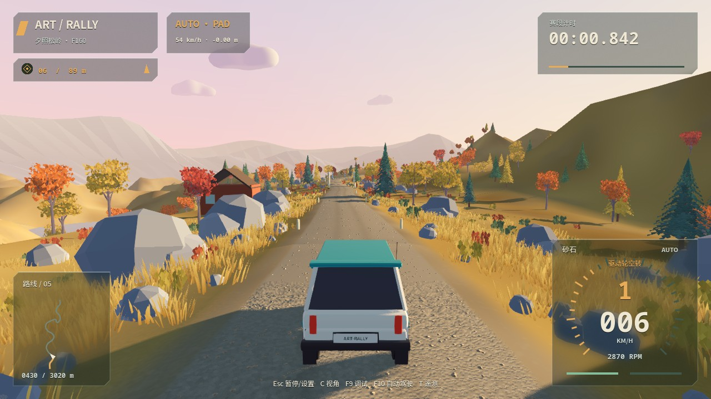
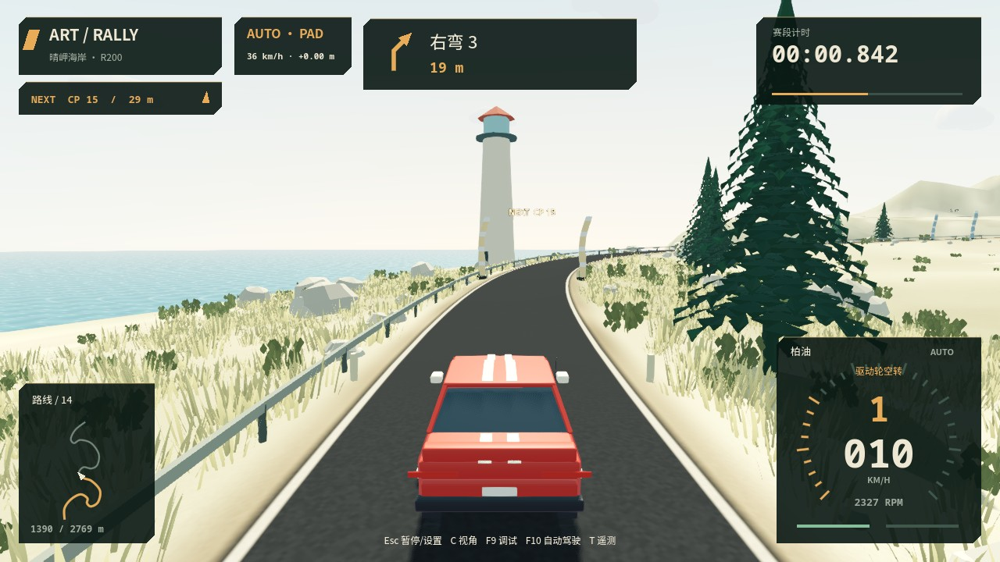
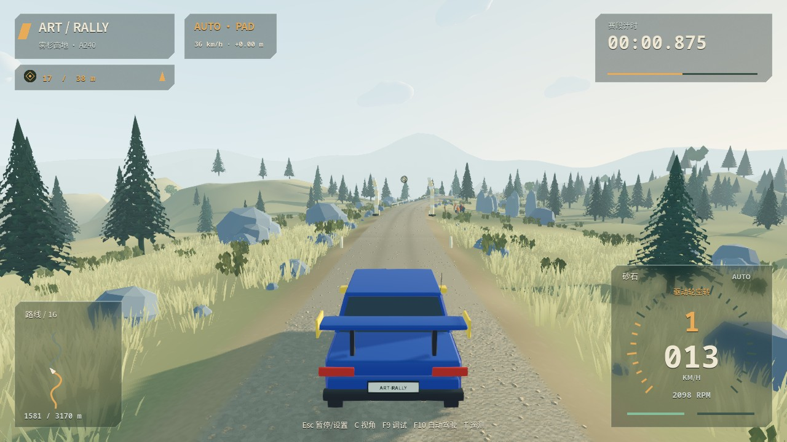

# Art Rally

## 简介

低多边形、完全离线的计时拉力游戏。当前为 **0.3.0-rc.1 首个完整试玩候选版**：三条主题赛道、F160 / R200 / A240 三辆原创赛车、三档动力的 27 个独立挑战、奖牌与分段计时、个人幽灵、本地档案、菜单、教学及声音。底层仍采用原有 120 Hz 车辆与轮胎系统。

[0.3.0 候选版变化](docs/V0_3_0_RC.zh-CN.md) · [实施计划](docs/FIRST_PLAYABLE_PLAN.zh-CN.md) · [实施状态与未通过项](docs/FIRST_PLAYABLE_STATUS.zh-CN.md) · [实测验收报告](docs/FIRST_PLAYABLE_VALIDATION.zh-CN.md) · [操作说明](docs/PLAY_GUIDE.zh-CN.md) · [素材名单](docs/ASSET_CREDITS.md)

当前奖牌为暂定阈值，真人标定、主观试听、真实 Windows、实体手柄及林地稳定 60 FPS 仍需验收；候选包不等于可公开发布版本。

源码启动请先进入这个版本所在的项目目录，再执行 `./scripts/dev.sh run`。启动脚本会先导入资源、更新 GDScript 类缓存，再显示标题菜单；首次导入会稍慢。不要在仍停留于旧版本的另一份 checkout 中运行同名命令。终端会打印本次使用的项目绝对路径，启动日志位于 `logs/startup_import.log` 与 `logs/game.log`。

<table>
  <tr>
    <td width="33%" align="center">
      <a href="docs/previews/first-playable-sunset_ridge.jpg"></a><br>
      <sub><b>夕照松岭 · F160</b></sub>
    </td>
    <td width="33%" align="center">
      <a href="docs/previews/first-playable-sunlit_cape.jpg"></a><br>
      <sub><b>晴岬海岸 · R200</b></sub>
    </td>
    <td width="33%" align="center">
      <a href="docs/previews/first-playable-misty_highlands.jpg"></a><br>
      <sub><b>雾杉高地 · A240</b></sub>
    </td>
  </tr>
</table>

以上为三主题自动驾驶实机截图，点击查看大图。当前版本继承并扩展 [秋日视觉方向](docs/ART_DIRECTION_AUTUMN.zh-CN.md)。

## 开发环境

- Godot **4.7.2 标准版**，使用 GDScript，无需 .NET、Node.js 或额外车辆插件。
- 3D 物理使用内置 Jolt 后端，固定 **120 Hz**，开启物理插值。
- Forward+ 渲染，macOS 使用 Metal；桌面优先。
- 世界单位为米、千克、秒，重力为 9.81 m/s²。
- 引擎版本记录于 `.godot-version`，开发脚本检查精确版本。

macOS 首次安装：`brew install --cask godot`。Homebrew 跟随新版发布，不保证日后仍安装本项目锁定的版本；若版本不同，请安装官方对应版本，并通过 `GODOT_BIN` 指定可执行文件。不要为迁就本项目降级其他项目正在使用的引擎。

## 常用命令

在项目根目录执行：

```bash
./scripts/dev.sh doctor  # 查看引擎路径、版本和架构
./scripts/dev.sh editor  # 打开 Godot 项目编辑器
./scripts/dev.sh run     # 启动完整游戏主菜单
./scripts/dev.sh stage   # 保留旧松岭开发入口
./scripts/dev.sh lab     # 保留原驾驶测试场，附多路面测试区
./scripts/dev.sh preview # 保留独立 200 米视觉样板用于对比
./scripts/dev.sh check   # 导入、全脚本解析、模型和场景测试
./scripts/dev.sh regression # 加做 30/60/120 FPS 输入回放对比（需 Python 3）
./scripts/dev.sh stage-check # 完整物理试跑，依次通过全部检查点
./scripts/dev.sh stage-check --keyboard # 二值键盘输入经辅助层完整跑段
./scripts/dev.sh stage-matrix # FWD/AWD/RWD × 虚拟键盘/手柄六组合自动驾驶
./scripts/dev.sh preview-check # 验证样板及视觉开关的驾驶一致性
./scripts/dev.sh preview-render-check # 真实图形窗口验证镜头光斑的深度遮挡
./scripts/dev.sh m5-render-check # 真实图形/音频后端、驾驶舱、暂停和菜单布局检查
./scripts/dev.sh autopilot-render-check # 真实窗口检查自动驾驶 HUD 与调试面板
./scripts/dev.sh result-render-check # 真实窗口检查完赛时间、罚时与最佳成绩
./scripts/dev.sh m6-perf # 1080p 跟车/驾驶舱/F9 三次完整性能与内存长跑
./scripts/dev.sh m6-release-check # 内置字体、1080p HUD、最小窗口与完赛流程检查
./scripts/dev.sh v02-tire-render-check # 真实窗口检查轮胎形变、动态接触斑与 F9 数据
./scripts/dev.sh autumn-capture # 自动驾驶采集砂石、泥地、驾驶舱三张秋日实机图
./scripts/dev.sh pacenote-render-check # 渲染左右普通弯、急弯四张实际路书卡片
./scripts/dev.sh first-playable-matrix # 27 个赛道 × 车型 × 动力组合完整自动驾驶回归
./scripts/dev.sh first-playable-lifecycle # 连续十次场景切换
./scripts/dev.sh first-playable-audio # 真实声音输出总线检查
./scripts/dev.sh first-playable-capture # 新版菜单/车型/三赛道截图
./scripts/dev.sh first-playable-perf # 三主题完整赛段 1080p 吞吐测试
./scripts/dev.sh controller-probe # 枚举当前真实手柄名称、GUID、映射与初始轴值
./scripts/dev.sh export-macos # 使用匹配模板生成 .app、ZIP 和 SHA-256
./scripts/dev.sh macos-app-check # 从导出包验证主场景、音频、字体、设置与成绩读写
./scripts/dev.sh export-windows # 在 macOS 上交叉导出 Windows x86_64 包
./scripts/dev.sh windows-package-check # 校验 PE32+ 架构、嵌入资源和 ZIP
```

编辑器中按 **F5** 运行完整游戏。正式比赛窗口内 F5 为重跑；开发入口的 F6/F7 保留赛段/测试场切换，正式挑战中返回选关；注意与编辑器快捷键的焦点区别。原测试场保留直道、25 m 定圆、蛇形、减速带和跳跃，并在远端 320–520 m 区域增加砂石、泥地、草土和水洼对比区。

`check` 验证环境、输入、轮胎、车辆动态、多路面、水阻、道路几何、赛段会话及恢复；长距离完整物理试跑独立为 `stage-check`，避免每次改动都等待完整跑段。日志存入忽略版本控制的 `logs/`。真实手柄连接与新增驾驶体验需人工验收。

`m6-perf` 需要真实 Metal 窗口并耗时约 12 分钟；它以生产自动驾驶连续跑三次，分别覆盖默认跟车、驾驶舱和 F9 调试面板，输出原始帧间隔、60 帧节奏 P95/P99、Godot 总物理、车辆回调、draw call、三角元及内存趋势到 `logs/m6_performance.json`。性能报告与测量限制见 [M6 验收记录](docs/M6_VALIDATION.zh-CN.md)。

macOS 导出要求安装与 `.godot-version` 完全一致的 4.7.2 模板；`doctor` 会显示模板状态。产物位于忽略版本控制的 `builds/macos/Art Rally.app` 和 `Art-Rally-macos-universal.zip`。当前包使用本机可验证的 ad-hoc 签名，不是 Developer ID 正式签名，也没有 Apple 公证；从网络下载或传到其他 Mac 后仍可能触发 Gatekeeper 提示。

Windows x86_64 包可由同一台 Mac 使用官方 4.7.2 模板交叉导出，不需要 Windows SDK。产物位于 `builds/windows/Art Rally/Art Rally.exe` 和 `Art-Rally-windows-x86_64.zip`，PCK 嵌入 EXE；目前没有 Authenticode 签名，可能触发 SmartScreen。macOS 只能校验 PE 结构和导出资源，不能运行 `.exe`；复制到 Windows 后执行 `powershell -ExecutionPolicy Bypass -File scripts/windows_smoke.ps1`，并重新完成 D3D12/Vulkan、镜头光斑、真实性能和手柄验收。

简介区的三张实机截图可用 `./scripts/dev.sh first-playable-capture` 批量更新，需要真实图形窗口；工具使用默认设置，不修改玩家的本机设置。

## 输入预设

进入比赛前选择 F160 前驱掀背、R200 后驱轿跑或 A240 四驱宽体车，分别为 160 / 200 / 240 PS，并采用独立质量、尺寸、模型和音色。正式挑战固定机械调校；练习模式可调整制动比例和弹簧。暂停菜单更换车辆会返回选关。旧开发入口仍保留共用基线车的 FWD/AWD/RWD 对比。

键盘默认标准辅助；F2 切换轻辅助。默认自动换挡和自动离合，M 切换手动换挡。默认启用倒车辅助：停稳后持续按 S/↓（手柄 LT）1 秒，缩短的横条结束后自动挂 R；R 挡时同一按键变为倒车油门。按 W/↑（RT）切回前进；若车还在后退，会先制动停稳再挂一挡。松开制动、暂停、复位或手动换挡会取消倒计时，空中或仍在移动时不计时。

辅助可在暂停设置中关闭；关闭后使用传统手动 Q/E 换向、W/RT 在已选挡位加速、S/LT 始终制动。倒车仍遵守赛道越界规则。

详细行为与验证见 [驱动选择与倒车辅助](docs/DRIVE_MODES.zh-CN.md)。

## 动力与换挡

三种驱动方式均为 **200 PS（约 147 kW）、峰值 260 Nm、1250 kg、六速**。PS 为公制马力；扭矩曲线按发动机净输出标定，而非在标称功率上再重复扣除内部阻力。

自动升挡同时检查发动机转速、实际前进车速、驱动轮空转和离合器耦合，泥地空转不会让挡位连续升高。实际车速过低会主动降到合适挡位；如果空转轮速使降挡有超转风险，会短暂收油同步再降挡。空中、拉手刹或手动模式不会自动换挡。

高转速、低车速仍可能是真实轮胎空转；不会伪造转速/速度，也没有新增全局牵引力控制。HUD 显示“驱动轮空转 / 同步降挡”，驾驶舱对应 `WHEELSPIN / SYNC DOWN`。泥地的前驱/后驱尤其需要渐进油门。新标定与历史验收指标的区别见 [200 PS 动力与换挡修正](docs/POWER_GEARING.zh-CN.md)。

## 操作与设置

| 操作 | 键盘 | 标准手柄映射 |
| --- | --- | --- |
| 前进油门 / 制动 | W / S 或 ↑ / ↓ | RT / LT |
| 倒挡加速（辅助开启时） | S / ↓ | LT |
| 倒挡切回前进（先停稳） | W / ↑ | RT |
| 转向 | A / D 或 ← / → | 左摇杆横轴 |
| 手刹 | Space | A / 底部面键 |
| 升挡 / 降挡 | E / Q | RB / LB |
| 恢复车辆（计时赛段 +5s） | R | Y / 顶部面键 |
| 跟车 / 引擎盖 / 简化驾驶舱 | C | X / 左侧面键 |
| 切换遥测 | T | 未预设 |
| 显示 / 隐藏实时可视化调试 | F9 | 未预设 |
| 关闭 / 虚拟键盘 / 虚拟手柄自动驾驶 | F10 | 暂停菜单 |
| 自动/手动换挡 | M | 未预设 |
| Legacy 单射线/包络调试（v0.2 模型不使用） | F3 | 未预设 |
| 计时/练习（重开赛段） | F4 | 未预设 |
| 完整重跑 | F5 | Back / Select |
| 暂停 / 设置 | Esc | Start |
| 镜头光斑开关 | L | 设置菜单 |

不同品牌手柄的按键标签不同，最终需使用实际设备验证。

M6 的 FWD/AWD/RWD × 真人键盘/真实手柄六组跑段、热插拔、震动和试听记录使用 [人工验收清单](docs/M6_MANUAL_ACCEPTANCE.zh-CN.md)。虚拟手柄自动跑段不能将这些硬件项标记为通过。

Esc 打开暂停/设置，Enter 或手柄 Start 明确恢复；失焦和活动手柄断开也会暂停。菜单支持键盘方向键/手柄导航，可调整音量、光斑、驾驶舱轻微震动、轮胎形变显示倍率、画面细节、自动挡、键盘辅助、踏板平滑和手柄死区；少量制动平衡/弹簧调校保存在本机，随时可恢复默认。轮胎显示倍率只改变胎体网格，不参与接触或轮胎力计算。完整游戏配置位于 `user://player/profile.json`（旧开发入口仍使用 `user://driving_settings.cfg`），不会修改 Git 中的基线车辆资源。

F8 暂停并导出最近最多 120 秒遥测至 `user://telemetry/`。T 在正式 HUD 和四轮开发遥测之间切换。主 HUD 显示转速弧、速度、挡位、踏板条、路面、路线图、计时和路书；驾驶舱模式使用舱内数字仪表，避免叠加两套大仪表。

**F9** 切换实时可视化调试面板（赛段、测试场和样板均可用）：四个轮胎独立展示接地/驱动状态、法向载荷、悬架行程、纵向滑移、侧偏角、轮速、材质、水深、水阻和摩擦圆；发动机面板只显示最近 6 秒的绿色净扭矩曲线（纵轴 Nm），随驾驶向左滚动，右侧持续更新最新值，并显示功率、离合传递扭矩及实际有效油门；转速历史仍保留在右下角的转速/车速小图，另有红色 G 值球、车身姿态和载荷分配。绿色摩擦圆向量横轴为 Fy、纵轴为 Fx，载荷条中线为单轮静态载荷。历史以 20 Hz 采样，暂停冻结，复位/开关清空，不改变驾驶物理或抢走手柄输入；T 与 F9 的面板互斥。图表轴超出范围时只裁剪标记，数值仍显示原值。

读数定义、验证和截图更新命令见 [实时可视化调试说明](docs/DEBUG_PANEL.zh-CN.md)。

**F10** 在关闭、虚拟键盘和虚拟手柄自动驾驶之间切换，暂停菜单也可选择。自动驾驶读取赛段中心线、前方曲率和危险路段生成输入，仍经过与玩家相同的键盘或手柄滤波链；真人操作转向、踏板、手刹或换挡会立即接管。它不会直接移动刚体或在卡住时传送。算法说明、成绩隔离和六组合验收命令见 [自动驾驶与虚拟输入](docs/AUTOPILOT.zh-CN.md)。

## 赛段规则

等待会自动结束，也可以直接踩油结束发车等待，无需先按空格解除制动；向前通过起点才开始计时。首次窗口重新获得焦点可直接操作，开始驾驶后仍保留切窗安全暂停。31 个检查点都有双侧摆动充气柱：金色是下一必经点，绿色表示已通过，HUD 同时显示编号、距离和方向。漏门不会被后续门跳过，可返回补过或按 R 恢复。

计时模式越过可驾驶区域边界会在掉出碰撞地形前自动复位，并罚 10 秒；手动 R 恢复仍罚 5 秒，练习模式不罚时。F5 重跑清空计时、罚时、检查点、路书及轮胎印。暂停不计时，完赛冻结结果。

正式完赛记录保存在 `user://player/profile.json`，按赛道版本、车型标定版本及规则版本隔离，幽灵保存在同目录 `ghosts/`。每挑战独立保存最佳成绩、三个累计分段、奖牌和近期记录。练习、自动驾驶及混合接管均不写入玩家纪录。成绩与幽灵通过临时文件和备份一致提交，损坏会尝试恢复并提示。旧 `stage_results.cfg` 原型成绩另行归档。

正式流程的操作、声音及存档说明见 [试玩指南](docs/PLAY_GUIDE.zh-CN.md)。下面的具体距离描述对应夕照松岭。

道路以浅褐砂石为主，1150–1650 m 为深褐泥地（含两处积水），1650–2100 m 为炭灰柏油，之后恢复砂石；2650 m 附近有坡顶。全程有低多边形树林、岩石、分层远山、立体切面云和方向性光斑；柏油弯道有护栏，近路树干/大石块有简化碰撞。四组观众位于可见围绳后，驶入观众保护区会安全恢复。没有撞人玩法或隐形阻挡墙。

原可驾驶道路/路肩走廊不变，远景地形是视觉背景，不支持任意开放世界驾驶；过远驶离道路或坠落仍会恢复。声音由本项目程序合成，不是实车录音，来源说明见 `assets/audio/README.md`。

中文界面和数字仪表使用随项目打包的 Noto Sans SC / Noto Sans Mono 可变字体，不依赖运行机器安装 PingFang 或其他系统字体；字体来源、SHA-256 和 SIL Open Font License 见 `assets/fonts/README.md`。

## 项目结构

```text
project.godot              引擎、渲染、物理、输入与碰撞层配置
scenes/dev/               环境验证与驾驶测试场场景
scenes/game/              主菜单和通用挑战场景
scenes/stages/            保留的松岭开发入口
scripts/game/             内容目录、游戏流程、档案、幽灵、声音
resources/content/        三车型资源
resources/stages/         三赛道资源
art_source/vehicles/      原创 Blender 可编辑源
assets/vehicles/          GLB 运行时车身
scripts/dev/              测试场会话、HUD 与镜头
scripts/input/            统一命令、设备适配和键盘辅助
scripts/vehicle/          车身、轮胎、悬架、传动与遥测
scripts/world/            程序化灰盒几何与测试场
scripts/surfaces/         材质资源、轮胎接触采样与水层
scripts/stage/            样条路线、分块几何、计时/路书和赛段会话
scripts/presentation/     全赛段场景、三视角、音频和轮端粒子
scripts/ui/               HUD、仪表、暂停菜单与本机设置
scripts/dev.sh            统一开发入口
tests/                    自动测试
assets/                   程序材质与音效来源记录
resources/vehicles/       车辆、柏油轮胎和动力总成基线资源
resources/surfaces/       柏油、砂石、泥地与草土参数
resources/stages/         路线种子、控制点与长度配置
docs/PROJECT_PLAN.zh-CN.md 完整策划案
docs/V0.2_TIRE_CONTACT_DEFORMATION.zh-CN.md v0.2 轮胎接触、形变与刷子模型方案
```

`.godot/` 是可以重新生成的本地缓存，不进入版本控制。GDScript 的 `.uid` 文件需要保留并提交，以保持资源引用稳定。

## 当前不需要安装

不需要建模 MCP、Blender、C# 工具链或第三方车辆插件。初期场景和车辆可通过基础网格与程序化生成实现。导出模板仅在需要打包独立应用时安装，应与 `.godot-version` 中的引擎版本完全一致。

v0.2 轮胎模型已按 [技术方案](docs/V0.2_TIRE_CONTACT_DEFORMATION.zh-CN.md) 实现并通过自动回归、六组合和 1080p 长跑；完整指标见 [v0.2 验收记录](docs/V0.2_VALIDATION.zh-CN.md)。它仍不包含独立非簧载刚体、侧壁碰撞或 FEM；真实手柄和真实 Windows 验收继续作为 prerelease 限制。

测试指标、提交分节和模型限制见 [M1 + M2 验收记录](docs/M1_M2_VALIDATION.zh-CN.md)。

新增赛段的运行与验证见 [M3 + M4 验收记录](docs/M3_M4_VALIDATION.zh-CN.md)。

已确认的独立样板仍保留：[200 米视觉样板](docs/M5_VISUAL_SAMPLE.zh-CN.md)及[第二版：16:00 / 切面云 / 光斑 / 砂石](docs/M5_VISUAL_SAMPLE_V2.zh-CN.md)。其中 V 迎光观察仅用于样板。

全赛段 M5 交付、仪表截图、测试结果与剩余限制见 [M5 验收记录](docs/M5_VALIDATION.zh-CN.md)。

后续体验修订见 [驾驶体验改进](docs/DRIVING_POLISH.zh-CN.md)：磨损过渡、即时越界恢复、充气检查点、方向键、赛车化驾驶舱和轻量轮胎印。

执行顺序与验收标准见 [开发计划](docs/DEVELOPMENT_PLAN.zh-CN.md)。手柄优先标定，键盘通过输入平滑与车速相关转向辅助降低难度，两者共享相同车辆物理。

最新赛道与选车改动见 [赛道第二版更新](docs/ROUTE_V2_UPDATE.zh-CN.md)。当前运行版本为 `0.3.0-rc.2`；路线版本 2 的成绩与旧版隔离。
