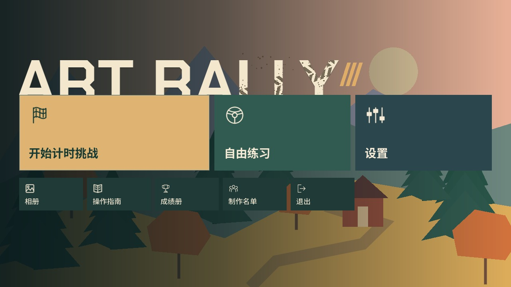
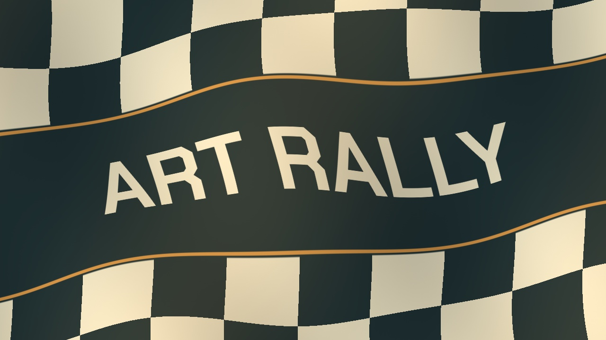
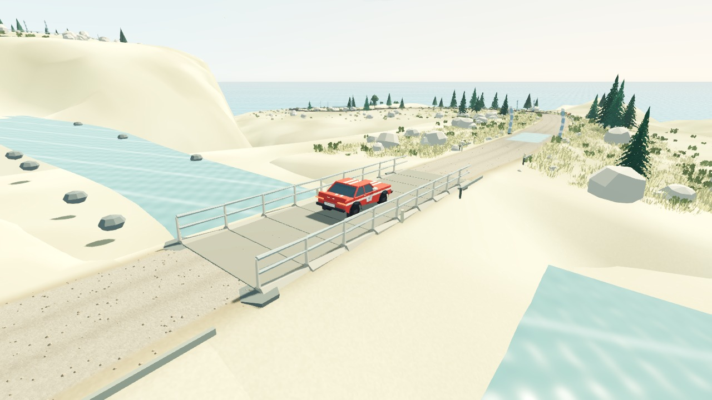
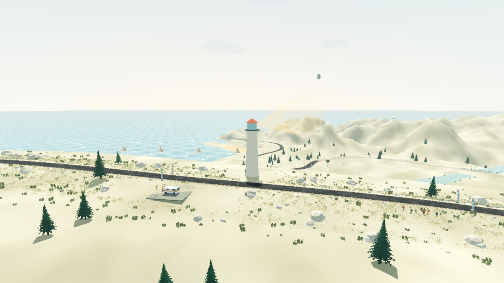

# 0.3.0-rc.4：页面动效与驾驶表现打磨

## 页面切换

- 普通菜单前进时内容和背景一起从右侧滑入，返回时反向滑动，时长 200 ms；同一页切换车辆、动力或赛道选中项不触发动画。
- 加载资源完成后，柔软方格旗从左上沿对角线向右下掠过。340 ms 三次曲线减速入场，180 ms 中点停留，300 ms 加速离场，总时长 820 ms。在旗面完全覆盖时切换画面，同时播放原创的短促布料／风切音；停留时风吹褶皱继续运动。
- 旗面中央是与标题共用 Chakra Petch Bold 字体的 ART RALLY 标识，上下为暖白／深青灰方格，细金线分隔。格纹与文字一同弯曲，使用暖色漫反射、宽褶皱阴影和细微织物纹理，不采用纯黑方格。
- 退出比赛时，先用 160 ms 淡出到黑色，在黑屏下释放赛道并构建菜单，再用 180 ms 显示菜单。更换车辆同样适用。
- 动画期间拦截输入，避免重复点击和误操作；进入驾驶前恢复操控。开发用无头回归跳过动画耗时。

## 界面与车辆

- 标题可见 A 字形左缘与「开始计时挑战」卡片对齐；LLY 字形内部叠加斜向胎纹和泥点，保留主按钮遮住字母底部的构图。
- 标题与车牌明确共用 Chakra Petch Bold 字体链，中文使用 Noto Sans SC 回退；输入框、预览与车辆车牌一致。
- 暂时隐藏标题页的「驾驶教学」入口，教学代码保留。
- 滑移图标改为倾斜车身与两道弯曲胎痕，仍放在仪表的独立图标位置。
- 尾灯轨迹从各车型红色尾灯的左右外缘发出，位置依据实际模型尺寸；轨迹全程为红色，并以透明混合避免亮背景上加色变白。
- 停稳后持续制动 600 ms 请求倒挡，保留松开取消、行驶中制动不误挂倒挡等安全条件；操作指南同步更新。

## 赛道与镜头

- 桥梁穿模的原因是装饰桥误用了 `pose_at()` 默认的 0.82 m 车辆出生高度。现在桥面以零偏移道路坐标构建，每个采样段追随道路，视觉桥面与物理三角面贴合。
- 桥面抬高 0.65 m，两端用 24 m 平滑缓坡连接。碰撞来自同一套道路网格，避免两层碰撞面争抢车轮接触；护栏保留实体碰撞。
- 路线版本升至 4，保留旧纪录但隔离其幽灵和成绩；玩家设置与已解锁动力保留。
- 直升机保留四个路线触发点，单次约 12 秒；两次出场起点至少相隔 47 秒，即离场后至少 35 秒空档。快速越过多个触发点也不会连续刷出。
- 热气球分布到全程 8%—92% 的不同位置、两侧与高度，生成时保证至少 240 m 空间间距，形成零散远景。
- 海岸灯塔增加黄色旋转射灯、灯芯和轻量光束，约 20 秒旋转一周。
- 回放位置采用按实际时间计算的三次 Hermite 插值，姿态仍使用四元数插值，车轮记录连续转角，旧记录在整圈边界采用角度插值；恢复罚时和断档禁止跨段补间。回放及幽灵关闭引擎的二次物理插值，回放镜头不再每遇到理想机位遮挡就强制瞬移，实际视线受阻时仍优先避障。

## 新配乐

四首均重新编写为 16 小节循环，以合成器、合成贝斯、失真吉他和鼓组构成；移除钢琴主导的旧编配。

| 场景 | 曲名 | 速度 |
| --- | --- | --- |
| 标题 | Ignition / Grid Lights | 126 BPM |
| 松岭 | Redline Through Amber | 140 BPM |
| 海岸 | Cliffside Overdrive | 148 BPM |
| 高地 | Summit Pressure | 136 BPM |

保留可编辑 MIDI、离线 WAV 与原创生成脚本。鼓轨使用 MIDI 第 10 通道；离线音色不依赖外部采样或音源。默认背景音乐音量从 0.45 提高到 0.585（相对增加 30%），已有玩家保存的音量和静音选择继续生效。

## 实际渲染预览

[对角线布旗动画预览](previews/flag-diagonal.mp4)（原生渲染器固定步长采集，背景使用项目截图；不作为性能数据）。

[回放与红色尾灯轨迹演示](previews/cinematic-replay.mp4)（固定步长画面采集，用于检查运动表现，不作为性能数据）。

[标题新配乐试听](../assets/audio/music/theme_menu.wav)

## 验证

验证结果记录在 `docs/validation/cinematic-polish.json`。使用独立档案运行界面与比赛测试，不修改玩家纪录。包含页面前进／返回、动画中断清理、旗面覆盖、黑屏下构建菜单、桥面物理高度、回放连续速度、恢复断档、直升机冷却、气球间距、倒挡边界与真实 CoreAudio 输出。

本次未更新 GitHub Release 二进制附件；Windows 实机及完整赛段性能验收不由这些功能回归替代。

本轮最终验证：50 组、997 项检查通过，另有 7 项 Python 测试；真实 Metal 窗口的入口 12 项、过场 9 项、回放 23 项与 CoreAudio 17 项检查通过。三赛道 × 三标准动力车辆的 9 个完整自动驾驶跑段全部零恢复。连续切换 10 次后维持 53 个节点、0 个孤立节点、119 个资源。增强动力版本本轮未重新进行完整跑段。

### 方格旗细化验证（2026-10-18）

本次局部调整另行通过 Metal 原生窗口过场测试 11 项、16:9／16:10／21:9 的实际像素遮盖测试 27 项，覆盖旗面入场前、中点、离场后及三种风相位；确认中点停留时风仍持续运动、普通菜单侧滑与黑屏返回不受影响。实际加载进入松岭驾驶并返回菜单通过。上述完整赛段回归为 rc.4 前一轮结果，本次未重复全套车辆回归，也未重新导出发行包。
