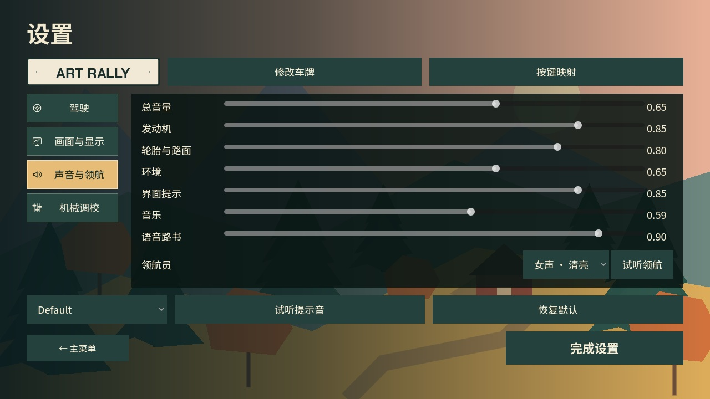
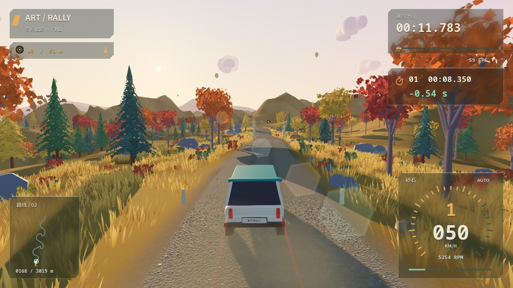
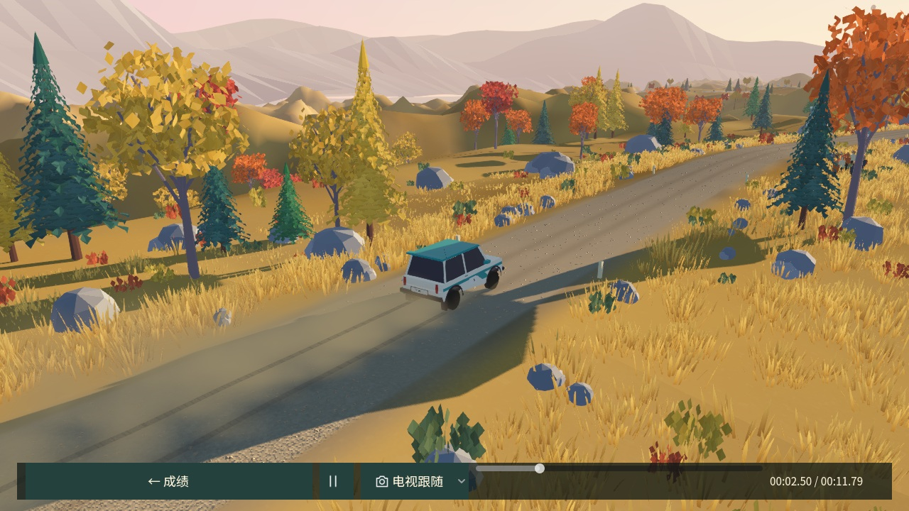
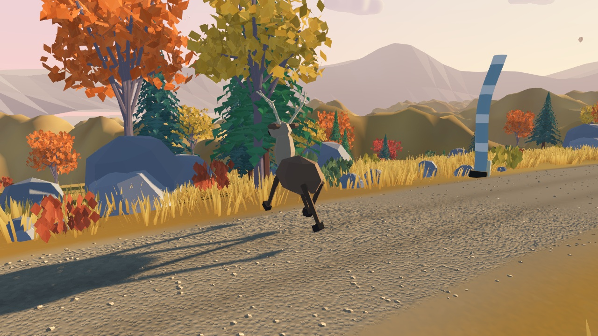
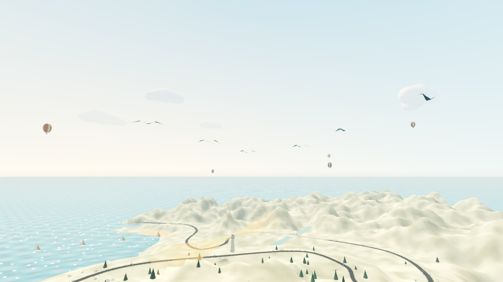

# 驾驶、回放与领航更新

## 回放与比赛提示

- 电视回放固定观察侧，不再因遮挡左右换边；原先每五秒换位的路旁镜头改为侧面跟随。四种机位由玩家手动选择，树木遮挡仅平滑抬升镜头。
- 回放通过车轮姿态、轨迹速度和实际道路射线接触，实时重建砂石扬尘、泥点、水花及胎痕。旧驾驶车辆的胎痕隐藏；拖动进度、循环和恢复断档清空临时效果；暂停冻结粒子。
- 每个编号检查点之间记录一段时间，保留原有三个正式计时分段。HUD 的秒表 SVG 提示闪两次、稳定显示约 2.6 秒，再用 200 ms 淡出；有相同赛道／车型／马力版本的个人最佳时显示该小段秒差，负数为绿、正数为橙红。
- 小地图用白色箭头表示玩家、青色圆环和虚线表示最佳幽灵；幽灵完赛后地图标记保持在终点，仍尊重关闭幽灵的设置。
- 隐藏 HUD 与驾驶舱中的轮胎空转指示。操作指南在车速低于 0.8 km/h 时显示，140 ms 淡入淡出；T 合并遥测、轮胎数据和受力调试，F9 不再切换面板。

## 驾驶与环境

- 保留悬架原有的实际载荷转移；转弯重刹时按轮胎载荷和路面抓地限制前轮制动，给转向保留摩擦能力。后轮已经侧滑时渐进释放部分制动，三种驱动使用不同的后轮制动保留量与防倾杆标定；不施加额外甩尾力矩。
- 86 km/h、三挡、95% 制动、固定转向的对比测试中，三车初始侧滑峰值约 12°–14°，均能用有限反打和油门回正。直线制动与手刹逻辑保留；这属于辅助标定，不能代替轮胎力学本身。
- 松岭／海岸桥面抬高 1.25 m、16 m 缓坡；高地采用 1.65 m、14 m 缓坡，抵消持续上坡的影响。桥面、路面碰撞和护栏使用相同路线。86 km/h 测试中三条赛道首座桥均有短暂腾空且稳定落地。
- 灯塔改为相反方向的双光束，角速度从 0.32 提升至 0.64 rad/s，一周约 9.8 秒。
- 海岸和高地各有三组五至六只飞鸟，采用两笔式折翼轮廓、共同行进轨迹和错开的振翅相位。
- 松岭和高地每次比赛安排两至三处随机驯鹿穿越，提前距离随车速增加；蹄声有空间衰减和进出渐变。驯鹿是非碰撞环境事件，避免随机事件改变计时挑战的可比性。
- 直升机出场播放原创旋翼循环，沿用原来的出场冷却；每座河桥下设置流水声源，约 145 m 内渐入、近桥响亮、离开渐出。环境音量统一控制这些声音。

## 设置、音乐与中文语音

标题与暂停设置共用分类控件：驾驶、画面与显示、声音与领航、机械调校。每类有独立 SVG 图标和持久选中态，增加帧率开关、领航员选择及试听。正式挑战仍锁定机械调校。

原三条赛道配乐虽然旋律不同，但共享鼓型和配器。本次分别重写：

| 赛道 | 曲名与风格 | 速度 |
| --- | --- | --- |
| 松岭 | Amber Gravel：车库摇滚、失真吉他、切分贝斯 | 144 BPM |
| 海岸 | Golden Wake：电子 House、FM 音色、四拍底鼓 | 128 BPM |
| 高地 | Stone and Thunder：低鼓群、长音铺底、号角 | 110 BPM |

保留可编辑 MIDI、离线 WAV 与生成脚本，标题音乐保留。中文语音路书含男女两套，每套十二种路书和一句试听，默认女声；可切换男声或关闭，单独调节语音音量。语音播放时音乐与环境声适当降低，新路书替换已经过时的播报。使用 Kokoro v1.1-zh 合成并随游戏离线打包，来源与 Apache-2.0 许可见 [素材名单](ASSET_CREDITS.md)。

## 存档与验证边界

路线版本为 5，车辆标定为 fp2。旧成绩与旧幽灵仍留在存档，但不参与新版本对比；设置、车牌和已解锁的动力组别保留。奖牌秒数暂沿用，`human_calibrated` 明确为 false，需要之后用新版真人基准跑重新标定。

验证明细见 [experience-update.json](validation/experience-update.json)。使用隔离档案，包含实际 Metal 回放／截图与 CoreAudio 输出测试。主观听感、真人驾驶评价、Windows 实机及全马力版本的完整赛段回归仍未在本轮完成；本轮不导出或更新 GitHub Release 二进制包。

截图中的分段差值与幽灵位置由开发脚本构造，用于检查布局；回放截图来自实际自动驾驶轨迹。截图不是性能测量。
