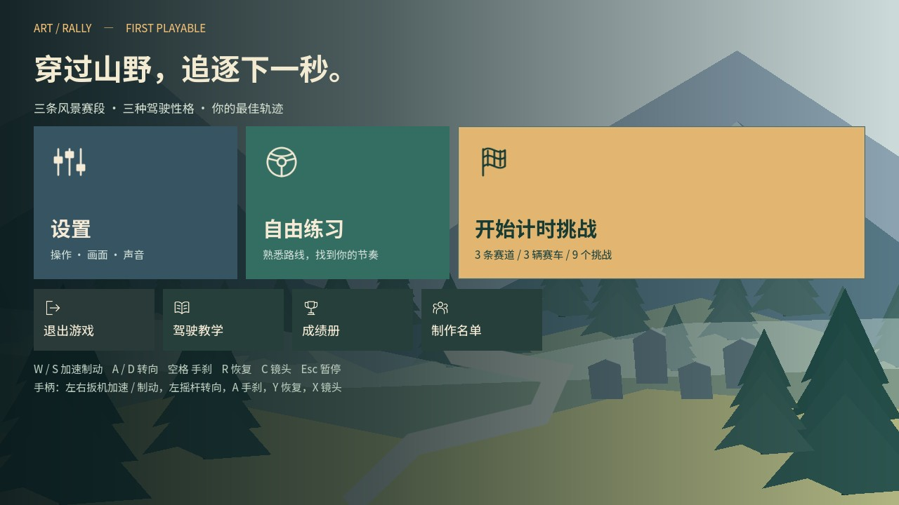
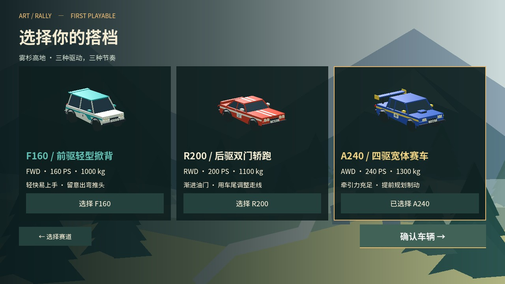

> 历史阶段记录。当前 Brushline Rally 升级的实际证据与待验收项见 [本轮验证](brushline/VALIDATION.zh-CN.md)；本文件不代表新版本已通过人工或平台验收。

# 首个完整试玩候选版验收报告

日期：2026-10-18。Godot 4.7.2 / Metal Forward+ / Apple M5。当前为 0.3.0-dev，发布门槛未全部通过。

## 自动验证

- 常规回归：36 组 GDScript 测试、603 项通过；另有 4 项 Python 奖牌标定测试通过。
- 九挑战自动驾驶：27 项通过。所有组合按顺序通过检查点、无恢复；没有写入玩家纪录。
- 十次切场景：3 项通过。返回菜单均为 49 节点、0 孤立节点、93 资源；原始数据在 `validation/first-playable-lifecycle.json`。
- 真实 CoreAudio 输出：7 项通过。提示音/音乐输出峰值约 0.099，未削波；三车型发动机波形独立，静音有效。系统检查时未静音，但默认输出为蓝牙设备，因此新增的输出选择有实际用途。这里没有宣称主观听感通过。
- 12 张最终渲染截图检查（截图工具定位到代表性路段，再由自动驾驶驱动；画面内时间不代表完整跑段成绩）：菜单、三维选车、三主题、三车灰度跟车与三车驾驶舱。修正了字体字重、菜单背景纹理生命周期、低座舱仪表与车身遮挡。

## 九组合自动驾驶

以下时间只用于回归，不作为真人奖牌基准。输入为生产虚拟手柄，经正常控制与物理链驱动车辆。

| 赛道 | 车型 | 行驶秒数 | 最大横向偏离 m | 恢复 |
|---|---|---:|---:|---:|
| sunset_ridge | F160 | 250.575 | 0.530 | 0 |
| sunset_ridge | R200 | 244.067 | 0.626 | 0 |
| sunset_ridge | A240 | 236.400 | 0.656 | 0 |
| sunlit_cape | F160 | 221.300 | 0.340 | 0 |
| sunlit_cape | R200 | 216.800 | 0.382 | 0 |
| sunlit_cape | A240 | 215.117 | 0.367 | 0 |
| misty_highlands | F160 | 264.425 | 0.470 | 0 |
| misty_highlands | R200 | 256.050 | 0.644 | 0 |
| misty_highlands | A240 | 244.342 | 0.754 | 0 |

## M5 完整赛段性能

1920×1080，A240，关闭垂直同步，固定模拟 60 帧/秒、物理 120 Hz，统计真实墙钟帧间隔；排除开始 5 秒。下表为远景树木优化前的完整三主题基线，不能把平均 FPS 等同于稳定 60 FPS。物理栏仅包围车辆自定义回调，不包含全部 Jolt/渲染耗时。原始数据在 `validation/first-playable-performance-baseline.json`。

| 赛道 | 平均 FPS | 帧耗时 P95 ms | P99 ms | 车辆回调 P95 ms |
|---|---:|---:|---:|---:|
| sunset_ridge | 67.9 | 22.39 | 33.38 | 4.66 |
| sunlit_cape | 94.0 | 15.20 | 21.67 | 2.89 |
| misty_highlands | 66.9 | 22.73 | 33.44 | 4.57 |

已增加 180 米以外的简化树木模型，保留近景枝叶、固定位置、碰撞与原有阴影范围。松岭优化后完整复测：平均 **69.2 FPS**，帧耗时 **P95 20.87 ms / P99 24.05 ms**，车辆回调 P95 3.30 ms。原始数据在 `validation/first-playable-performance-lod.json`。相比基线减少了慢帧，但尚未满足稳定 60 FPS；海岸与高地表中仍为优化前数据。

## 包与交付

macOS 通用包与 Windows x86_64 包均附操作说明、素材名单、引擎及第三方许可和 SHA-256。macOS 包内验证覆盖菜单、九挑战目录、三 GLB、三车发动机、实际物理发车、真实音频驱动、档案读写与返回选关。Windows 当前只完成交叉导出、PE32+ x86_64 和 ZIP 完整性检查。

macOS 最终包内冒烟测试通过，Windows 包结构检查通过。退出时的音乐资源释放警告已修复，最终包检查没有资源泄漏警告。ZIP 校验值如下：

```text
7f1d7ee701bffcc3ae1619bfc4161f2b5c929c7f8f94b39f44c82011a3559c94  Art-Rally-macos-universal.zip
3a92514edf6cec31e72c1c32aac894cb6a845707784137a21c9d765fd926694f  Art-Rally-windows-x86_64.zip
```

未做 Apple Developer ID 公证或 Windows Authenticode 签名；本次没有公开发布。

## 仍未通过的发布门槛

- 真人九组合完整跑段，以及每组合三次熟练、无恢复基准；现有阈值明确标为暂定。
- 耳机、扬声器及导出包的主观听感与循环衔接。
- 真实 Windows 和实体手柄验收。
- 新玩家可用性试玩。
- 林地稳定 60 FPS 的慢帧目标，须以优化后实测判断，不能仅凭平均值勾选。

人工项目见 [人工验收表](FIRST_PLAYABLE_MANUAL_ACCEPTANCE.zh-CN.md)。`scripts/calibrate_medals.py` 只检查记录字段，不能代替确认真人驾驶与熟练程度。

## 复现

```sh
./scripts/dev.sh check
./scripts/dev.sh first-playable-matrix
./scripts/dev.sh first-playable-lifecycle
./scripts/dev.sh first-playable-audio
./scripts/dev.sh first-playable-capture
./scripts/dev.sh first-playable-perf
./scripts/dev.sh export-macos
./scripts/dev.sh macos-app-check
./scripts/dev.sh export-windows
./scripts/dev.sh windows-package-check
```

图形与音频检查在真实窗口执行，截图静音只影响该测试进程。长跑与常规单元检查分开，避免每次小改动都等待全赛段。

## 画面预览






