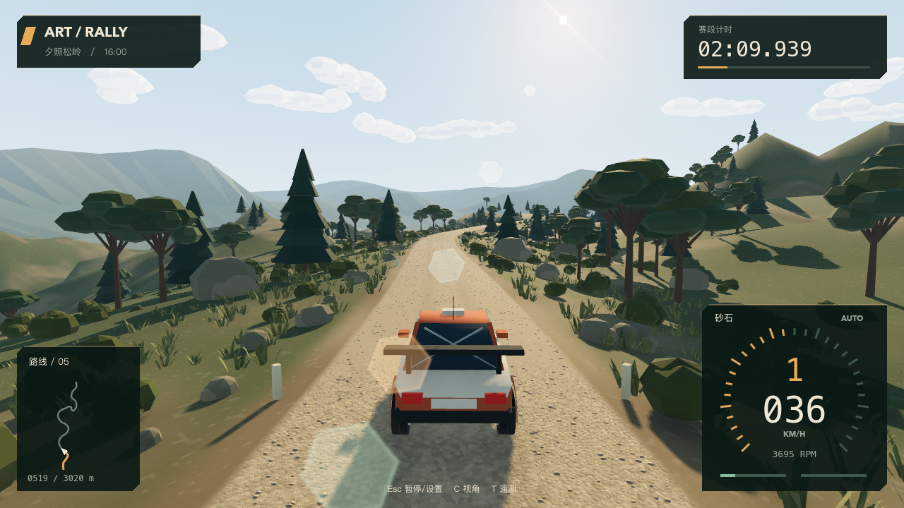
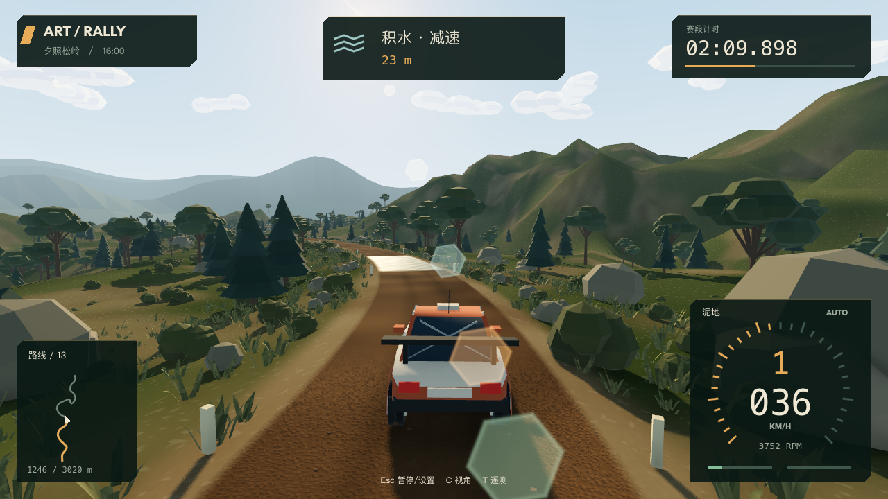
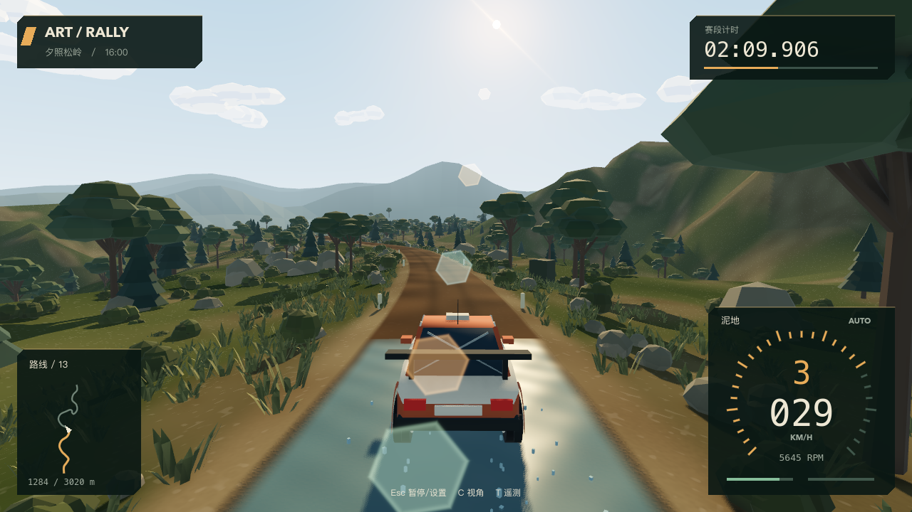
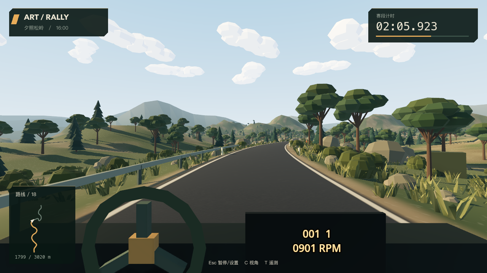
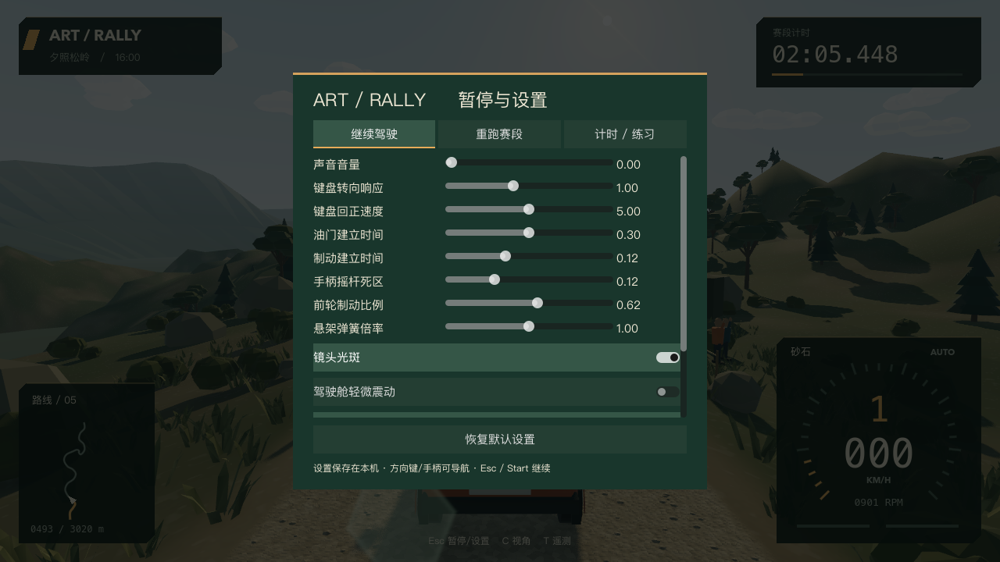

# M5：全赛段场景、HUD、仪表与驾驶反馈

状态：实现完成并通过自动/本机图形后端检查；实际手柄设备、主观听感和完整人工试玩仍待验收。用户已明确确认样板 02 并授权全赛段施工。未开始 M6 打包或对外发布。

## 交付内容

- 将已确认的暖色 16:00 斜光、两层世界锚定切面云、可遮挡镜头光斑、低多边形车壳、草木岩石与远山推广至约 3.05 km 全赛段。样板和原测试场仍可独立启动。
- 砂石有浅层碎石/轮迹，泥地有深褐湿态变化，柏油保留深灰细颗粒与边线，积水有小波纹和受控反射。复查时降低了湿泥/草地的过曝高光，保证前方道路可辨。
- 碰撞与装饰分离：道路碰撞几何不变；增加近路树干、大石块和部分柏油弯道护栏的简化碰撞。四组共 28 个简单观众位于可见围绳后，安全区域覆盖整排观众，侵入时按原计时规则恢复，不做撞人反馈。
- 植被按路段 MultiMesh 批量绘制，草簇和散石按距离裁剪，背景地形不做开放世界碰撞；低细节设置可减少小物体与远处植被显示，不删道路碰撞。
- 新 HUD 使用深松绿、米白和琥珀色切角面板，包含速度/挡位/分段转速弧、转速数值、油门/制动条、路面标签、计时与罚时、路线进度图、图形化路书和危险提示。倒计时、暂停、漏门、逆行与完赛均有状态反馈。
- 跟车、引擎盖、简化驾驶舱三个视角。驾驶舱提供随输入旋转的方向盘和速度/挡位/RPM 数字显示，进入驾驶舱时隐藏重复的右下大仪表；附加震动可以关闭，默认关闭。
- 原创合成引擎/负载、柏油、砂石、泥地、涉水和悬架冲击音。声音从实际车轮与传动状态混合，暂停/退出会暂停或释放播放；它不是实车采样音色。
- 四轮按实际材质、接触、滑移与水深分别触发扬尘、泥点、水花。悬空/静止不持续喷地面特效；手柄震动接口有强度上限、设备检查和暂停清理。
- 暂停设置支持键盘/手柄焦点导航，可调整音量、光斑、附加震动、画面细节、自动挡、键盘辅助、转向/回正、踏板平滑、手柄死区及少量制动/弹簧调校。设置可恢复默认并保存于本机，不修改基线 `.tres`。

## 实机截图

这些是 Godot Metal / Forward+ 的可运行场景输出，使用受控起始位置便于复查，不是概念图或外部合成。截图工具会静音并使用默认设置，不覆盖用户配置。











## 验证

环境：Godot 4.7.2 / Jolt / 120 Hz，Apple M4 Pro，macOS，Metal / Forward+。

| 命令 | 结果 |
| --- | --- |
| `./scripts/dev.sh regression` + `preview-check` | 218 项功能/样板检查通过，另有环境冒烟与 30/60/120 FPS 回放检查 |
| `./scripts/dev.sh stage-check` | 连续归一化输入完整跑段，31 门全过，无恢复/传送 |
| `./scripts/dev.sh stage-check --keyboard` | 二值键盘命令经过原输入平滑层完整跑段，31 门全过，无恢复/传送 |
| `./scripts/dev.sh m5-render-check` | 6 项真实图形/音频后端检查通过：音频播放推进、HUD 数据、驾驶舱、暂停音频、较小窗口菜单、重跑恢复 |
| `./scripts/dev.sh preview-render-check` | 4 项 GPU 太阳光斑/完全和部分遮挡检查通过 |

两种完整试跑的记录：

| 输入协议 | 用时 | 最大横向偏离 | 车辆回调 P95 |
| --- | --- | --- | --- |
| 连续命令（模拟量输入协议） | 231.26 s | 0.529 m | 约 0.401 ms |
| 二值键盘 + 原辅助层 | 302.56 s | 0.575 m | 约 0.457 ms |

二值测试控制器采用更保守的目标速度，这些用时不能用来比较设备优劣；游戏并未对键盘额外设置低速上限。两个协议都通过普通 `DriverCommand` 驱动车辆，不直接设置沿赛道的位置/速度。

原柏油帧率回放结果保持不变：5 秒加速距离 56.3465 m、末速度 22.7695 m/s、后续停车距离 26.8932 m。默认车辆/轮胎/动力总成文件没有改动；只有用户主动调设置时才修改运行中的独立车辆配置。

新专项检查覆盖：全程装饰、道路中心无障碍侵入、观众排两端保护、低细节模式、仪表与真实车速/转速映射、各窗口比例布局、本机设置安全值与读写、PCM 振幅、各材质声音贡献、四轮水花、暂停反馈、三镜头及方向盘运动。

砂石、泥地、水洼、柏油驾驶舱与菜单均完成实际截图复查。当前 1280×720 截图运行在 60 FPS 限制下显示 60 FPS；这是局部观察，不是全设备或整段 GPU P95 性能保证。车辆回调耗时也不包含完整 Jolt 求解和渲染，M6 仍应做长期性能记录。

## 运行与设置

```bash
./scripts/dev.sh run
./scripts/dev.sh stage-check
./scripts/dev.sh stage-check --keyboard
./scripts/dev.sh m5-render-check
```

Esc / Start 暂停并打开设置；C / 手柄 X 循环三个视角；L 切换光斑；F2 切换标准/轻键盘辅助；T 切换开发遥测。完整重跑仍为 F5 / Back，安全恢复仍为 R / Y。原接触调试快捷键 F3 保留，但一般试玩无需调整。

设置存储于 `user://driving_settings.cfg`。标准辅助、音量 0.65、自动挡、光斑开、驾驶舱附加震动关为默认值；恢复默认不会覆盖仓库文件。无窗口测试和带 `--test-defaults` 的截图/渲染验证使用默认参数且不写真实用户设置，保证回归可重复。

音效来源记录在 `assets/audio/README.md`。所有声音由程序生成，没有取用其他游戏音频或未授权录音；美术使用本项目程序化几何/材质。字体使用本机系统字体回退，跨平台字体打包和许可文件应在 M6 处理。

## 剩余限制

- 真实手柄按键、扳机量程和震动强度未通过物理硬件人工验收；自动模拟输入不能替代这一项。声音播放链路已运行，音色与响度仍需人耳试听调校。
- 驾驶舱是简化前向视角与仪表板，不是完整可环视内饰。音效为合成原型，不宣称达到实车录音质量。
- 远景山体与路外扩展地形只用于视觉，实际驾驶仍限定于原道路/路肩走廊及安全恢复规则，不是开放世界。树冠、草叶、观众不使用复杂物理。
- 保留 M1–M4 的射线轮胎包络、经验湿态/水阻、无完整非簧载质量和空中轮端反作用等模型限制。
- 成绩跨启动持久化、正式分发签名/公证、导出模板、独立应用打包、其他平台与长期性能测试仍属于 M6，未在此轮执行。

## 分节提交

| Commit | 小节 |
| --- | --- |
| `09b845d` | 全赛段场景、材质与观众安全 |
| `8b05841` | HUD、转速仪表、路书与路线图 |
| `58a4cbd` | 暂停菜单、本机设置和输入选项 |
| `717ccf4` | 合成音效、尘泥水粒子与反馈 |
| `0716ec0` | 三镜头与驾驶舱仪表 |
| `e4a4d32` | 观众排保护、护栏与柏油表现 |
| `c5f6937` | 整段双输入、视听后端验证与湿面可读性 |

本文及实机截图另行提交；没有 amend 或推送远端。
