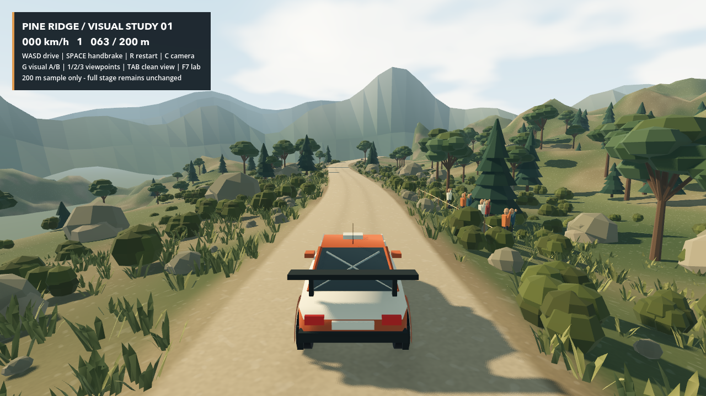
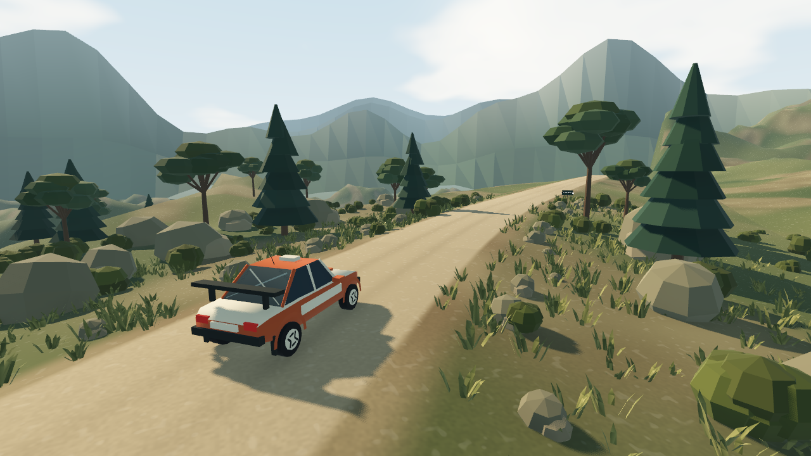

# M5 视觉样板 01：等待用户确认

本轮交付仅为独立 200 米视觉样板，不代表完整 M5，也不把美术推广到 3 km 赛段。默认主场景、M1–M4 车辆参数和赛段代码保持不变。

## 参考与方向

用户提供四张其他拉力游戏截图，参考其中的浅色砂石道路、橄榄绿植被、岩石路肩、层叠山体、局部观众与清楚的驾驶视距。不提取原游戏资产，不复制授权车标、赞助商图案或 UI。

本版采取明确的低多边形视觉语言：伞形松与针叶松混合、成组石块、草丛与灌木、分层冷色远山、带云的蓝天和暖色斜射光。色调偏自然晴朗午后，没有把所有材质染成橙色。主要请确认简化程度、植被密度、明暗/色彩与车壳比例，确认后才统一扩展。

## 样板范围与实现

- 取原赛段 430–630 m 的 200 m 区域；前后只保留 30 m / 70 m 的驾驶安全缓冲。主路与近侧路肩直接使用 M4 原始顶点和碰撞生成逻辑，没有重塑道路。
- 独立扩展近景地形、谷地基底和三层远山，消除悬空道路边缘。背景地形、树石草和观众都是视觉层，不新增碰撞障碍；车辆偏离中心约 18 m 时恢复。
- 植被与岩石由确定种子生成；三种伞形松、三种针叶松及三种岩石/灌木/草簇变体，按 40 m 区段使用 MultiMesh 批量绘制。路内不放大型装饰，远处草簇按距离剔除。
- 7 个简化观众站在道路外约 7.5–8.5 m，前面有可见绳围，使用简单头身与挥手动作。这里只验证观感，不是最终观众保护机制。
- 独立原创橙/米白车壳包含斜面玻璃、轮拱、尾翼、车轮轮辋、天线、后窗交叉杆和制动灯反馈；所有变化只在样板中挂载，不改基线车的物理形状。
- 地面采用程序噪声、浅轮迹、细微法线和粗糙度；天空采用程序云层。轻量砂石扬尘由后轮接触/载荷/速度/路面状态控制，停车、离地或湿态不持续喷尘。
- G 提供视觉 A/B 对比，环境、道路材质、装饰、车壳和颗粒呈现可切换；实际物理始终相同。退出样板恢复视口抗锯齿设置。

本轮不做音效、完整菜单、驾驶舱细节、全部材质的艺术定稿、成套观众资产或整条赛道布景。柏油/泥水的统一美术会在方向确认后再做。

## 启动与观察

```bash
./scripts/dev.sh preview
```

场景文件：`scenes/dev/visual_sample.tscn`。`run` / `stage` 仍进入原 M4 赛段，不会自动进入样板。

| 按键 | 作用 |
| --- | --- |
| W/S、A/D、Space | 原有油门/制动、转向与手刹 |
| R / 手柄 Y | 回到样板起点 |
| 1 / 2 / 3 | 三个固定观察位置 |
| G | 增强视觉 / 灰盒对比 |
| Tab | 隐藏/显示 HUD，便于观察和截图 |
| C | 跟车 / 引擎盖视角 |
| T | 原四轮遥测 |
| Enter / Start | 失焦或暂停后明确恢复 |
| F7 / F6 | 返回原测试场 / 完整赛段 |

到达 200 米终点自动制动，按 R 可重复试跑。样板路肩装饰暂不阻挡车辆，不能将其作为最终路外碰撞行为验收。

## 实机截图

两张图均由 Godot Metal / Forward+ 实际渲染导出，不是生图结果，也没有后期合成。





重现命令：

```bash
godot --path . --script tests/sample_capture.gd --max-fps 60 -- --at=493 --hud
godot --path . --script tests/sample_capture.gd --max-fps 60 -- --at=590 --angle
```

另支持 `--gray` 拍摄灰盒、`--moving` 短距离加速查看扬尘。测试截图时会主动解除失焦暂停，这一行为只存在于截图脚本，正常游戏仍保留安全暂停。

## 验证

- `./scripts/dev.sh regression`：原有模型、几何、会话、物理及 30/60/120 FPS 检查全部通过。
- `./scripts/dev.sh preview-check`：普通控制指令完整驾驶样板。视觉打开与关闭均约 21.28 s 到达终点，最大横向偏离约 0.046 m，停止位置差小于 0.15 m。
- 本轮总计 158 项功能检查通过，另有原环境冒烟测试和帧率回放检查。样板专项覆盖 200 m 范围、道路顶点等同基线、装饰无隐藏碰撞、资源不污染、完整样板试驾、视口恢复与扬尘条件。
- 真实 Metal 窗口检查了驾驶、侧视、观众区域、灰盒/增强模式与运动截图。没有把一次渲染成功宣称为所有设备稳定 60 FPS；长时间 GPU 性能和玩家视觉反馈仍待后续验收。
- `project.godot`、`scripts/vehicle/`、`scripts/stage/`、车辆与路面资源相对 M4 交付未修改。

## 生图接口实测

内置 `image_gen` 本次调用成功，生成了一张预览用低多边形拉力概念图。没有使用 CLI/API 回退，没有要求密钥。它仅是概念参考，不参与当前游戏加载；模型、着色器和粒子仍是可编辑的 Godot 原生代码。

最终调用提示词（原文）：

> Use case: stylized-concept. Asset type: preview-only art direction study for an original low-poly rally driving game, not a texture or screenshot of any existing game. Create one wide landscape image of a 200-meter Mediterranean mountain gravel road with a readable gentle bend, pale limestone road, olive-green scrub and scattered varied pines, rocky roadside, a few very simple spectators safely set back, layered cool distant mountains, soft blue sky with clouds and restrained warm late-afternoon sunlight. Camera is a driver's chase-view behind a compact original orange-and-ivory rally hatchback. Cohesive intentionally simplified faceted 3D geometry, natural believable proportions, rich landscape depth without photorealism, road remains clearly readable. No brands, logos, HUD, typography, watermarks, no extracted copyrighted game assets. This is only a feasibility test of image generation and a concept preview; actual deliverable is a native Godot scene.

概念图已在对话中展示，作为预览保留于生图工具默认输出目录，不作为仓库素材。实机审批应以上方两张截图与可驾驶场景为准，不能将概念图细节当作已实现功能。

## 提交与停工点

- `92ebc32`：独立样板、背景地形、天空与道路材质。
- `0e68b7d`：程序化树石草、观众、原创车壳与 A/B。
- `4238d4a`：远景层次、轻量扬尘、驾驶验证与隔离检查。
- 本文和实机截图另作文档提交。

**当前停在用户审批点：不启动完整 M5，不扩展全赛段，不修改驾驶调校。**
