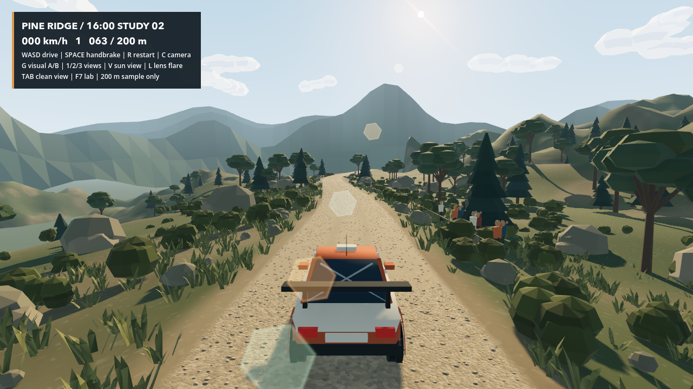
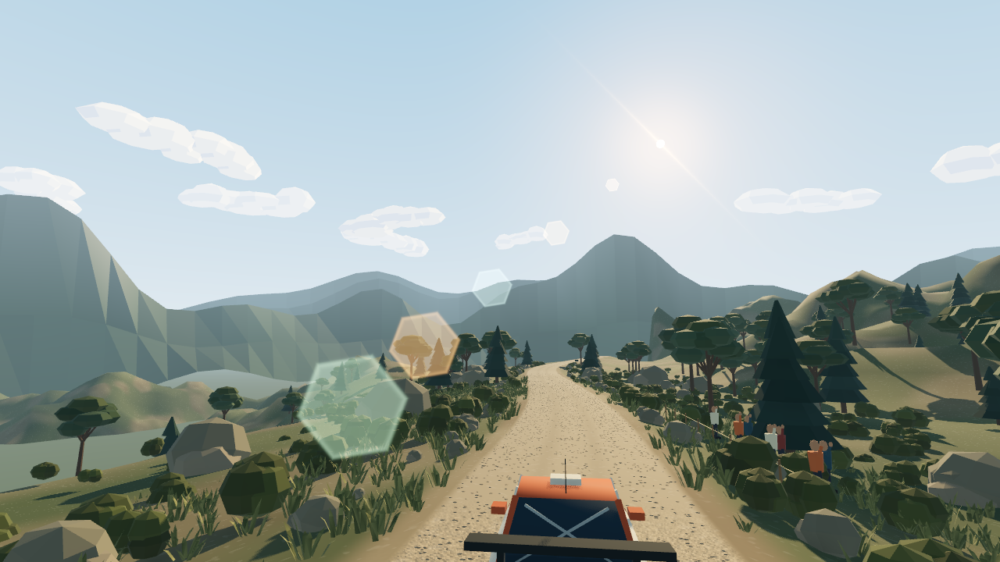

# M5 视觉样板 02：16:00 / 切面云 / 镜头光斑 / 砂石

按用户对第一版的反馈调整，仍只修改独立 200 米样板。完整赛段、默认入口、车辆物理、路面抓地和原道路碰撞保持不变。收到确认后才考虑推广。

## 三项调整

### 天空与下午光照

- 移除 sky shader 中柔和的分形噪声云，仅保留天空渐变、太阳圆盘和近太阳的暖色散射。
- 新增两层有限距离、固定在世界中的低多边形云体：近层水平距离约 540–850 m、高度约 190–290 m；远层约 1250–1700 m、高度约 350–460 m。具体几何由固定种子生成，太阳附近保留小片开口。
- 云团由扁平底部、分块隆起与平面三角法线构成，使用离散明暗值表现切面。这里是低多边形风格，不是把整屏降分辨率成 8-bit 像素画。
- 云不是跟随相机的贴片：转弯改变其画面位置，车辆平移时近层产生比远层更强的角位移。相机移动/旋转不会改变云节点的世界变换。
- 采用美术化的“下午约 4 点”：太阳高度角 24°、暖色直射、偏冷环境补光及更长斜影。未指定经纬度、季节和日期，因此不是严格天文太阳模拟。
- 太阳圆盘、DirectionalLight、云面受光和光斑统一使用同一个太阳方向，不再各自硬编码不同方向。

### 方向性镜头光斑

- 五个由大到小的六边形光斑沿“太阳投影—画面光学中心”轴线排列，并带轻度源头光晕与细斜线炫光；朝向变化时整条轴线随之变化，不是固定对角线贴图。
- 仅迎光、太阳接近视野时渐入；背光或太阳离开画面时消失。L 可以独立关闭，G 灰盒模式也会移除光斑。
- 使用 Forward+ / Metal 的屏幕深度纹理，对太阳附近 3×3 点采样。树木、地形、云等不透明渲染几何可以遮住太阳，不要求这些装饰拥有物理碰撞体。
- 真实渲染测试覆盖无遮挡、完全遮挡、部分遮挡和太阳在相机背后。完全遮挡时光斑贡献为零；部分遮挡时贡献降低。
- V 是便于检查的迎光观察构图开关，不改变车辆方向或物理。正常跟车视角也会按真实太阳投影自然出现光斑；跟车构图略抬高，给云层与太阳更多可见空间。

这是用于美术表现的光学近似，不是对特定镜头多层玻璃的物理追迹。只使用不透明深度，透明粒子的透射/遮光不在此版范围内。

### 路面砂石

- 在原 200 米主路内增加一万余颗确定性浅层碎石，按 20 米区段分成十个 MultiMesh 批次；近处显示真实轮廓，远处淡出以减少闪烁和绘制成本。
- 石粒主要半径 2.5–5.5 cm，突出高度 4–14 mm；轮迹区域更压实、松散石粒更少，中央和两侧更密。
- 路面 shader 增加细胞状碎石色差、颗粒间隙、细微法线和更清楚的轮迹，并随屏幕覆盖率减弱高频细节。
- 不增加碎石碰撞，不改变路面顶点与轮胎受力。本轮只解决“看起来过平”的问题，不给已经认可的驾驶手感引入额外随机振动。

## 启动与对比

```bash
./scripts/dev.sh preview
```

新增按键：

| 按键 | 功能 |
| --- | --- |
| V | 切换迎光观察构图，再按一次回正常驾驶构图 |
| L | 独立开/关镜头光斑 |
| G | 整体增强视觉 / 原灰盒对比 |
| 1 / 2 / 3 | 原样板固定观察位置 |
| Tab | 隐藏/显示 HUD |

原 WASD、手柄、R 恢复、C 引擎盖视角与 Enter/Start 恢复暂停均保留。

## 实机截图

以下均为真实 Godot Metal / Forward+ 输出，不是生图或后期合成。第一版截图仍保留在原文档中，不覆盖它们。





重现：

```bash
godot --path . --script tests/sample_capture.gd --max-fps 60 -- --at=493 --hud
godot --path . --script tests/sample_capture.gd --max-fps 60 -- --at=493 --sun
```

追加 `--no-flare` 可导出相同构图、不带光斑的截图，`--gray` 仍可用于整体对比。

## 验证与限制

- `./scripts/dev.sh regression` 与 `./scripts/dev.sh preview-check` 通过，共 177 项功能/驾驶检查，另有原环境冒烟和 30/60/120 FPS 回放检查。
- `./scripts/dev.sh preview-render-check` 打开真实图形窗口完成额外 4 项 GPU 检查。无遮挡时取样区域平均颜色差约 0.0130、完全遮挡为 0、部分遮挡约 0.0102。这是测试构图的相对指标，不是物理曝光值。
- 云层验证包括有限距离、近远视差、相机旋转时世界锚定、切面法线以及太阳方向一致；碎石验证覆盖尺寸、范围、批次、轮迹密度、确定性和没有新增碰撞。
- 视觉开/关自动试跑均约 21.28 s 到达 200 m 终点，最大横向偏离约 0.046 m，原柏油加速和制动基线保持不变。
- 云团固定在世界中，当前没有气象模拟或大范围移动云影。真实图形检查只验证本机可渲染和遮挡逻辑，不保证所有硬件的长期帧率。
- 修改仅位于样板表现层、样板材质、测试和说明；`project.godot`、车辆/赛段核心脚本及车辆/路面资源未变。

## 分节提交与审批点

- `63c6d2e`：有限距离切面云、统一太阳方向与下午光照。
- `fb92a90`：方向性镜头光斑和 GPU 深度遮挡。
- `fe09d2c`：浅层砂石、压实轮迹与观察构图。
- `3219b0b`：部分遮挡验证，文档图片不进入游戏资源导入。
- 本文与第二版截图另行提交。

**仍等待用户确认，只交付样板修订，不推进完整 M5 施工。**
