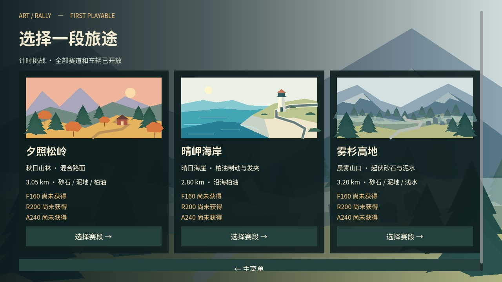

# 主菜单磁贴与赛道插画

2026-10-18。

- 主菜单采用 Metro 风格直角磁贴、统一间距与大小层级。计时挑战为双宽大磁贴，练习、设置为大磁贴；教学、成绩册、制作名单和退出为小磁贴。
- 七个操作使用项目原创 SVG 图标：旗帜、方向盘、调节器、书本、奖杯、人物和退出。按钮保留原生焦点、鼠标与键盘响应，图标和文字不拦截按钮点击。
- 「设置与声音试听」简化为「设置」，声音试听保留在设置页中。
- 三种场景分别绘制矢量几何：松岭为暖色山林、橙色树冠和木屋；海岸为大面积青蓝海面、白崖、沿海道路和灯塔；高地为双峰山口、冷杉、低处薄雾和石阵。赛道卡片移除背景文字用的深色渐变遮罩，保证插画主体清晰。
- 菜单背景根据最近选择的赛道显示对应地貌；卡片和全屏背景使用同一组可缩放几何。

验证：玩家入口及实际按钮点击导航 11 项通过，菜单至比赛流程 10 项通过；1280×720 与 960×540 的 Metal 实际渲染检查通过。此变更不涉及车辆物理与计时规则。

macOS / Windows 候选包已重新生成；macOS 包内冒烟测试及 Windows PE/ZIP 结构检查通过。Windows 实机与发布状态仍以完整试玩版人工验收记录为准。

