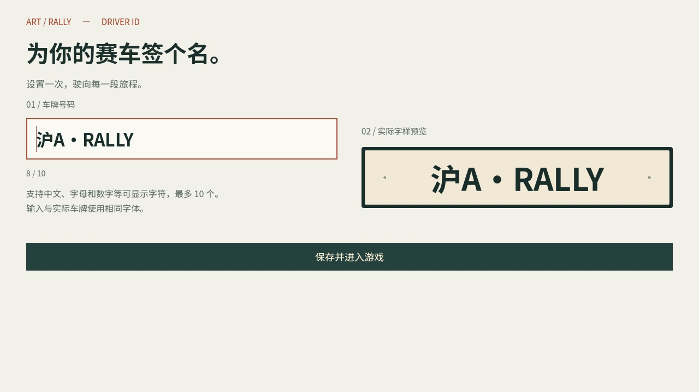
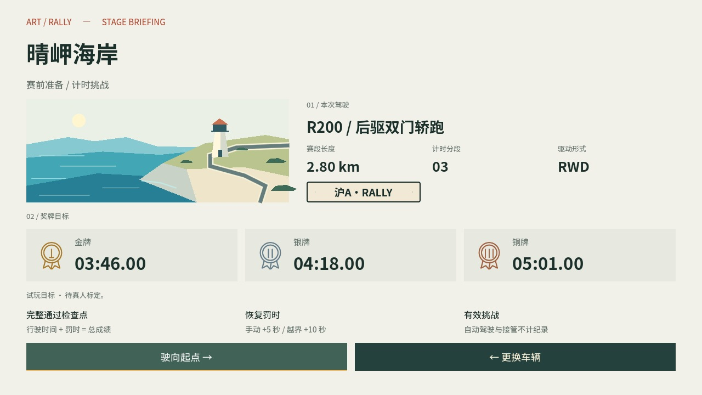
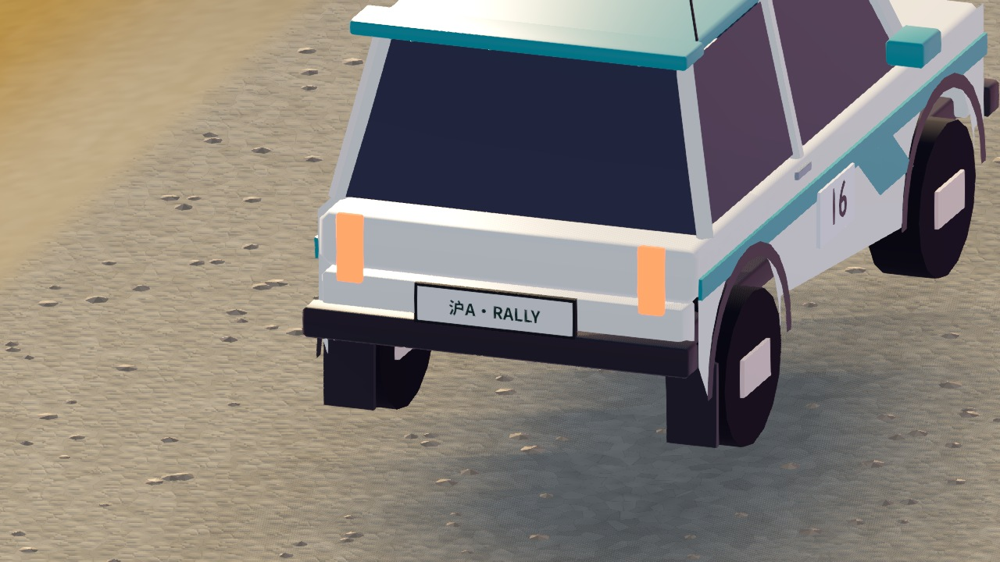
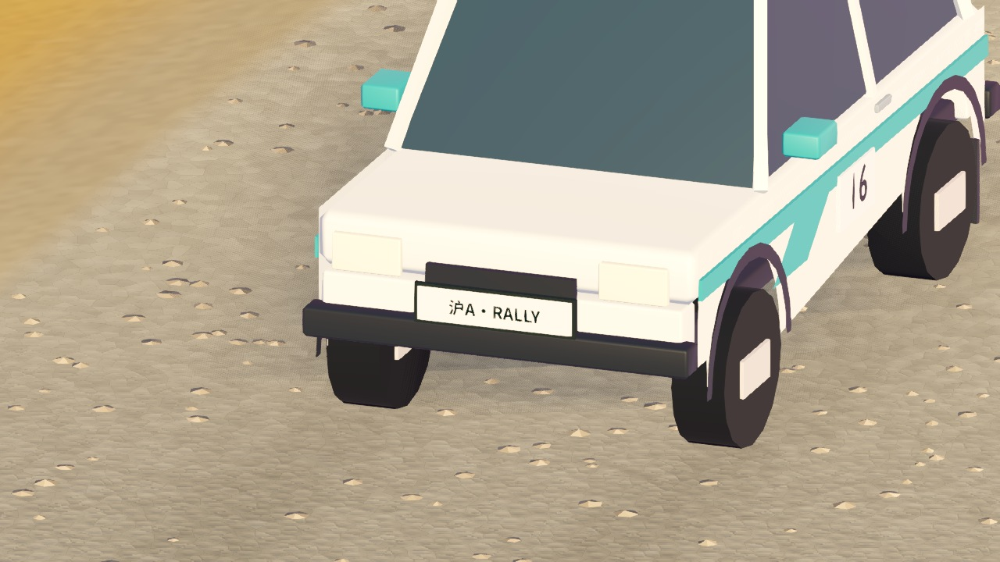

# 专属车牌与赛前页面

2026-10-18。

## 玩家体验

- 赛前准备页采用 Swiss 风格：浅色底、左对齐字阶、编号、清晰列网格。赛道插画与车型、长度、分段和驱动形式分区排列；金银铜牌使用三枚原创 SVG 图标，目标时间各占独立区域。罚时规则缩为三个短条目。
- 首次进入游戏，先设置车牌再进入主菜单。支持 1–10 个字体可显示的字符，包括中文、字母与数字；拒绝空白、控制字符和无法显示的字符。输入框限制为 10 字符，粘贴或程序写入也受存档验证约束。
- 输入、实时预览、选车、三辆车的前后牌照与驾驶 HUD 使用同一份 Noto Sans SC 粗体字形。实际车牌按文本长度调整字号与像素比例，保留外框与边距；不影响碰撞、轮胎和车辆动力。
- 设置页显示当前车牌，通过「修改车牌」修改；保存后应用到选车预览和之后的比赛。

## 存档

`player/profile.json` 增加可选 `plate` 字段，保持现有版本兼容。旧档案缺少此字段时只补设车牌，不重置成绩、幽灵、设置或键位。

车牌保存沿用临时文件替换与有效备份机制。写入失败时恢复原值，并在界面显示错误。首次设置写入失败时允许明确选择继续使用当前车牌，提示退出后可能需要重新设置，避免损坏档案导致无法进入游戏。

## 验证

- 全量回归：38 组 GDScript、640 项通过；Python 标定测试 4 项通过。
- 此后扩展的车牌与布局专项：无窗口及 960×540 Metal 实际渲染各 29 项通过，覆盖长度、中英文、重启、旧档、保存失败、首次设置、设置修改、字体一致、三车前后朝向、无新增碰撞和奖牌时间不换行。
- 1280×720 核对设置车牌、赛前、设置、驾驶 HUD、三车尾部及 F160 车头的实际截图。
- 截图使用隔离的临时档案与进程静音，不覆盖玩家车牌或成绩。
- 双平台候选包已重新导出并更新随包说明；macOS 包内检查包含车牌保存、实际车辆与 HUD 字样一致性，测试通过。Windows 仅确认导出包结构与 ZIP 完整性，仍需对应实机验收。

