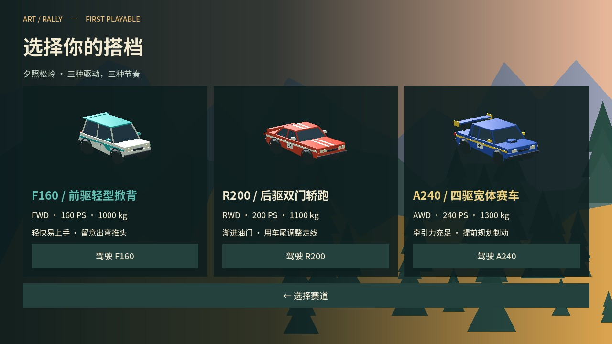
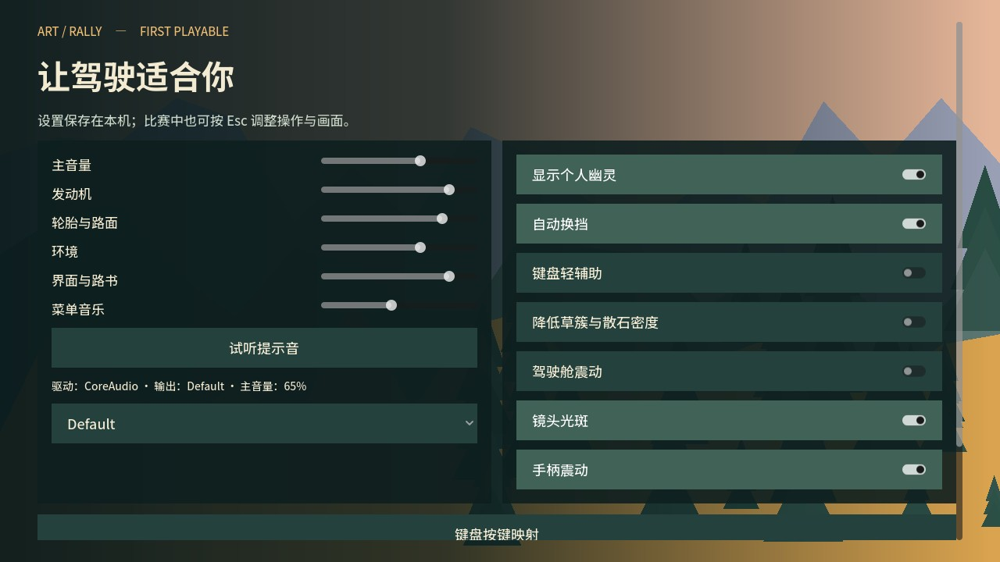

# 玩家入口修复记录

2026-10-18。用户从终端启动后只见天空，没有菜单。

## 原因

- 常用目录 `/Users/cong/Documents/Projects/Art-Rally` 仍在 0.2.0（`c5de451`），主场景指向旧松岭开发入口；新菜单仅在 Codex 工作区分支中。此前交付启动命令没有说明目录差异。
- 常用目录没有完成 Godot 导入。实际启动日志显示 `RallyStageDefinition`、`RallyHUD` 等全局类型无法解析，旧赛段脚本加载失败，窗口只显示场景背景。
- 之前测试依赖已经导入过的工作区，没有覆盖全新源码副本直接运行启动命令的情况。

## 修复

- `run`、`stage`、`lab`、`preview` 启动前先执行 Godot 无窗口导入，建立脚本类缓存、导入字体与模型；导入出错时停止启动。
- 启动脚本输出项目绝对路径；正常运行输出保存在 `logs/game.log`，导入输出保存在 `logs/startup_import.log`。
- 常用主项目目录以 fast-forward 同步本次完整试玩版，使默认场景进入标题菜单。
- 增加从项目配置读取实际主场景的玩家入口回归，检查菜单按钮可见、地图选择、三车选择、设置和返回标题。测试不修改玩家档案。
- 修正 Windows 包中遗留的 0.2.0 文件版本信息为 0.3.0。

## 验证

- 无 `.godot` 缓存的干净源码副本，直接执行 `./scripts/dev.sh run --quit-after 120`，自动导入并正常启动，无解析错误。
- 玩家入口检查：无窗口与真实 Metal 渲染各 8 项通过；干净副本同样 8 项通过。
- 原菜单至比赛流程回归 10 项通过。
- 实际渲染核对标题、地图、车辆和设置四个页面。以下图片来自真实入口测试。






## 启动

```sh
cd /Users/cong/Documents/Projects/Art-Rally
./scripts/dev.sh run
```

直接启动导出的 `.app` 或 `.exe` 不需要源码导入步骤。正式游戏从标题菜单进入；`stage`、`lab`、`preview` 为开发入口。
