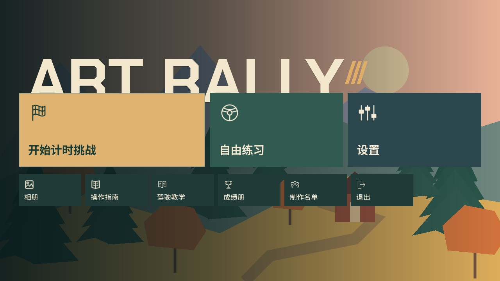
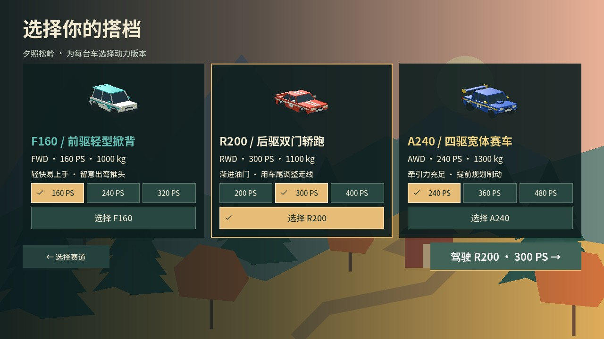
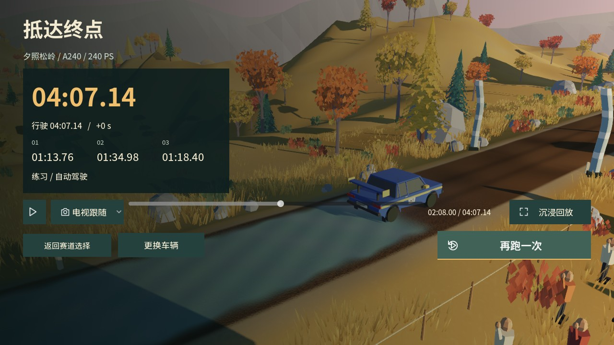
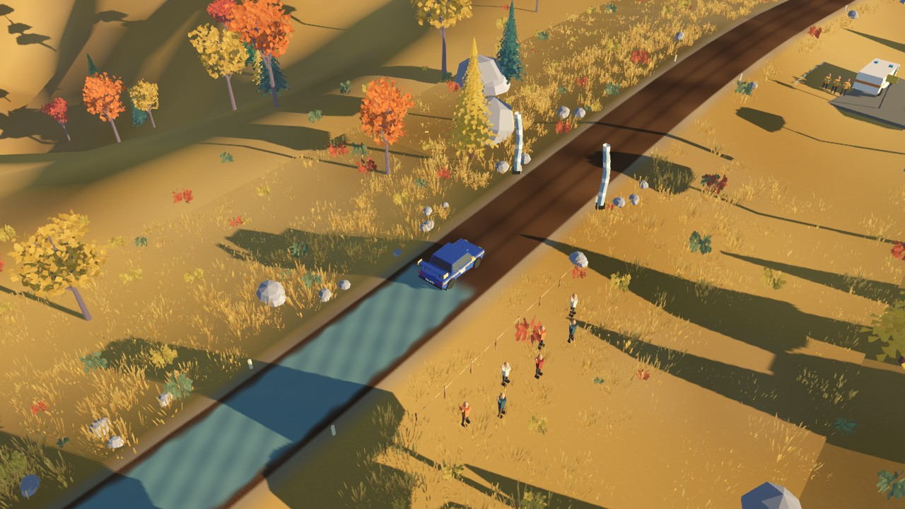
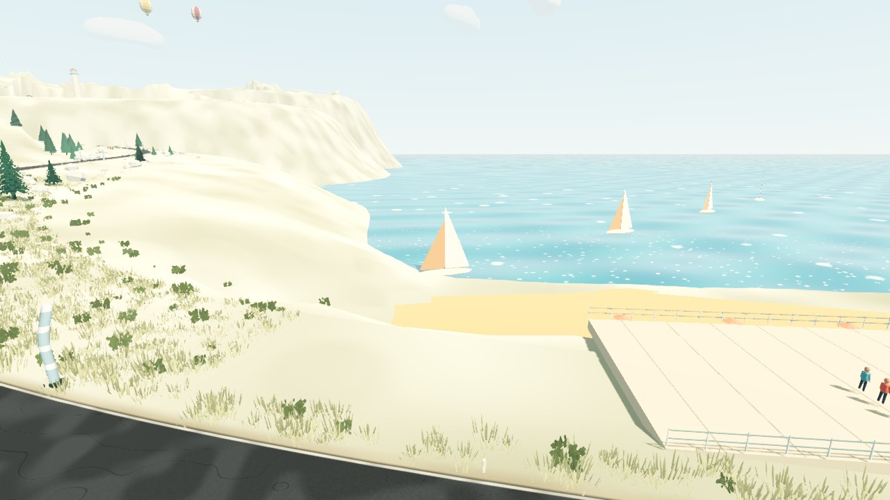
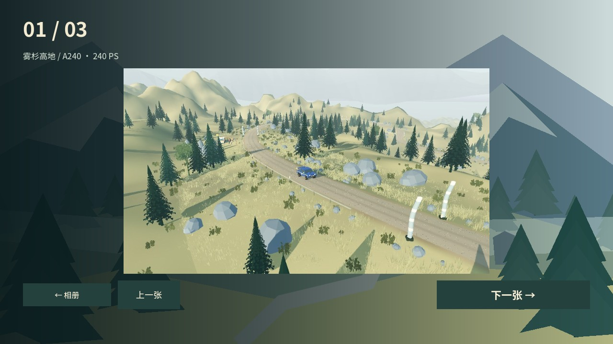

# 玩家体验、回放与沿途影像更新

2026-10-18，运行版本 `0.3.0-rc.3`。本次包含 UI、检查点判定、混合路面与桥梁、回放、相册及四主题音乐。

## 界面与个性化

- 选中状态统一使用矢量对勾、底色和边框；选中不依赖焦点或鼠标悬浮。锁定项使用 SVG 锁和简短解锁条件。
- 每台车的卡片内显示实际马力：F160 为 160／240／320 PS，R200 为 200／300／400 PS，A240 为 240／360／480 PS。右下角确认按钮复述车型和 PS。成绩册使用原厂／进阶／极限组区分组别，各车仍显示具体 PS。
- 仪表顶部独立状态区使用滑移轮胎、手刹和换挡图标，移除重叠的“驱动轮空转”等状态文字；紧急恢复和保存错误保留必要提示。
- 车牌的英文和数字改为棱角鲜明的 Chakra Petch Bold，中文回退到 Noto Sans SC。输入、预览和车辆上的字样共用同一字体链，最多 10 字符。
- 标题页移除口号、FIRST PLAYABLE 页眉和底部操作说明；大字 ART RALLY 的底部由主要按钮遮罩。二排提供相册、操作指南、教学、成绩册、名单和退出。

已将“矢量图标＋短文案、明确的持久选中态、选项靠近作用对象”等规则保存到项目技能 `.agents/skills/art-rally-ui/SKILL.md`，并在 AGENTS.md 中建立入口。

Chakra Petch 的 [原始 OFL 许可](https://raw.githubusercontent.com/google/fonts/main/ofl/chakrapetch/OFL.txt)允许随软件嵌入和分发；字体文件及许可均已随项目保存。

## 赛道与驾驶

| 赛道 | 路面占比（四舍五入） | 河流／桥梁 | 桥面最窄宽度 |
| --- | --- | --- | --- |
| 夕照松岭 | 柏油 15% / 砂石 69% / 泥地 16% | 2 处，590、1840 米 | 4.2 米 |
| 晴岬海岸 | 柏油 83% / 砂石 17% | 2 处，770、2120 米 | 4.5 米 |
| 雾杉高地 | 柏油 7% / 砂石 79% / 泥地 14% | 3 处，760、1820、2720 米 | 4.0 米 |

- 路面区间的边缘有约 12 米的混合过渡，物理接触权重与画面均读取赛段配置。加入不规则泥砂、磨损边线、细裂缝、补丁以及积水周边逐渐变暗、变亮的湿润区域。
- 积水不再使用写死的松岭距离；每处积水自带边界参数，三条赛道均有浅积水。河流在桥下横穿道路，与路面积水分开。
- 桥梁包含收窄路面、支撑、接缝和护栏；桥下河床由地形雕刻，水道与两岸保持清楚层次。桥上的车辆接触仍使用连续道路碰撞，避免双层碰撞接缝。
- 检查点使用车身包围盒角点的连续扫掠和门线截面：车身仅有很小一部分进入气柱外缘即可通过。仍要求正向运动、按顺序通过，并拒绝高空越过和长距离传送。
- 两侧尾灯后增加细长气流拖尾，随速度增强并逐渐消失；恢复、重试、低速和不连续位移会断开尾迹。
- 海岸与高地增加远处飞行的海鸥；各赛道特定区域分别布置 9／12／9 个热气球。海湾原有四艘帆船已放大并移近终点视线，继续保持离港动画。

本次路面、桥宽和检查点规则改变了有效成绩条件，因此赛道升级到版本 3、规则升级到 `time-trial-3`。旧成绩和幽灵仍保留但不与本次比较；已取得的动力解锁保留。

## 个人幽灵与完赛回放

个人最佳幽灵默认开启，只读取当前赛道版本、车型、马力版本和规则相符的最快有效玩家轨迹。第一次没有兼容纪录时正常发车；同分不会覆盖最佳。玩家保留的关闭设置仍受尊重。与玩家过近时淡出，恢复罚时区间隐藏，无碰撞和声音。

成绩页默认自动循环播放本次 30 Hz 实际轨迹，使用电视跟随镜头；还可切换直升机、追尾、路旁机位。可暂停、拖动时间轴和前后跳转。恢复罚时内隐藏车辆，避免跨地形插值；整个回放期间实际车辆物理保持冻结，轮胎反馈和驾驶循环声音暂停，主题音乐继续播放。

“沉浸回放”隐藏成绩界面，控制栏闲置三秒后收起，移动鼠标可唤回。空格播放／暂停，C 切换镜头，左右键跳转五秒，Esc 返回成绩。重试或返回选关会清理回放并恢复驾驶。保存成功的新个人最佳会在标题附近播放约两秒五彩纸屑；普通完赛、同分、练习和自动驾驶不会伪造新纪录。

## 直播直升机与相册

橙白直升机在每条赛段约 16%、37%、60%、82% 处各经过一次，带有旋翼、起落架和肩扛摄像机的记者。每次从远处进入并离开，经过中段时用独立 960×540 相机拍摄车辆。

- 航拍共享实际三维场景，照片不包含 HUD，也不拍到直升机自身的机体边缘。
- JPEG 与元数据保存到当前玩家目录的 `gallery/`，独立于比赛成绩。索引采用临时文件替换与备份；保存失败给出提示，不影响比赛。
- 标题页相册提供缩略图、单张查看及前后切换，自动保留最近 64 张航拍，界面会明确显示这一上限。
- 自动测试和截图工具使用独立档案，不会把摆拍、测试色块或解锁写进真实玩家存档。

## 四首原创配乐

| 场景 | 曲名 | 速度 | 配器方向 |
| --- | --- | --- | --- |
| 标题 | Long Way Home | 84 BPM | 吉他、钟琴、轻柔铺底 |
| 松岭 | Amber Switchbacks | 112 BPM | 明快拨弦、音乐盒音色 |
| 海岸 | Sails in the Sun | 120 BPM | 电钢琴、颤音琴与切分节奏 |
| 高地 | Above the Morning Mist | 76 BPM | 笛声、稀疏旋律与柔和铺底 |

16 小节循环同时保存为可编辑 Type-1 MIDI 和离线 WAV，源位于 `assets/audio/music/`，生成器为 `scripts/generate_music.py`（生成时需 NumPy，游戏运行无此依赖）。全部音色为原创加法合成，不使用第三方采样或 soundfont。游戏直接播放离线渲染，避免系统 MIDI 合成器差异。

同时修复压缩 WAV 的循环终点：改按解码时长和采样率计算，避免把压缩字节数误当成 PCM 样本数而提前截断。音乐拥有独立音量，驾驶暂停时冻结，回放时继续；路书提示仍可压低背景声。

## 验证与实拍

最终验证数据见 [验证记录](validation/v0.3.0-rc.3.json)：48 组、961 项功能检查，7 项 Python 工具测试及 17 项真实 CoreAudio 链路检查通过；27 组合自动完赛、零恢复。连续十次切换赛道后节点数保持 51、孤立节点为 0，资源数量保持 115。macOS 包启动检查和 Windows 包结构检查通过。回放机位额外检查树冠与山石遮挡，必要时换侧、升高或缩近；恢复后使用切镜避免相机穿地形。M5 1080p 单游戏实例的 600 帧短段诊断平均约 59.9／65.9／60.0 FPS，P95 约 21.7／18.2／20.0 ms；编辑器仍打开，此结果不等于完整赛段稳定 60 FPS 验收。自动驾驶不能代替真人奖牌标定、主观听音与实体手柄验收，Windows 导出不能代替 Windows 实机验证。

