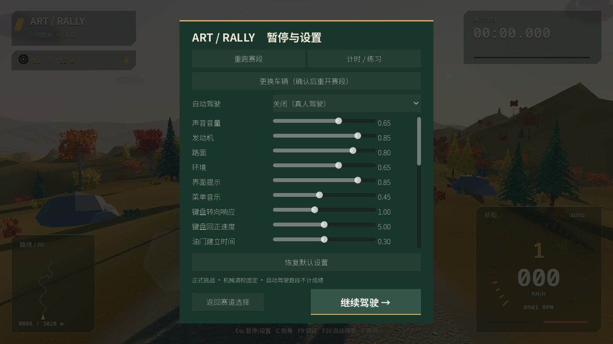

# 操作层级、赛道符号、亚克力 HUD 与三地光照

2026-10-18。

## 操作

- 共用操作栏：返回按钮较小并居左，确认按钮较大并居右。覆盖选关、选车、赛前、教学、成绩、设置、键位、车牌、制作名单、暂停与旧开发选车窗口。
- 选关、选车先点击卡片高亮，再使用右下角确认按钮进入下一页。主菜单的大挑战磁贴也移到右侧。
- 调整选择页间距，确保 1280×720 与缩放后的 960×540 中确认按钮完整显示，无需滚动寻找。

## 驾驶画面

- 移除道路上的 START、FINISH 和 CP 大字，改为双箭头起点、菱形检查点、方格旗终点 SVG 符号。仅当前目标显示悬浮符号；气柱颜色继续区分已过、当前和后续检查点。
- HUD 的检查点使用小图标、序号和距离；移除 HUD 上重复的车牌，只在车辆牌照及菜单预览中保留号码。
- HUD 使用亚克力面板：约 34% 的深色透色、轻微屏幕磨砂、固定细噪点、细亮边。警告面板保持更强对比，文字、数字和箭头保持清晰并带细阴影。屏幕取样只用于面板底层，文字不参加模糊。

## 三地光照

- 夕照松岭：12.5° 低角度、朝道路斜侧方照射的暖色太阳，金色亮部与偏冷阴影形成对比；天空与云同步采用暖桃色、淡紫与蓝灰层次。
- 晴岬海岸：海面增加两个尺度的细碎反光，随波面缓慢明灭，并按太阳方向增强。远景尺度与导数过滤控制闪烁，近处避免出现粗大亮点。
- 雾杉高地：18° 晨光、偏冷环境光与低谷高度雾，远处逐渐融入薄雾，保留近处道路与制动距离。三地均为固定光照方案。

## 验证

- 常规回归 38 组、643 项通过；另有 4 项 Python 标定测试通过。
- 新增页面操作层级 35 项通过，检查左右位置、大小与选关/选车/赛前确认按钮完整可见。
- 新增三地展示 11 项通过，检查太阳、天空和云的一致性、低角度夕照、海面反光方向与晨雾参数。
- 真实 Metal 渲染核对三地驾驶、驾驶舱、灰度车型、页面、暂停、海面与低谷视角；960×540 入口及导航检查通过。
- 截图为测试进程、默认设置和自动驾驶采样，不写入玩家最佳记录；额外景观视角不代表可驶入海面。
- 双平台候选包已重新导出；macOS 包内流程、驾驶、音频与车牌保存测试通过，Windows PE/ZIP 结构检查通过。两包均附更新后的操作说明与校验文件；Windows 实机仍按既有人工验收表执行。

