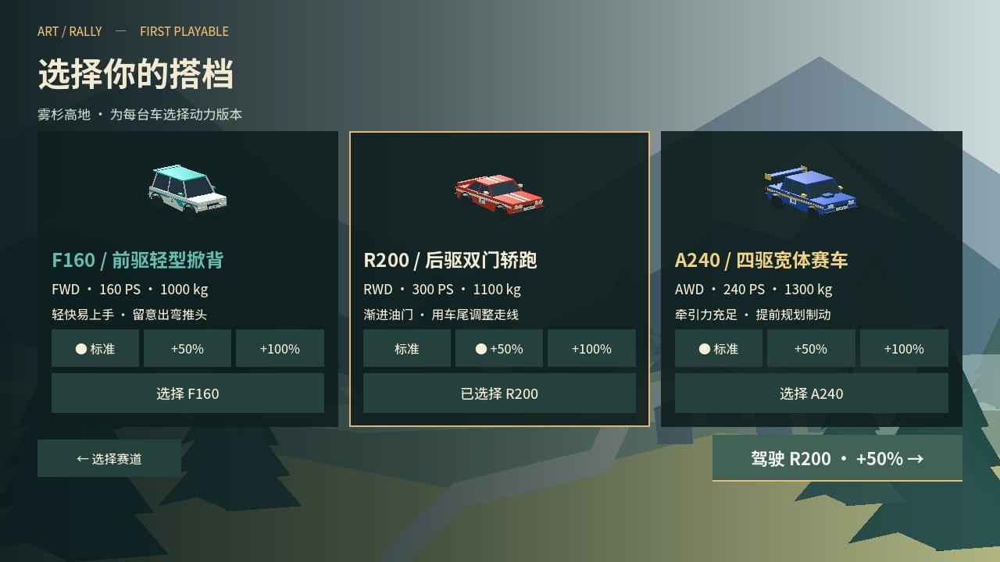
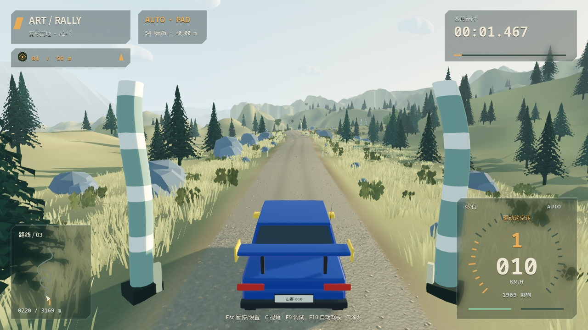
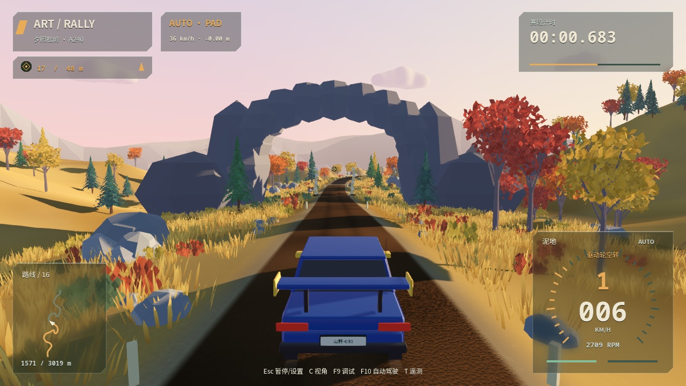
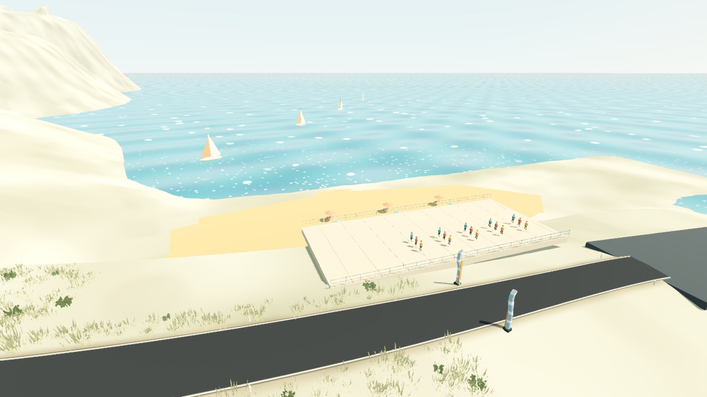
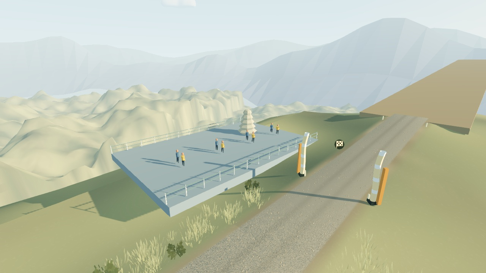
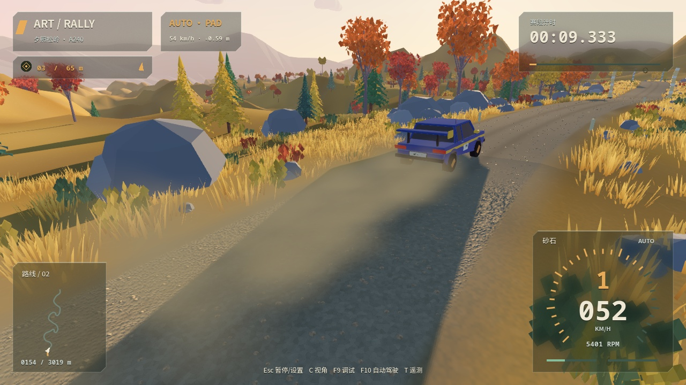

# 赛道第二版与选车交互修订

2026-10-18。本次更新会修改路线，所有赛道的 `stage_version` 从 1 升为 2。旧成绩和幽灵仍保留在本地存档，不与新版路线比较；已经取得的全车系动力解锁保留。奖牌时间仍为暂定工程目标，不能当作真人标定结果。

## 选车交互的修正

旧页面把三档动力横排在三辆车正上方，形成了强烈的“一列对应一种车”的视觉暗示。虽然程序把动力作为全局选项，玩家却会自然地按照空间位置理解它。这是信息分组设计的问题。

新版让每张车辆卡片拥有自己的标准／+50%／+100% 控件：

- 动力控件、实际 PS、车型与驱动方式在同一卡片内，点击动力同时选中对应车辆。
- 每台车在当前会话中记住自己的动力选择，切换另一台车不会改掉上一台车的配置。
- 金色卡片边框标识当前参赛车辆；卡片内的圆点标识该车的动力版本。
- 页面右下角的主按钮显示最终组合，例如“驾驶 R200 · +50%”。未解锁项禁用，并提供解锁条件提示。

后续界面应沿用“选项靠近其作用对象、局部状态与最终确认一致”的原则，减少依靠长段说明弥补布局歧义。

## 驾驶与视觉修复

- 停稳后按住 S／↓ 或手柄制动键，等待 **1 秒** 自动请求倒挡。行驶中的制动仍不会误挂倒挡，松开、暂停、手动换挡仍取消等待。HUD 进度条也按 1 秒计算。
- 新增坡道恢复驻车：恢复到检查点后保持制动，直到玩家踩油门或制动踏板，避免在爬山路段松脚溜车。
- 起点、终点使用同一套方格旗 SVG；路书的终点提示也用方格旗，不再显示警告三角。
- 高地遮挡包括两个因素：原有高度雾设置偏浓；远景谷底平面采用“赛道中点高度减 35 米”，会高于较低的起段，形成不透明遮挡。新版按整条路线最低点再减 100 米安置背景底面，降低雾密度，将高度雾基准放到起点下方。
- 近路地形网格由 16 米细化为 8 米，并增加与道路的垂直余量，降低起伏道路被背景三角面覆盖的可能。
- 扬尘排查还发现低发射比例会让高速尾迹断续，原来的包围盒也不足以覆盖移动中的长尾迹；新版保持均匀发射并扩大尾迹包围范围。
- 干燥砂石和草土地面增加轮后扬尘的数量、尺寸、持续时间与后抛速度；泥水仍使用各自的效果。粒子没有碰撞，靠近地表柔和消隐，暂停停止发射。

## 三条路线

| 赛道 | 线路与海拔 | 新地标和终点 |
| --- | --- | --- |
| 夕照松岭 | 约 3.05 km，五处飞坡位于 360／850／1430／2230／2650 米，增加连续缓起伏与折返弯 | 路线中段天然石拱、旁侧岩柱；保留秋日林地与混合路面 |
| 晴岬海岸 | 约 2.8 km，从 125 米持续下降至约 -10 米；海平面 -25 米，终点仍在海面上方 | 黄金海岸观景平台、沙滩、遮阳伞、原创低多边形成年泳装游客、离港帆船与观众 |
| 雾杉高地 | 约 3.2 km，从 15 米持续上升至约 255 米，新增多组折返爬升弯 | 山顶石堆、观景栏杆和观众，终点周围地形向谷地下降，远山保持空气透视 |

三条赛道中段均设有医疗保障车、着高可视背心的工作人员、无线电标识和隔离栏；人物放在道路以外。海岸帆船为离线程序动画。所有新增几何都为项目原创，可编辑生成源位于 `scripts/presentation/stage_landmarks.gd`。

## 真实路况参考与实现取舍

[TOYOTA GAZOO Racing 对科西嘉拉力的车队报道](https://toyotagazooracing.com/wrc/report/2019/04/summary/)说明了柏油边缘的砂石路肩、高差和尖石如何影响切弯，以及车手如何在勘路时决定是否标注“不要切弯”。因此，“可以切”不能仅由道路宽度决定。

[FIA 拉力安全资料](https://www.fia.com/rally-safety)强调赛段设置、医疗与工作人员、观众区域管理。这些资料提供设计依据，本游戏不声称按真实赛事认证要求复刻医疗布置。

本次采用固定作者配置，保持可学习、可重复的计时体验：

- 各赛道在普通路段、收窄段、可小切弯段之间平滑变化，最窄约 4.4 米，宽处约 7.3 米。
- 收窄提示对应实际窄路，内弯道路边缘之外的路肩设置可见岩石；可小切提示对应扩宽的路面与清理过植被的平整路肩。
- 弯道方向与强度继续从路线几何生成，危险提示由作者配置；“注意”“收窄”“切弯”不视为同义词。
- 新版自动驾驶按当前路面和飞坡配置提前控速，移除对旧松岭固定距离的限速假设。

## 验证

功能与规则检查：44 组、884 项通过，另有 6 项 Python 工具测试通过。五处飞坡均验证了真实四轮腾空与稳定落地，约 0.13–0.26 秒。新版所有赛道均额外扫描了车辆通行走廊，新增场景碰撞不会侵入车道中心。macOS 导出包已通过实际启动、驾驶、资源与音频链路检查。3 条赛道 × 3 辆车 × 3 档动力的 27 次虚拟手柄自动驾驶均完整通过所有检查点，零恢复；81 项回归断言通过。详细数据见 [验证记录](validation/v0.3.0-rc.2.json)。1080p 短时诊断采样中，松岭／海岸／高地平均帧率约 31.2／43.0／31.3 FPS；采样时另一份用户启动的游戏与 Godot 编辑器仍在运行，因此这些数字不作为单实例性能结论，也没有通过稳定 60 FPS 发布验收。截图为 Godot 实际渲染；摆拍脚本使用独立档案，不修改玩家解锁或纪录。自动驾驶回归不能替代真人奖牌标定、实机手柄与 Windows 验收。

## 实际画面

