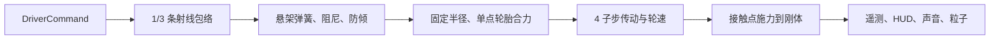
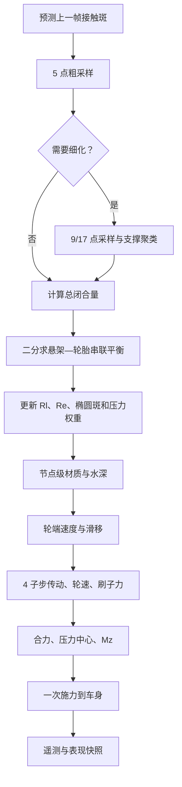

# v0.2.0：轮胎形变、动态接触斑与刷子模型技术方案

状态：批准实施。目标是提升接触过渡、轮胎力建立、路肩和落地反馈的连续性与可解释性，不以“增加抓地”或“缩短圈速”为成功标准。

## 1. 范围与非目标

v0.2.0 采用降阶实时模型：

- 每轮一个标量径向形变量；
- 加载几何半径与运动学有效滚动半径；
- 载荷相关的椭圆接触斑；
- 5 / 9 / 17 点自适应地形与材质采样；
- 接触斑内压力分配、局部组合滑移和刷子力积分；
- 纵横向剪切松弛状态；
- 单一地面合力、压力中心与受限回正力矩。

仍保留单一 `RigidBody3D` 车身，不实现：

- 独立轮毂刚体、真实非簧载质量或轮跳；
- 侧壁碰撞、夹胎、脱圈和爆胎；
- 软体、有限元、带束层高频模态；
- 温度、磨损、胎压热变化和损伤；
- 可变形土壤、真实水膜和胎纹排水。

本模型只能称为“可解释的实时降阶轮胎模型”，不能称为真实轮胎数字孪生或认证级预测工具。

## 2. v0.1.0 基线

当前数据流：



关键限制：

- `RallySuspension.sample()` 从悬架锚点发射中心射线；包络模式增加纵向前后射线，但只选择最短支撑长度。
- 轮胎始终使用 `RallyVehicleConfig.wheel_radius`，没有径向顺应性。
- `RallySurfaceQuery.footprint()` 固定采样中心、纵向 ±0.12 m、横向 ±0.09 m；它只混合材质，不承担分布载荷。
- `RallyTireModel` 使用单轮总载荷、经验力曲线、全局摩擦圆和固定松弛长度。
- 多射线永远只产生一份悬架力，这是必须保留的 invariant。

## 3. 单位与状态定义

内部统一使用 SI：

- 长度、形变、半轴、松弛长度：m；
- 力：N；
- 压力：Pa；
- 刚度：N/m 或 N/m²；
- 阻尼：N·s/m；
- 转速：rad/s；
- 角度：rad。

每轮新增状态：

```text
radial_deflection       δ
suspension_compression  xs
loaded_radius           Rl
effective_radius        Re
patch_half_length       a
patch_half_width        b
patch_area              A
pressure_center         cp
aligning_moment         Mz
relaxed_longitudinal    qx
relaxed_lateral         qy
sample_count
contact_age
diagnostic_flags
```

必须始终满足：

```text
0 ≤ δ ≤ δmax
0 ≤ xs ≤ suspension_travel
0 < Rl ≤ Re ≤ R0
a ≥ 0, b ≥ 0, A ≥ 0
Fz ≥ 0
所有向量、力和力矩 finite
```

## 4. 悬架—轮胎串联形变

### 4.1 总闭合量

设：

- `R0`：未加载轮胎半径；
- `l0`：悬架静止长度；
- `D`：悬架锚点到等效地面的法向距离；
- `xs`：悬架压缩；
- `δ`：轮胎径向形变。

总闭合量：

```math
\Delta = l_0 + R_0 - D = x_s + \delta
```

v0.2.0 不增加无簧载质量，因此轮毂是质量为零的中间节点：

```math
F_s(x_s,\dot x_s)=F_t(\delta,\dot\delta)
```

### 4.2 轮胎竖向力

默认使用单调二次弹簧与 Kelvin–Voigt 阻尼：

```math
F_t=\max\left(0,k_1\delta+k_2\delta^2+c_t\dot\delta+F_{bottom}\right)
```

其中 `F_bottom` 仅在 `δ > δ_soft_limit` 时渐进建立。参数必须验证：

```math
F_t(0)=0,\qquad \frac{\partial F_t}{\partial \delta}>0
```

正式参数优先来自指定轮胎的 SAE J2704 载荷—形变和足迹试验；通用文献值只作先验。

### 4.3 固定次数隐式求解

用后向差分：

```math
x_s=\Delta-\delta
```

```math
\dot x_s=\frac{x_s-x_{s,n}}{h},\qquad
\dot\delta=\frac{\delta-\delta_n}{h}
```

求根：

```math
g(\delta)=F_t(\delta,\dot\delta)-F_s(\Delta-\delta,\dot x_s)
```

在合法形变区间执行固定 14 次二分。单调弹簧和正阻尼保证根唯一。若区间无符号变化，必须区分：

- 接触释放；
- 悬架限位；
- 轮胎底碰；
- 非法参数。

禁止静默返回中点。最终只对车身施加一次地面法向力，不得再额外施加一遍悬架力。

## 5. 加载半径、有效半径与接触斑

### 5.1 半径

加载几何半径：

```math
R_l=R_0-\delta
```

运动学有效半径采用可标定的形变函数，并限制：

```math
R_l\le R_e\le R_0
```

使用规则：

- 射线几何、轮心高度、视觉压平：`Rl`；
- 滑移率、自由滚动转速、纵向力轮轴反力矩：`Re`；
- 轮轴反力矩：`T = -Fx·Re`。

### 5.2 椭圆足迹

无实测数据时，纵向半长使用缩放弦长：

```math
a=\lambda_a\sqrt{\max(2R_0\delta-\delta^2,0)}
```

接触面积不能简单视为 `Fz / 胎压`。先使用含胎体贡献的标定平均压力：

```math
A^*=\frac{F_{elastic}}{\bar p(F_{elastic},p_g)}
```

再求横向半宽：

```math
b=\frac{A^*}{\pi a}
```

`a`、`b` 必须受胎面几何和最小载荷约束。阻尼冲击载荷只提高瞬时压力，不直接令接触斑在一个物理步内异常膨胀。

### 5.3 压力分布

椭圆内：

```math
r^2=(x/a)^2+(y/b)^2
```

```math
p(x,y)=p_0(1-r^2)^n
```

离散节点权重归一化后严格满足：

```math
\sum_i dF_{z,i}=F_z
```

默认 `n=1`，只作为平滑、可调的降阶压力场，不代表真实花纹块压力。

## 6. 自适应地形与材质采样

采样节点必须嵌套：

- 5 点：中心与纵横四点；
- 9 点：增加四个对角点；
- 17 点：增加外环；
- v0.2.0 每轮硬上限 17 点。

触发细化：

- 命中与未命中同时存在；
- 高度拟合残差超过 1–2 mm 或 5% 形变；
- 法线差超过 3–5°；
- 材质、水深或摩擦参数不一致；
- 粗细级等效闭合量差超过 1 mm；
- 接触边界进入椭圆。

降级阈值使用升级阈值的一半，并要求连续 3–5 帧满足，防止层级抖动。

节点按空间聚类。若两个支撑簇被明显沟槽分隔，不能拟合成一张跨沟平面；保留主支撑簇或标记 `BRIDGE_REJECTED`。局部支撑面积不足时不得把整轮载荷重新归一化到单个节点。

材质和水深必须先在节点级保留，轮胎力积分后才能聚合成兼容的 `RallySurfaceSample`。split-μ 时禁止先平均摩擦系数。

## 7. 接触斑感知刷子力

对节点 `i`：

```math
dF_{z,i}=F_z\frac{A_i\phi_i}{\sum_j A_j\phi_j}
```

从前缘到节点的输运距离：

```math
s_i=clamp(a-sign(V_x)x_i,0,2a)
```

局部剪切试算：

```math
dF^*_{x,i}=-K_x^A A_i s_i q_x
```

```math
dF^*_{y,i}=-K_y^A A_i s_i q_y
```

每个节点使用自己的路面参数做局部组合摩擦椭圆投影，再积分：

```math
F_x=\sum_i dF_{x,i},\qquad F_y=\sum_i dF_{y,i}
```

```math
M_z=\sum_i(x_i dF_{y,i}-y_i dF_{x,i})
```

接触面积只改变压力分布、刚度、松弛和材质占比，绝不直接乘到总摩擦容量。

回正力矩初始增益默认为 0，仅在 B2 稳定后逐步启用并限制其功率与幅值。

## 8. 松弛状态

定义：

```math
v_{sx}=R_e\omega-V_x,\qquad v_{sy}=-V_y
```

```math
U=\max(|V_x|,|R_e\omega|)
```

速度形式松弛：

```math
\sigma_x\dot q_x=v_{sx}-Uq_x
```

```math
\sigma_y\dot q_y=v_{sy}-Uq_y
```

`U > ε` 时解析更新，低速时使用有界后向更新。B2 启用后必须替换现有 `relaxed_slip` / `relaxed_angle`，不能重复计算两层迟滞。

前进/倒车切换时逐渐交换前后缘；离地后剪切状态以有限时间衰减，长时间离地、传送和复位立即清零。

## 9. 120 Hz 求解顺序



接触查询每个 120 Hz 步只做一次；4 个轮胎/传动子步复用该斑，不能把射线预算乘四。

## 10. 代码结构

新增：

- `RallyTireVerticalModel`：纯竖向串联求解；
- `RallyWheelContactSample`：单节点位置、法线、闭合、权重、材质；
- `RallyWheelContactPatch`：椭圆斑、节点、支撑簇、压力中心；
- `RallyContactSampler`：5/9/17 点查询与细化。

修改：

- `RallyTireConfig`：胎压、胎宽、径向刚度/阻尼、形变上限、足迹参数、刷毛与松弛参数；
- `RallyWheelState`：形变、半径、斑、剪切、Mz、功率和诊断标志；
- `RallySuspension`：串联求解与法向力；
- `RallyTireModel`：有效半径、节点刷子积分和解析松弛；
- `RallySurfaceQuery` / stage provider：椭圆节点级采样；
- `RallyVehicle`：新求解顺序、一次合力/力矩、视觉快照；
- 遥测、F9、声音、震动和轮胎视觉：只读新增状态。

保留 `LEGACY` 与 `COMPLIANT_PATCH` 开关，直到 v0.2.0 冻结后仍允许诊断回滚。

## 11. 驾驶感受预期

可信趋势：

- 细坎、接缝、材质边界和入水边缘更连续；
- 入弯、制动和出弯的力建立/释放有有限迟滞；
- 路肩冲击不再由最高单射线瞬间接管；
- 落地法向冲量被摊开，轮速重新耦合更柔和；
- FWD 动力推头、RWD 动力甩尾、AWD 再附着过程更渐进。

必须实测：

- 极限是否更容易控制；
- 制动距离、峰值抓地和圈速是否变化；
- 回正力矩在无 FFB 条件下是否有可感知收益。

不得宣称：

- 砂石或泥地因面积增加就更有抓地；
- 模型能预测真实水滑速度、排水能力、土壤沉陷或动态车辙；
- 落地改善等于真实轮跳，因为仍无非簧载质量。

## 12. Bad cases 与防护

| Bad case | 防护 |
| --- | --- |
| 多节点重复完整轮荷 | 压力权重和严格为 1，只施加一次合力 |
| 面积直接乘摩擦上限 | 总容量仍由载荷、路面与载荷敏感性决定 |
| 悬架与胎体重复支撑 | 串联平衡，法向力只有一个来源 |
| 二分无根 | 分类释放/限位/底碰，记录标志并使用有界回退 |
| 形变负值或超过半径 | 单边约束与底碰曲线，finite 断言 |
| 阻尼吸住地面 | 总法向力最小为 0，回弹不得产生拉力 |
| 阻尼做正功 | 监控阻尼功率并钳制非被动输出 |
| 零速滑移爆炸 | 速度形式松弛和低速正则化 |
| 形变—半径—滑移振荡 | 有效半径有界，轮速纵向力继续隐式二分 |
| 抱死/空转高频振荡 | 局部力曲线单调饱和，4/8 子步收敛检查 |
| 离地保留旧力 | 接触释放立即清法向力，剪切有限衰减后清零 |
| 前后换向前缘瞬移 | 低速换向区混合前后缘 |
| 单节点承担全部载荷 | 支撑面积与局部压力上限 |
| 斑跨沟搭桥 | 支撑聚类与 `BRIDGE_REJECTED` |
| 三角面法线跳变 | 同半球处理、压力加权拟合、角速度限制 |
| 采样层级抖动 | 嵌套节点、滞回和短时混合 |
| 高速漏掉窄障碍 | 前缘预测、粗细误差触发 17 点、闭合增量上限 |
| 接触墙壁/天花板 | 法线与车辆上方向夹角门限 |
| split-μ 被平均 | 节点级摩擦投影后再积分 |
| 水阻随面积失控 | 使用湿区比例和功率/冲量上限 |
| 有效半径扰乱换挡 | 传动专项测试和半径变化速率限制 |
| 防倾杆与形变互相迭代 | 每轴有限 Gauss–Seidel 外迭代或冻结本步形变 |
| 可变步长不稳定 | 物理固定 120 Hz，超大步长禁止进入模型 |
| 视觉形变反控物理 | 物理快照单向驱动独立胎体网格 |
| 查询预算爆炸 | 5/9/17 硬上限、只在 120 Hz 步首查询 |
| 遥测遗漏尖峰 | 120 Hz 事件环形缓存，F9 显示窗口峰值 |

## 13. A/B、测试和性能门槛

阶段：

1. A：v0.1 legacy；
2. B0：形变和半径，稳态力保持等效；
3. B1：动态接触斑和材质；
4. B2：分布式刷子与瞬态；
5. B3：视觉和反馈。

B0 门槛：

- 静态总轮荷 A/B 差异 ≤1%，原绝对误差仍 ≤5%；
- 车身静态高度差 ≤3 mm；
- 柏油稳态 Fx/Fy、定圆、制动距离差异约 ≤2–3%；
- 0–80 km/h 和轮速/挡位关系差异 ≤2%。

全量自动门槛：

- 形变、半轴、面积和有效半径单调、有界、finite；
- 压力权重和为 1，局部力和不越过容量；
- 停车 10 秒漂移 <0.1 m；
- 30 / 60 / 120 FPS 回放差异 <1%；
- 4 / 8 子步关键结果差异 <2%；
- 六组合自动驾驶 31/31 门、0 恢复；
- 车辆回调 P95 内部目标 ≤1.2 ms、P99 ≤1.8 ms，硬门 P95 ≤2 ms；
- 总物理 P95 ≤5 ms；
- 连续重跑无持续内存增长。

人工门槛：

- FWD/AWD/RWD × 真人键盘/真实手柄；
- 低速、制动、入弯、出弯、路肩、积水和落地各重复至少三次；
- 隐藏视觉形变、随机 A/B 顺序；
- 无真实设备时不得用虚拟手柄冒充。

## 14. 遥测、视觉与反馈

CSV/F9 每轮增加：

- `deflection_mm`；
- `loaded_radius_m` / `effective_radius_m`；
- `patch_length_m` / `patch_width_m` / `patch_area_m2`；
- `sample_count` / `support_ratio`；
- `pressure_center_x/y`；
- `aligning_moment_nm`；
- `slip_dissipation_w` / `damping_power_w`；
- `wet_fraction`；
- 诊断标志。

轮圈保持刚体；胎体独立网格按物理斑压平，侧壁做有限保体积鼓起。视觉倍率只影响显示，倍率 0 / 1 / 2 和 F9 开关必须得到完全相同的物理遥测。

声音和震动读取耗散功率、法向冲量及湿区比例，不再仅依赖裸滑移率。

## 15. 参数与声明边界

参数来源优先级：

1. 指定轮胎的 TIR / MF 或厂商试验；
2. SAE J2704 力—形变与足迹；
3. 平带/滚筒滑移与瞬态试验；
4. 同规格同类别公开文献；
5. 通用典型值。

无指定轮胎数据时，只验证内部一致性、可信趋势和主观驾驶感，不宣称真实赛车精确复现。

参考：

- SAE J2704：Tire Normal Force/Deflection and Gross Footprint Dimension Test；
- Pacejka, *Tire and Vehicle Dynamics*；
- Besselink, Schmeitz, Pacejka：MF-Tyre / MF-Swift；
- NHTSA, *The Pneumatic Tire*；
- Project Chrono ENVELOPE / Fiala tire documentation；
- TU/e：轮胎竖向阻尼、胎体形变与纵向松弛长度测量。

## 16. 实施与发布顺序

每阶段独立提交：

1. `docs: add v0.2 tire contact deformation proposal`
2. `feat: add compliant tire vertical model`
3. `feat: add adaptive dynamic tire contact patch`
4. `feat: integrate patch-aware brush tire forces`
5. `feat: visualize and report dynamic tire deformation`
6. `test: freeze v0.2 tire calibration and validation`
7. `release: prepare v0.2.0 dual-platform packages`

最终提升 `calibration_version` 和应用版本到 `0.2.0`，构建 macOS universal 与 Windows x86_64 ZIP，生成 SHA-256，创建注释 tag `v0.2.0` 并上传 GitHub Release。

若真实手柄或真实 Windows 验收未完成，GitHub 只能发布为 prerelease，并必须在说明中列出未验收项。
