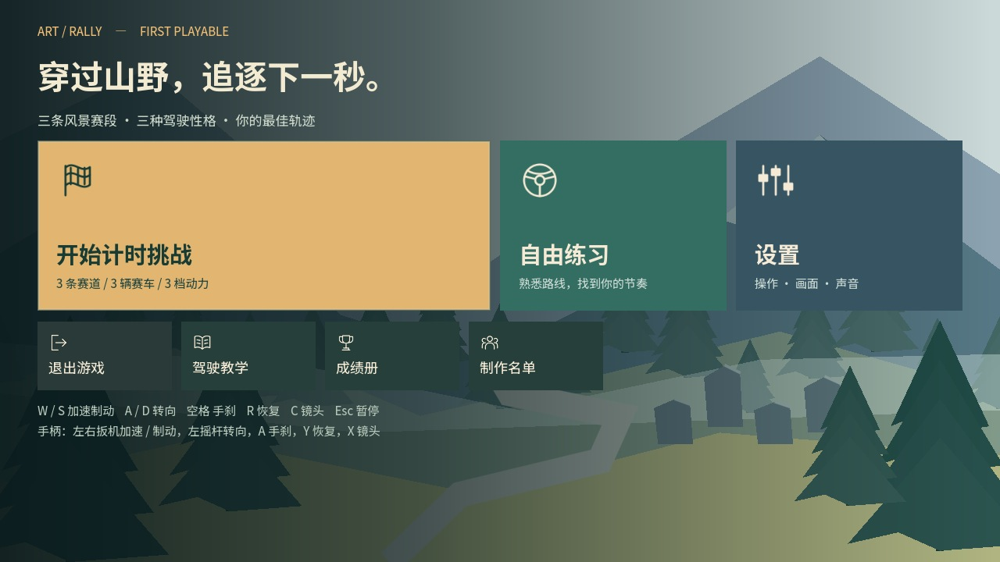
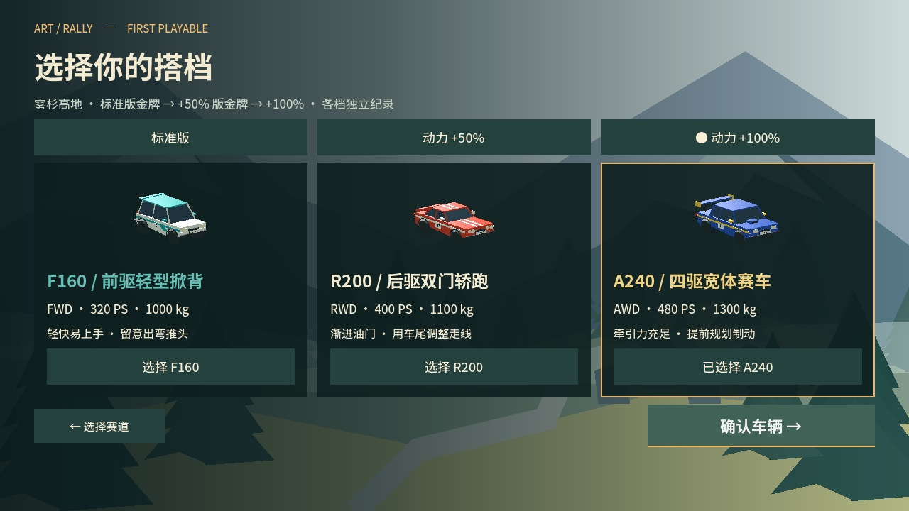
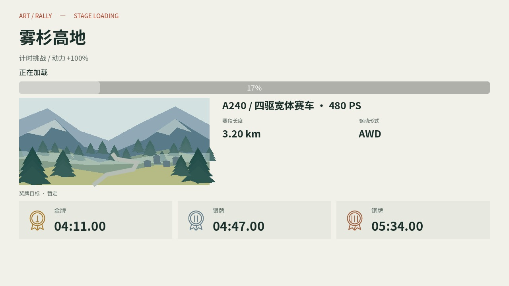
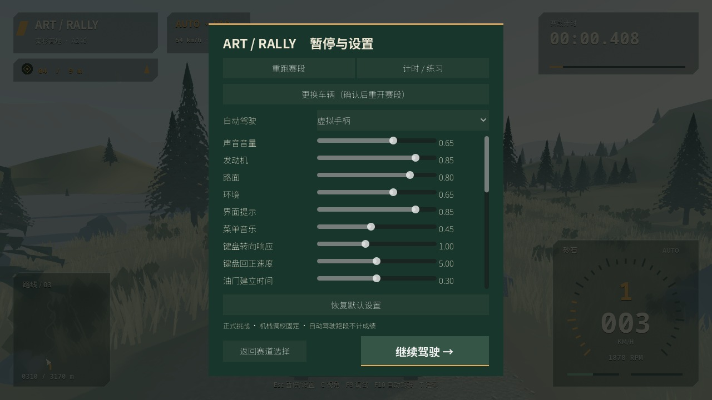

# 0.3.0-rc.1 候选版

日期：2026-10-18。Godot 4.7.2，Apple M5 / Metal Forward+。此记录覆盖当前增量，历史首次试玩版数据见 `FIRST_PLAYABLE_VALIDATION.zh-CN.md`。

## 玩家可见变化

- 主菜单主要按钮从左到右为「开始计时挑战」「自由练习」「设置」。
- 标准版任意正式金牌解锁全车系 +50%；在 +50% 版取得正式金牌后解锁全车系 +100%。每次选车可手动切换，成绩册也可按档位查看。重复取得标准版金牌不会直接解锁 +100%。
- 旧版有效玩家金牌保留解锁资格；奖牌、纪录、幽灵及解锁一起成功保存后生效，失败不提前解锁。练习、自动驾驶和混合接管不参与。
- 选择车辆后直接进入真实分阶段加载并自动发车。赛前信息合并在加载页，只保留赛道预览、车型与动力版本、长度、奖牌目标及进度。移除检查点要求、罚时规则、接管说明和重复车牌等文字。
- 三条赛道观众各从 4 组增加为 10 组，保留安全绳栏及保护区。
- 树木近景显示距离由 180 米增至 234 米，远景由 360 米增至 468 米；草、灌木、岩石同步增加 30%，树木近远景采用渐变切换。简化画质仍保留近远景衔接。
- 主路面外 1.2 米路肩平滑过渡到草地，视觉路肩随实际路宽调整。草地适度提高抓地与滚动阻力，仍可自由驾驶，不增加隐形围墙。
- 新增动力版自动驾驶按动力倍率控制油门；虚拟手柄使用模拟油门，虚拟键盘根据实际踏板滤波反馈控制二值按键，保留共享输入滤波。玩家手动驾驶保留全部动力。

| 赛车 | 标准版 | +50% | +100% |
|---|---:|---:|---:|
| F160 前驱 | 160 PS | 240 PS | 320 PS |
| R200 后驱 | 200 PS | 300 PS | 400 PS |
| A240 四驱 | 240 PS | 360 PS | 480 PS |

发动机额定功率和实际扭矩曲线同时缩放，车重、传动形式及底盘几何保持车型原标定。

## 成绩兼容与奖牌

路肩与草地物理变化后采用 `time-trial-2`，三个动力版本以车型标定版本进一步隔离，共 27 个挑战。旧成绩和幽灵文件继续保留，旧轨迹不会在新规则下播放。旧版有效金牌仅迁移解锁资格。

所有目标仍明确标为暂定。标准版沿用原工程参考；+50% / +100% 的初始参考分别为标准版的 94% / 90%，各自计算金银铜目标，不能当作已完成真人标定。`calibrate_medals.py` 现要求全部 27 个挑战分别有三次合格真人跑段，新的规则版本才能冻结；不同档位不能相互借用基准。

## 实际截图

动力选择图使用独立截图档案展示全部选项，未改动真实玩家进度。

加载图来自真实分阶段加载过程；场景图为自动驾驶摄影定位，不作为真人成绩。

## 验证记录

常规验证：42 组 GDScript、801 项检查通过，6 项 Python 奖牌标定测试通过。最新 macOS 导出包内菜单、驾驶、实际 CoreAudio 信号、车牌与档案读写检查通过；Windows ZIP / PE x86_64 结构检查通过，未做 Windows 实机测试。27 个赛道、车型与动力组合的虚拟手柄长跑全部完赛、零恢复，81 项通过，最大路线横向偏离 0.754 米；全程未写入玩家成绩。400 PS 后驱虚拟键盘整段复测也通过，零恢复（3 项）；闭环按键与模拟油门测试 15 项通过。已完成十次切场景：每次返回为 52 节点、0 孤立节点、103 资源；预热后内存由约 186.010 MB 至 186.127 MB，无场景资源累积。原始数据归档于 [候选版验证数据](validation/v0.3.0-rc.1.json)。

物理对照使用相同平地、初始横向 6 m/s、前向 15 m/s、制动 0.7：旧草地最大横向位移 5.899 米、总位移 21.369 米；调整后为 4.611 米、16.535 米，分别减少约 22% 和 23%。这是控制条件下的实际车辆模拟，不代表真人手感已验收。

首次 400 PS 后驱自动驾驶在松岭约 414 米失控恢复；修正机器人油门后，独立整段复测 245.90 秒、零恢复。后续矩阵以修正后结果为准。

LOD 渐变使用 [Godot GeometryInstance3D visibility ranges](https://docs.godotengine.org/en/stable/classes/class_geometryinstance3d.html#class-geometryinstance3d-property-visibility-range-fade-mode)；项目使用支持该渐变方式的 Forward+。更远显示及渐变有额外渲染成本，性能单独记录。

### 27 组合完整跑段

下表为实际自动驾驶行驶时间（秒），全部检查点与三处分段均完成，恢复次数均为 0。自动驾驶刻意控制油门和速度，不作为真人奖牌基准。

| 赛道 / 赛车 | 标准版 | +50% | +100% |
|---|---:|---:|---:|
| 松岭 / F160 | 250.57 | 252.17 | 253.05 |
| 松岭 / R200 | 244.07 | 245.25 | 245.90 |
| 松岭 / A240 | 236.40 | 237.43 | 237.99 |
| 海岸 / F160 | 221.30 | 222.82 | 223.65 |
| 海岸 / R200 | 216.80 | 217.94 | 218.54 |
| 海岸 / A240 | 215.12 | 216.04 | 216.52 |
| 高地 / F160 | 264.42 | 266.37 | 267.42 |
| 高地 / R200 | 256.05 | 257.35 | 258.06 |
| 高地 / A240 | 244.34 | 245.49 | 246.09 |

### LOD 性能抽样

M5 / 1920×1080 / Metal Forward+，每项预热 120 帧后采样 900 渲染帧，约 15 秒模拟行驶。后台回归在采样时暂停，森林 A/B 使用同样的内容、车型、路线起点与镜头，仅改变显示距离和渐变。此抽样不替代全赛段性能验收。

| 场景 | 平均 FPS | 帧耗时 P95 | P99 |
|---|---:|---:|---:|
| 松岭旧距离对照 | 67.62 | 23.26 ms | 24.46 ms |
| 松岭距离 +30% 与渐变 | 61.11 | 20.61 ms | 23.31 ms |
| 海岸距离 +30% 与渐变 | 73.44 | 22.62 ms | 32.68 ms |
| 高地距离 +30% 与渐变 | 60.00 | 17.88 ms | 22.35 ms |

松岭增加距离与渐变后平均帧率下降约 9.6%，没有达到稳定 60 FPS 的结论；三项新设置采样均零恢复。

## 发布状态

当前版本为 `0.3.0-rc.1`。正式 0.3.0 发布仍需真人跑段与奖牌标定、主观听音、真实 Windows、实体手柄及目标帧率验收。交叉导出和自动驾驶不能代替这些项目。

GitHub CLI 当前未登录，已连接的 GitHub 工具没有 Releases 上传接口；浏览器文件上传此前还需要启用扩展的文件 URL 权限。因此源码推送与 Releases 附件上传分别记录，不将本地产物误报为已上传。

## 候选包

本地产物位于忽略 Git 的 `builds/release/v0.3.0-rc.1/`，含两平台 ZIP、`SHA256SUMS.txt` 与发布说明；尚未上传 GitHub Releases。SHA-256：

- `Art-Rally-v0.3.0-rc.1-macos-universal.zip`：`6c73ece68fe77041d236cc9bd6d1f2765a92a391d0df3583753a756280d4ab21`
- `Art-Rally-v0.3.0-rc.1-windows-x86_64.zip`：`1d18935adc0606f7c3b7463dbfd6a1e99abb65faedc8ba24f0460a6d1f3568cf`
