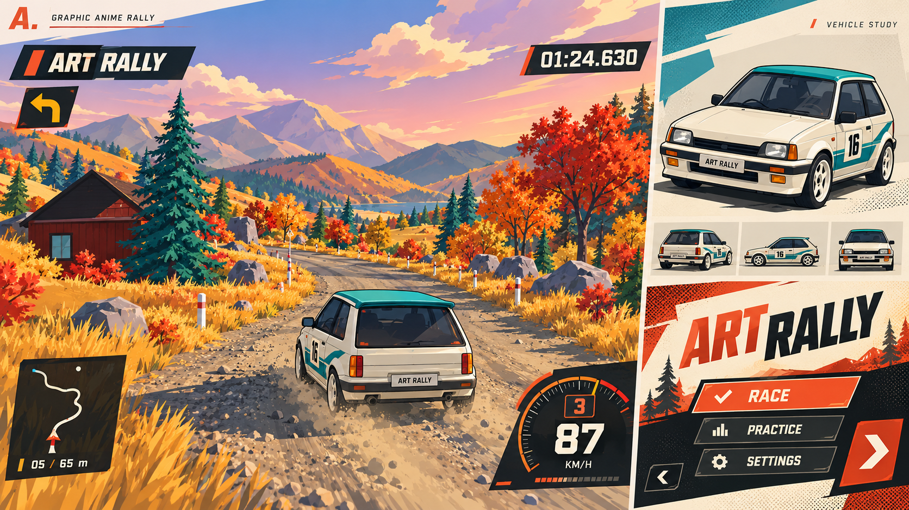
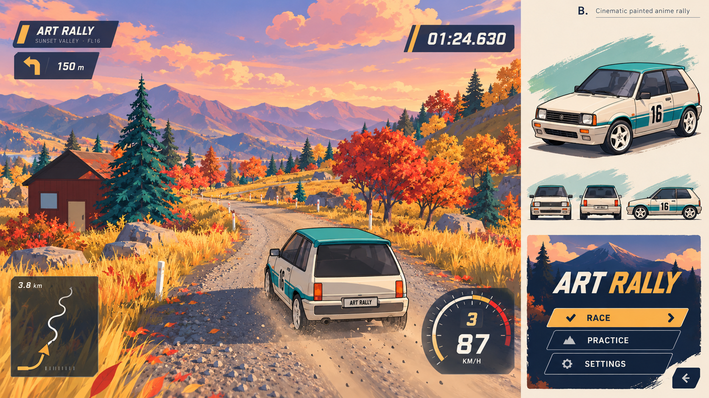
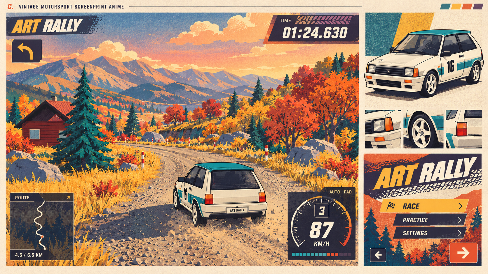

# Art Rally 日漫手绘方向与工作量评估

日期：2026-10-19。阶段：设计研究与概念图，不是已经完成的游戏改造。

## 结论与边界

用户希望车辆采用黑色描边，场景物体不描边，同时调整车辆造型、三条赛道和游戏内 UI。建议用三维赛璐珞车辆搭配无描边绘画环境实现；“手绘感”不要求逐帧手绘，也不要求所有资产都换成二维。方向 A 最接近用户提出的强烈日漫图形设计；方向 B 最适合保留当前风景吸引力；方向 C 最能延续现有复古赛车印刷身份。

本轮交付三张独立方向图及估算，不改运行时代码、模型、游戏设置或地图。图中使用同一松岭场景和 F160 奶油白／青绿掀背，方便比较。每张包含驾驶 HUD、车辆研究和标题菜单研究。图为 AI 概念图，不是 Godot 实机、工程承诺或最终 UI；文字、数据、车标与个别比例须在实现时校正，车辆保持原创。

## 当前资产与改造依据

- scripts/generate_vehicles.py：三车已有 Blender 源文件、GLB、独立材质和少量倒角。车身由多个对象组成，轮系由运行时驱动。需要整理描边轮廓网格、法线、接缝和玻璃遮挡，不能将每块零件等比例扩大后直接叠加。
- scripts/visual/sample_meshes.gd：大量环境资产采用程序化几何与顶点色。可复用生成与摆放规则，但需重塑树冠、山体等视觉形体，并建立材质／笔触规范。
- scripts/presentation/stage_presentation.gd：环境与配色有集中入口，适合统一渲染方向；三赛道仍需要独立调色和逐段修整。
- assets/shaders/stage_ground.gdshader、autumn_foliage.gdshader：现有细碎路面纹理、植被密度与光照需要调整细节层级。
- scripts/game/game_app.gd、scripts/ui：覆盖标题、指南、赛道、车辆、加载、成绩、回放、图库、成绩册、设置、车牌及按键等界面。UI 改造必须覆盖交互状态和手柄焦点，而不只是重新画标题页。
- 评估观察来自现有三赛道截图和代码；本轮未运行 GPU 基准，也未完成描边原型，估算置信度中等偏低。

## A — 疾速墨线

车辆：清晰黑色外轮廓，少量结构线，两至三级明暗，适当强化轮拱和姿态；保留三车轮廓与涂装差异。
场景：无描边的大色块，利落的日照阴影，金黄／青绿／橙红对比。避免把整个世界限制为红黑白。
UI：红橙、墨黑与暖白，斜切面板、错位排版、短促转场，明确的选中态。强烈图形效果集中在菜单、完赛及关键反馈，驾驶 HUD 收敛。
适合：追求明显的日漫图形冲击和竞技气氛。
风险：倾斜、黑块和动画堆叠容易抢占驾驶注意力，需控制面积、频次与动效幅度。
完整交付预算：45～65 人日（含约 20% 迭代余量）。

## B — 夕映动画

车辆：细黑轮廓与分区明暗，轮廓倒角更柔和，玻璃高光由整块形状表达。
场景：无描边的动画背景画，桃金夕照、紫蓝阴影、分组树冠与笔触山体；以形体和色彩完成体积。
UI：深蓝墨色、暖白和琥珀色，保留少量斜切构图，用清楚的留白与层级承托风景。
适合：重视景色、摄影和回放，同时希望车辆显得像动画中的主体。
风险：场景美术投入最大；静态笔触必须在追尾、驾驶舱和自由回放镜头下稳定成立。
完整交付预算：55～80 人日（含约 20% 迭代余量）。

## C — 套色拉力

车辆：较强黑色轮廓、简练硬朗形体，少量网点阴影与哑光色块。
场景：无描边的套色海报构成，石油青、芥黄、砖红和暖白；远山层次简化。
UI：拉力杂志式版面、粗体数字、轮胎印与纸张印刷质感。
适合：延续 Art Rally 已有的复古字体与轮胎印设计，建立更独立的品牌。
风险：概念图中的颗粒适合展示，但实装需显著降低道路和远景的细颗粒，以免高速闪烁。纸纹／网点应局部使用，不成为覆盖视野的噪声。
完整交付预算：50～75 人日（含约 20% 迭代余量）。

## 工作量口径与拆解

1 人日 = 约 8 小时有效制作。估算假设由熟悉 Godot、Blender 和 UI 的开发者／美术完成，允许 AI 辅助概念和基础素材，但包含人工检查、整合与返工。它不是 AI 执行时间，也不是承诺的日历工期。

范围为现有三条赛道、三辆车和现有全部玩家界面的视觉升级。保留现有赛道布局、驾驶物理和流程功能；新增赛道、重写物理、新角色系统、全套音频重制和市场宣传片不包含在本估算中。方向图并不代表需要复刻某一现有作品的资产或布局。

以 A 为基础的工作包，先按不含余量计算：

- 风格规范与原型：2～3 人日。确定轮廓粗细、阴影层级、道路可读性、UI 网格和三赛道配色。
- 渲染与材质：4～6 人日。车辆专属描边、赛璐珞明暗、玻璃／灯具／轮胎表现、距离与分辨率适配，以及幽灵与透明效果处理。
- 三车视觉重构：6～9 人日。车身曲面与法线、轮拱与驾驶舱轮廓、轮系视觉、材质与涂装；维持物理尺寸和挂点。
- 公共环境库与三赛道：9～14 人日。树草岩石、地标和道具风格统一；松岭／海岸／高地各自的天空、光照、雾、水和地表调色，逐段检查。
- 全部玩家 UI：7～10 人日。主菜单、选关选车、加载、驾驶 HUD、暂停设置、成绩回放、图库成绩册与车牌页面；重做图形表现、动效和适配，保留向量图标和持久选中态。
- 动态效果统一：3～5 人日。扬尘、轮胎印、尾灯拖尾、水花、落石、动物及直升机等既有效果的视觉整合。
- 整合与验收：5～8 人日。所有车辆与赛道组合、镜头／幽灵／回放、键鼠手柄、常用分辨率、性能及 macOS／Windows 实机检查。

基础合计 36～55 人日；加入约 20% 余量并按规划取整，A 约 45～65 人日。B 增加环境绘画、模型与光照修整投入；C 增加印刷材质与运动稳定性验证。三方案是替代关系，不是要累加的工作量。

单人每周 5 个有效工作日：A 约 9～13 周，B 约 11～16 周，C 约 10～15 周。多人协作不能直接将工期除以人数，风格确定、渲染原型和整合存在先后依赖。硬件、字体许可或素材来源等待可能额外延长日历时间。

## 建议先交付一个纵向样片

用 5～8 人日完成一辆车、200～300 米松岭路段、驾驶 HUD 和一版标题菜单，作为所选方向完整预算中的第一批工作，而非额外预算。样片需在 Godot 中运行并支持追尾和回放，不能用生成图代替。

样片包含：车辆黑色轮廓、阴影分区、树木和山石样本、道路／天空、扬尘以及一套 UI 主视觉。样片验收后用实际工作耗时修订余下估算，再扩展至三车三赛道。

海岸应保留乳白岩壁、青蓝海水和明亮日光；高地应保留冷色山崖与克制晨雾。图中统一用松岭只是便于比较，不意味着三赛道采用同一色调。

## 技术取舍与验收

优先评估车辆专用外壳描边或对象遮罩方案，避免全屏边缘检测给整个环境加边。需要处理分离零件的缝隙、内轮廓脏线、玻璃、轮胎转动、倒角法线和远距离线宽。具体方案由原型确定，不能凭概念图承诺实现成本。

轮廓绘制与车辆主材质分开控制；幽灵车采用单独强度与透明度策略，仍能与实体车区分。接触阴影应保留，以免车辆像浮在画面上的贴纸。场景用绘画色块表达体积，保持路面类型、积水、道路边缘、障碍物与路书信息可读。

检查 1280×720 与 1920×1080、常用窗口比例，验证 3 条赛道 × 3 车型 × 3 动力档中的视觉功能兼容（动力档不新增独立车身模型）。检查高低速、逆光、雾、海面、追尾／驾驶舱／回放镜头、幽灵与透明特效。以目标设备 1080p／60 FPS 为目标记录帧时间，不能用静态图片推断性能。Windows、实体手柄验证须有对应设备，未完成时单独列出。

UI 延续项目技能要求：短文本与矢量图标、对象内的动力选择、持久选中态、左侧返回／右侧确认、明确手柄焦点、车牌与标题字体关系。概念图中的英文、部分示例符号不作为最终实现规范。

## 公开技术依据

Godot 官方提供 diffuse_toon、specular_toon 和可编程顶点／片元／光照流程，说明可在当前引擎开展试验；这些功能本身不等于完成手绘美术：
https://docs.godotengine.org/en/stable/tutorials/shaders/shader_reference/spatial_shader.html

屏幕读取方案在 3D 中涉及不透明阶段之后的屏幕拷贝，透明对象以及法线／粗糙度缓冲支持有额外约束；因此描边选型应结合当前渲染器与幽灵／粒子需求：
https://docs.godotengine.org/en/stable/tutorials/shaders/screen-reading_shaders.html

上述官方资料用于技术可行性；人日范围是基于本仓库结构的工程估算，不是文档提供的基准。

## 生成记录

三张图由内置 image_gen 生成。完整提示词见 [PROMPTS.md](PROMPTS.md)。参考原图为 docs/previews/showcase-sunset_ridge.jpg。生成图可能含不准确的小文字、通用车徽或不一致比例，生产资产须清理并维持原创。
