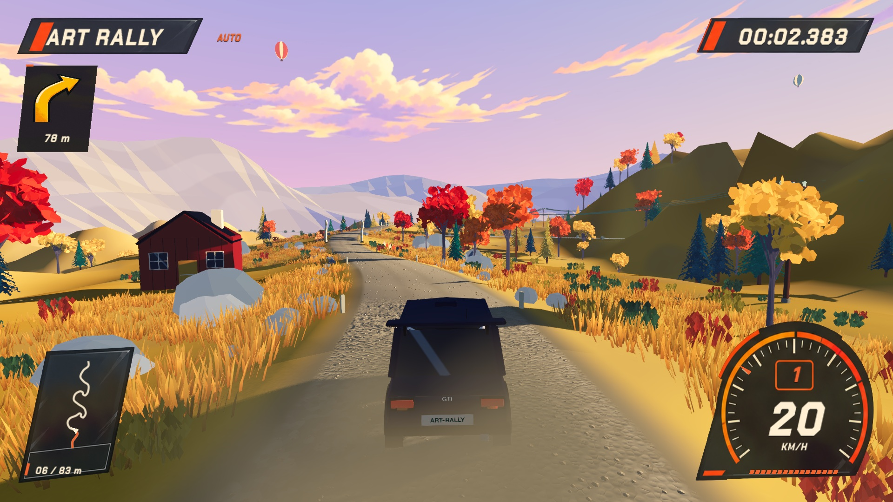
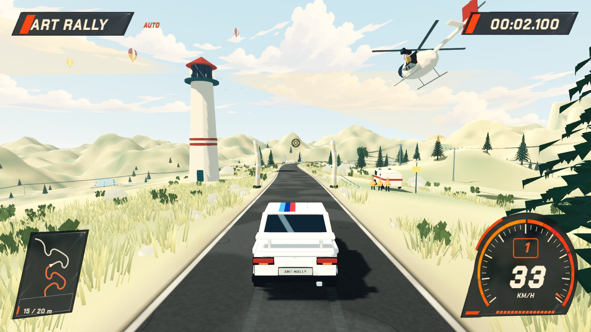
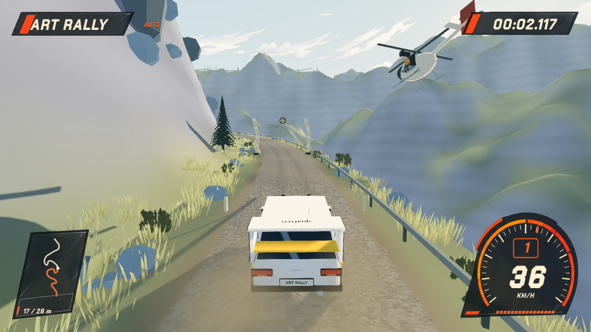
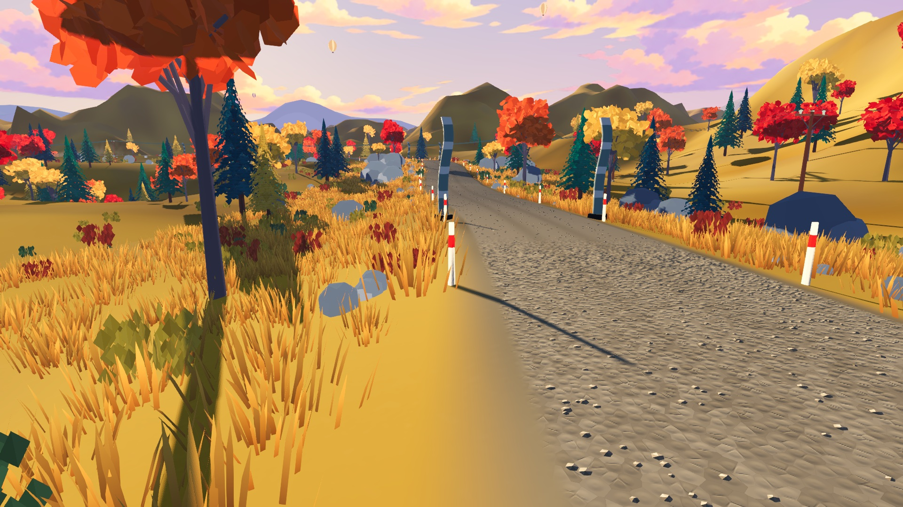
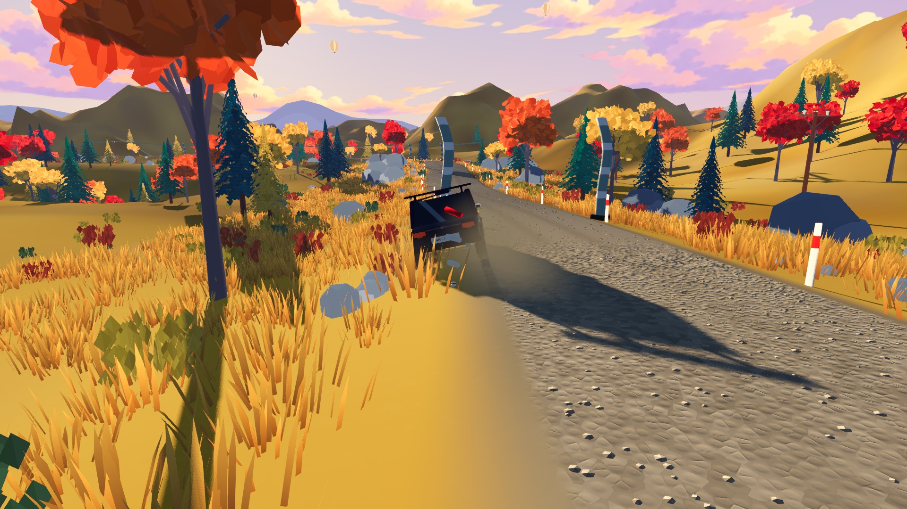

# 漫画拉力 HUD 与场景调色 · 2026-10-20

本轮参考用户提供的 `codex-clipboard-72d7767a-74aa-4906-b21b-1bc0046958fe.png`。已应用到正常 `./scripts/dev.sh run` 入口；加载界面继续使用插画，没有加入游戏截图。

## 实际变化

- 仪表盘：黑色拱形底板、橙色转速刻度、上方挡位、居中大时速、KM/H 与小型踏板条。速度、挡位、计时均为实时数值，文字在屏幕坐标中向右倾斜，保持水平基线。
- HUD：移除常驻赛道／车型文字及独立检查点条；检查点序号与距离并入小地图。路书移至左上，保留箭头、距离和必要的两字危险提示；分段差值、罚时、恢复与逆行提示仍保留。幽灵位置继续显示。
- 黑色亚克力：生图底板遮罩下采样模糊场景，使用中性近黑色降低背景干扰；橙色边缘与刻度保持清晰。
- 漫画箭头：生图 atlas 中选用六档不同转角，右弯水平镜像。根据路书位置附近连续同向弯曲测量角度，遇反向弯停止累积，避免 S 弯相互抵消。保持现有路书播报与危险提示规则。
- 红白路桩：全赛道固定五段，每段占总长 6%，合计 30%；两侧每 12 m 一对，距道路边缘 0.8 m。松岭 160、海岸 140、高地 160 根。车身扫掠包络命中后断成三段，碎片仅与地面碰撞，最多保留 24 块，末段淡出；恢复车辆不会沿传送路径撞倒杆，重跑恢复全部路桩。剩余区域保留原有矮路标。
- 场景：加强松岭金黄草坡、橘红树冠和青绿松针，调整宽幅叶面反光、蓝紫山体明暗及砂石表面色块。三赛道继续保留各自配色、雾效、湿地与路面区别。
- 云层：四种透明手绘云带按天空方向铺设十组，缓慢漂移，暂停时冻结；海岸和高地重映射为偏中性的明暗色。没有全屏纸纹或屏幕噪点，也没有给环境增加墨线。

## 资产与复现

两张纹理使用内置 `image_gen` 模式生成，原始 RGBA 文件原样复制进仓库，运行时裁区、镜像和调色。完整提示词在 [imagegen-prompts.md](imagegen-prompts.md)，文件哈希在 [validation.json](validation.json)。

- `assets/ui/comic_hud/atlas.png`：HUD 外壳与路书箭头。
- `assets/sky/comic/cloud-banks.png`：手绘云带，启用 mipmaps。
- `scripts/dev/comic_direction_capture.gd`：独立测试档案、1920×1080 的三赛道短段驾驶、左右箭头、1280×720 HUD、实际撞杆演示。
- `scripts/dev/comic_hud_capture.gd`：六档弯度／右回头弯、188 km/h、12:34.567 与幽灵位置的布局夹具。`fixture-*` 图为代表性数据，不是实际驾驶截图。

```bash
./scripts/dev.sh run
# 以下命令在 dev.sh run 已刷新资源导入后执行
/Applications/Godot.app/Contents/MacOS/Godot --path . --max-fps 60 --script res://scripts/dev/comic_direction_capture.gd -- --test-defaults
/Applications/Godot.app/Contents/MacOS/Godot --path . --max-fps 60 --script res://scripts/dev/comic_hud_capture.gd
```

## 验证与边界

- 9 组相关自动测试共 274 项通过：漫画 HUD／路桩、既有 HUD、套色外观、主题、赛道美术、正式流程、回放图库、赛段规则、重跑。
- 三赛道的路线点、静态碰撞、27 个挑战兼容键与既有快照完全一致。
- Mac 原生 Metal 窗口查看了三条赛道、左右转向、720p 和 1080p；真实车辆命中 1 根杆并生成碎片。布局夹具额外检查六种箭头和长数字。
- [capture-metrics.json](capture-metrics.json) 记录短段 180 帧样本的 P95/P99。采集限帧 60，包含显示用子视口，不等同完整赛段性能验收。本轮未验证 Windows 或实体手柄。
- 画面更接近参考图的色彩和 HUD 构图；现有地形、建筑与车辆几何仍是游戏资产，并非效果图的逐像素复刻。没有替换车辆物理、赛道中心线或挑战规则。

## 实机截图







更早画面保留在 `docs/art-direction/reference-cars/`；本轮截图未覆盖之前的记录。
