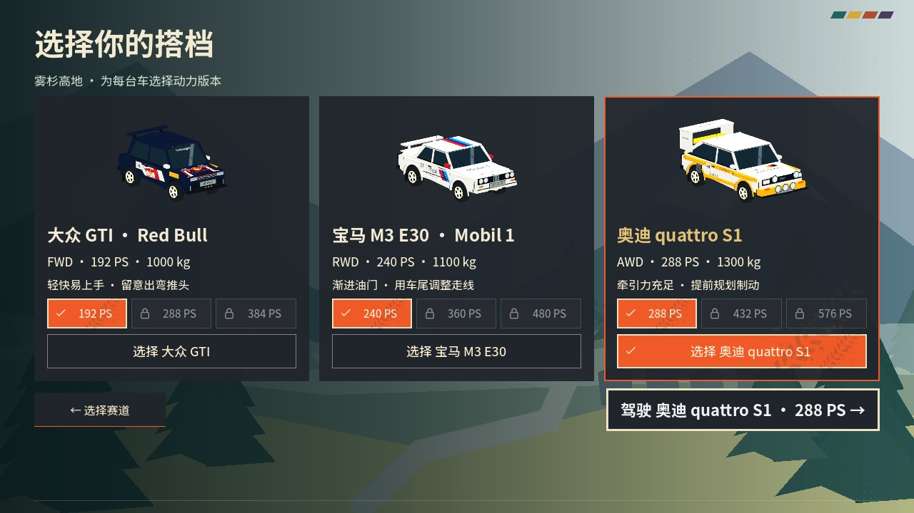
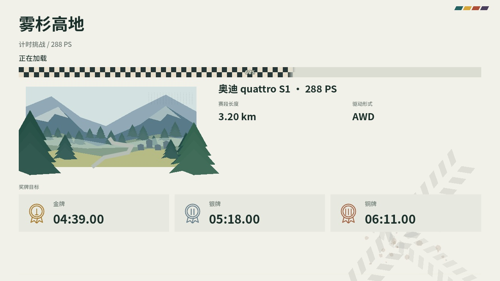
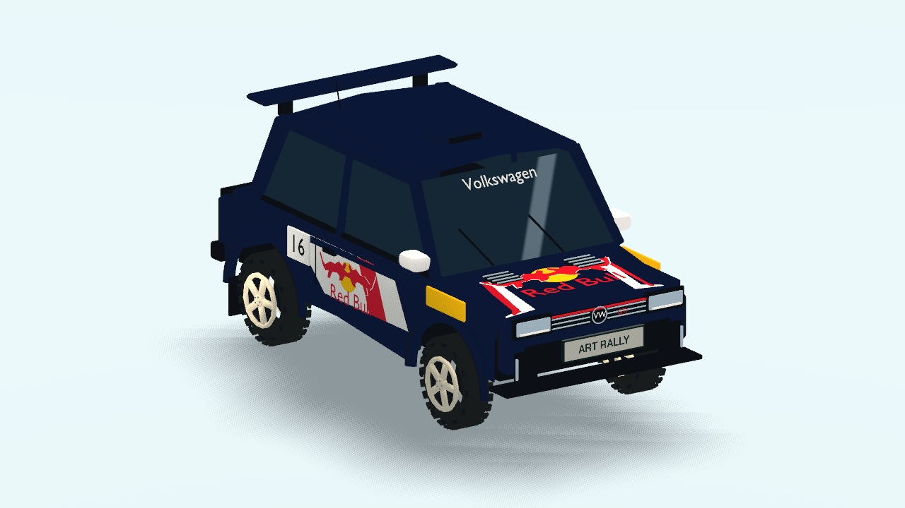
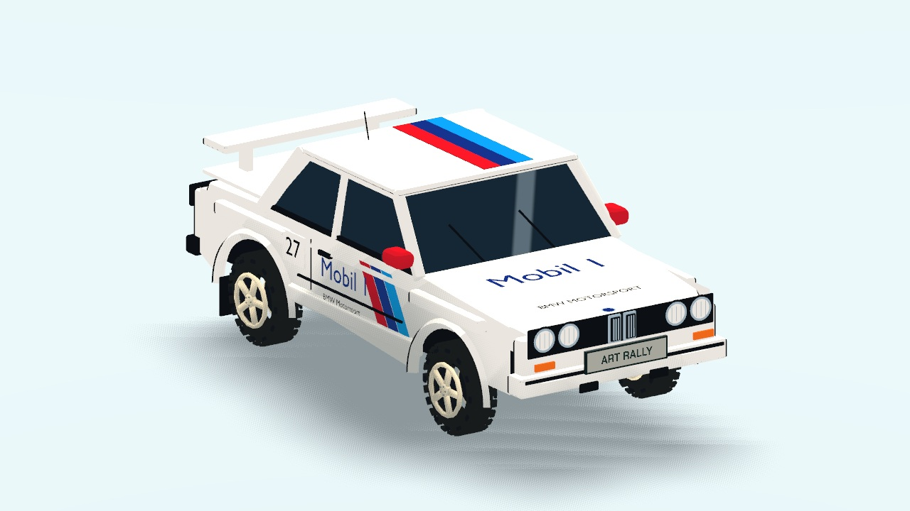
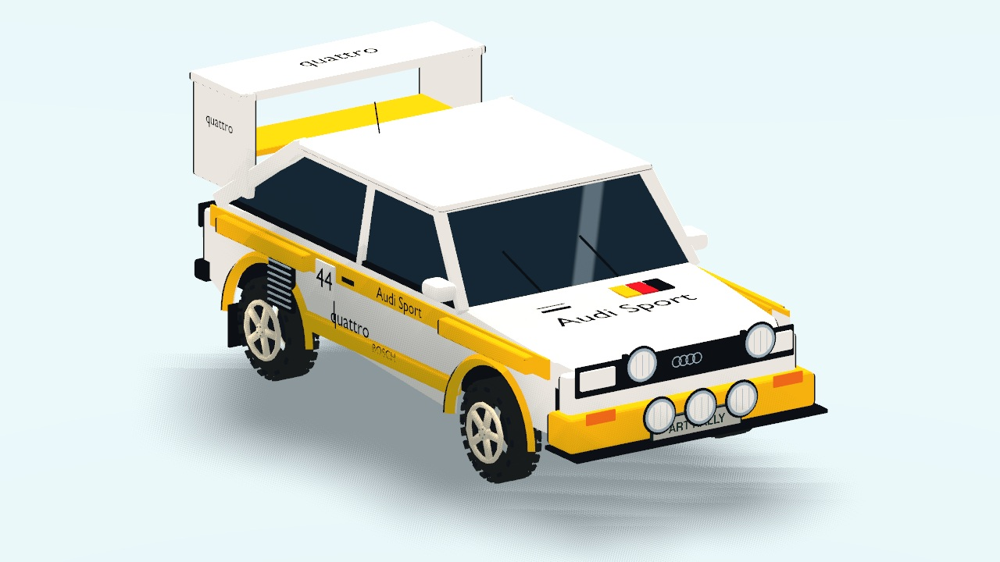

# 参考赛车改造 · 2026-10-19

使用 Blender 5.2.2 LTS 的 Python 建模工具制作三辆参考赛车，保存可编辑 `.blend` 并导出三档 GLB。Godot 4.7.2 的玩家车、选车预览、实体回放和幽灵车共用同一外观加载入口。沿用套色画风、车辆墨线和原有物理尺寸；本次没有改为真实赛车的动力或底盘参数。

## 车型与来源

- **F160 → 大众 GTI · Red Bull**：深蓝底色、红白斜切、黄色翼子板及双牛标识，掀背轮廓、车顶进气口和扰流板。参考用户提供的 `de818754-68e2-4a69-a934-5540af246976.png`。
- **R200 → 宝马 M3 E30 · Mobil 1**：白色、浅蓝／深蓝／红色条带，双肾格栅、四圆灯、箱形翼子板和尾翼。车身参考 `091fe799-7650-4c0a-8fa2-91c9aec744ac.png`；赞助涂装采用用户文字指定的 Mobil 1，没有照搬照片中的另一套赞助商。
- **A240 → 奥迪 quattro S1**：黄白涂装、宽轮拱、侧面百叶进气口、高位大尾翼和五盏辅助拉力灯。参考 `c1a42b7e-51fe-4b9d-851f-2ceb70b8b01b.png`。

品牌名称及标识依据用户要求表现。网格、标识近似轮廓和几何分色由本项目建模脚本制作，没有导入第三方整车模型或下载贴图。车号继续为 16／27／44；保留基础 192／240／288 PS 与三个动力档、机械版本、挑战 ID 和历史记录。

## 源文件与接入

- 权威源文件：`art_source/screenprint/vehicles/F160.blend`、`R200.blend`、`A240.blend`。
- 游戏资产：`assets/screenprint/vehicles/*-lod0.glb`、`*-lod1.glb`、`*-lod2.glb`。
- 本次建模记录：`scripts/build_reference_cars.py`。只有显式参数 `--replace-reference-cars` 才允许覆盖源模型；之后手工编辑应直接保存 `.blend`，使用导出工具更新游戏，不能再次执行初始化覆盖手工成果。
- 灯具、车牌、尾灯拖尾、四轮和镜头使用命名挂点；修正一侧轮毂朝向，选车、玩家车、回放和幽灵均使用相应朝向。
- 高细节车身三角面数：GTI 15,990；E30 19,074；S1 22,171。均低于每车 40,000 的预算，另含三档描边代理。四轮沿用现有白色五辐与 AT 胎。

加载页删除实机截图叠层及不再使用的三张游戏内 JPEG，保留赛道矢量插画、边框外景物、交错胎印和棋盘进度条。开发截图只保存到文档目录，采集脚本不再自动把截图写回 UI 资源。

## 实机查看

以下均为 Godot Metal 实际渲染，没有以参考照片或概念图代替游戏画面。







同目录另有每车侧面、车尾、驾驶及回放截图，以及 1920×1080 的菜单截图。

## 验证

- 7 组相关测试，**262 项检查，0 失败**：外观资源、菜单流程、档案／幽灵、手柄菜单输入、回放／图库、车牌、尾灯拖尾。结果见 `validation.json`。
- 比较三条赛道改造前后的中心线、静态碰撞及 27 个挑战键，全部一致。资源测试对车辆配置只排除名称、说明和配色字段，继续保护其余机械与兼容字段；旧原始文件哈希基线保留。
- 实际窗口渲染 1280×720 和 1920×1080；检查车侧文字方向、三车灯组、轮毂、尾部、选中态和加载插画。
- 三车型分别在松岭、海岸、高地实际运行约 6 秒自动驾驶，取得有效轨迹并进入实体回放；移动距离与轨迹数量见 `native-driving.json`。这是本次外观的短段冒烟验证，不是全程驾驶回归或性能基准。
- 实体手柄及 Windows 本轮未另行验收；没有创建新的正式 Release。

复现截图：

```sh
/Applications/Godot.app/Contents/MacOS/Godot --path . --max-fps 60 --script res://scripts/dev/reference_cars_capture.gd -- --test-defaults --drive
```

截图使用独立档案及会话静音，不覆盖玩家的成绩或声音偏好。车牌首次使用测试需不带 `--test-defaults`，该参数会跳过首次车牌流程。
