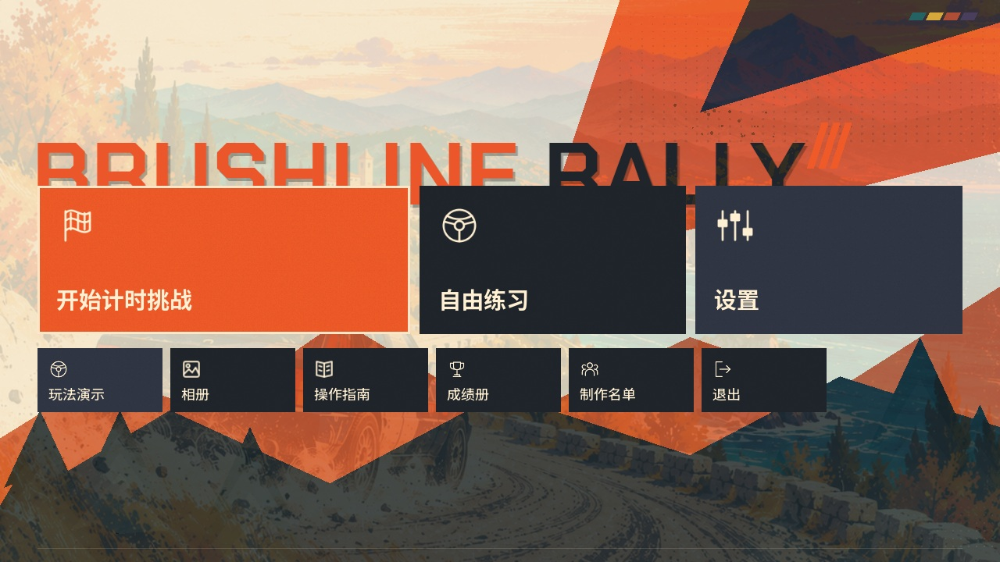
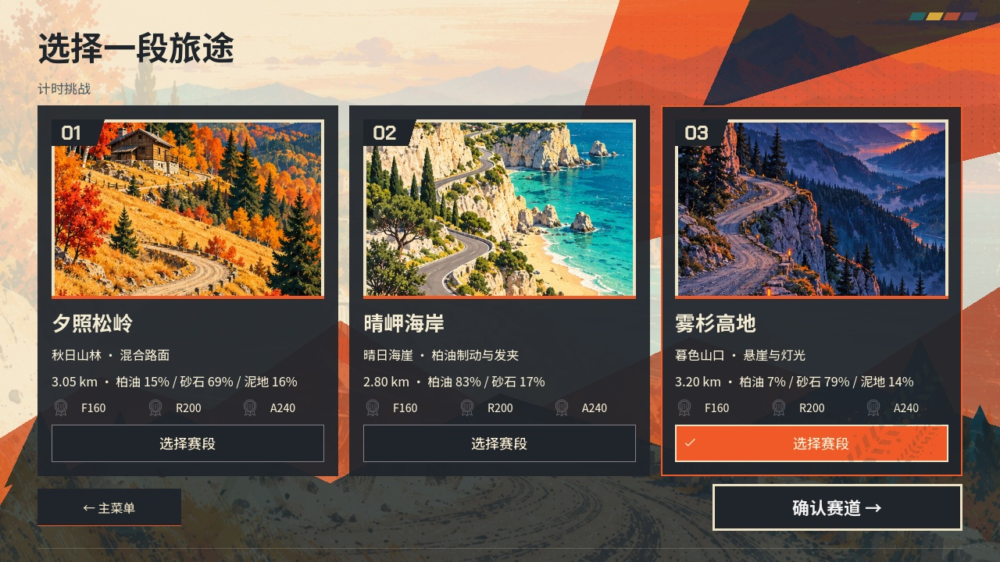
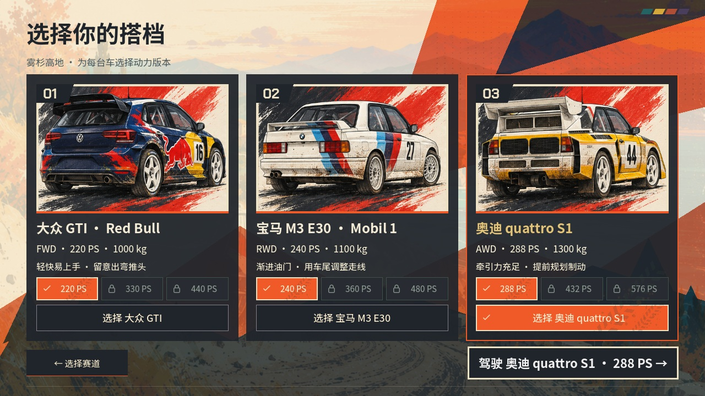
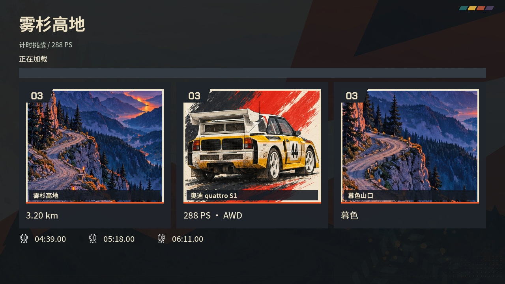
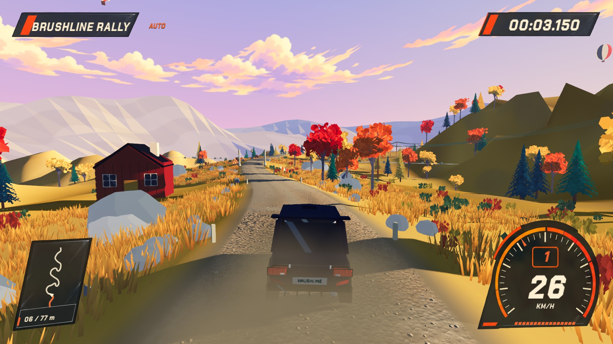
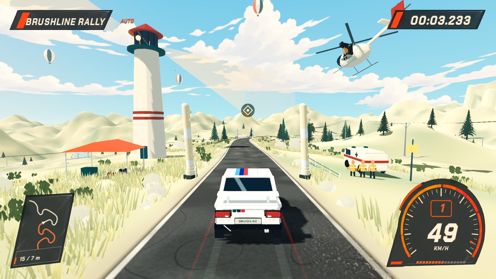
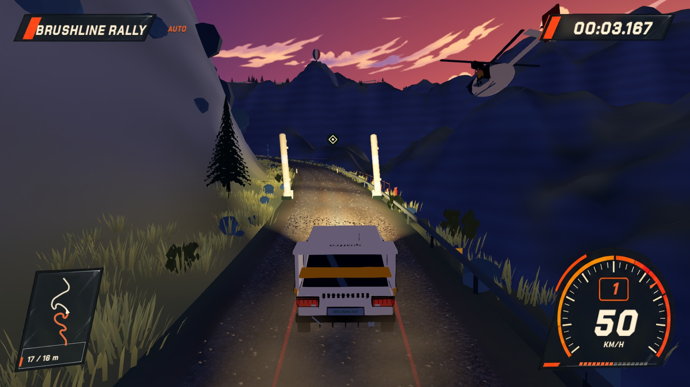

# Brushline Rally 本轮实施与验收

最新检查点概念、实机效果与验证见 [三赛道光柱](light-checkpoints/README.zh-CN.md)。

最新车辆展示及泥地诊断见 [车辆展示修整](vehicle-polish/README.zh-CN.md)。

最新菜单素材见 [Blender 透明模型渲染](menu-models/README.zh-CN.md)。

后续界面修正见 [菜单与回放验收](menu-polish/README.zh-CN.md)，本页性能与验证包数据仍对应原批次。

状态：开发验证版，不创建新正式 Release。应用内部数字版本暂沿用 0.4.0；新名称包用于本轮验证，不能与已发布的 Art Rally 0.4.0 视为同一内容。

## 已接入

- 新品牌标题、HUD、布旗、起终点字标、默认牌照、应用图标及包名；仓库与工作目录保持 Art-Rally。
- 旧 Art Rally 目录的档案、备份、设置、幽灵、相册复制与校验；失败时保留旧档并显示只读提示。用户牌照不替换。
- 松岭正式真人金牌解锁后两赛道，练习始终开放；旧有效成绩保留赛道权益。选择页与发车／结算共用查询，失败保存不提前解锁。
- 高地碰撞去除隐形平面、增加与可见山体对应的碰撞，崖侧真实失去支撑；高地赛道版本 8，其他赛道／车型／规则兼容键不变。
- 蓝紫暮色及橙红余晖、真实车灯照路、五处不碰撞车辆的近距离落石与声音；海岸配色强化。
- 三格旅行与赛车画册、加载地标插页、固定背景、45 ms 错峰入场与短退场、减少动态效果选项。加载页无实机截图、无百分比。
- Blender 车辆尾部、气柱、气球、五种动物、记者直升机、补给棚、帆船、终点旗手与观众。普通环境不加描边，保留物理和挂点。
- 稀疏且固定在路面的材质磨损、方向性车辙；不修改抓地参数。
- 120 秒固定松岭后驱演示，三个单画面机位，真实控制与载荷／滑移／轮胎力遥测，暂停／退出／重播，成绩与图库隔离。

## 验证证据

测试日志保存在 `logs/brushline*`，最终摘要与性能 JSON 随本目录归档。`drive-matrix.json` 是三赛道 × 三车型 × 三动力档的完整自动驾驶结果，27 个组合全部完赛、零恢复，81 项检查通过。自动驾驶不等于真人驾驶验收。

`demo-telemetry.json` 来自实际 Metal 窗口（1280 × 720、60 FPS 上限）的两分钟驾驶，约 8.69° 侧滑，反打后恢复、零重置。10 Hz 遥测采样记录可验证过程。固定演示性能不替代三条赛道性能。

`baseline/` 的三张旧画面与短采样指标是历史画面基线，不冒充全程性能。另用原提交 784afbf、同一机器和 `first_playable_perf.gd` 跑全程，最终对比记录在本目录的性能 JSON。

## 实机画面

## 仍需人工或对应设备验收

- 金牌阈值仍是工程目标；需熟练真人基准跑标定，不称为已标定。
- Windows 只能完成交叉导出、PE／包结构检查；真实 Windows 图形、音频和输入验收待对应机器。
- 实体手柄、不同耳机／扬声器以及全部九个基础组合的人工完整巡查未由自动输入代替。本轮会记录原生窗口与模拟手柄检查，不能宣称实体设备已验收。
- 生图插画是美术资源，不能当作实机还原度证据。高地帧率以实测最终数据为准，不因完成打包就标记满足 60 FPS。

历史 `FIRST_PLAYABLE_*`、0.3.x／0.4.0 发布报告保留，用来解释当时状态；本文件及附带数据是本轮交付依据。

## 最终验证结果与验证包

核心实现提交：`a8fc70e`；Blender 与品牌资源提交：`a5f9d07`。2026-10-21 在 Apple M5 / Godot 4.7.2 / Metal Forward+ 上完成本轮检查。

- 69 个功能测试脚本最终全部通过，见 `test-summary.json` 和 `test-logs/`。首轮 67 个脚本有一项落石路径安全间距失败；修正弯道投影后该项 56 个检查全部通过，再补充菜单入口与原生演示测试。保留首轮失败标记，未降低安全间距标准。
- 电线杆落地、道路间距、最大高度与导线净空分项通过；男女 ROCKFALL 资源随包导出。声音资源与播放链检查不代表耳机／扬声器主观听音验收。
- 九种车型／动力组合下，静止、倒车及行驶的落石间距与真实坠崖恢复检查通过；五处原生追尾捕获最近间距约 1.50～1.81 米，零恢复。浮点计算有约 0.00002 米误差。
- 原生 120 秒演示平均 59.50 FPS，P95 / P99 帧耗时 16.949 / 17.465 ms，实际发生反打并恢复；物理 P95 / P99 为 1.772 / 2.049 ms。演示不写最佳成绩、解锁或个人幽灵。
- 连续十次切换后节点 81、资源 165、孤立节点 0 均稳定；第二次至第十次内存约 227.33→227.44 MB，未出现持续的节点或资源增长，见 `lifecycle.json`。
- 720p、1080p 与 2560×1080 画册页面进行了原生窗口截图检查，插画不再挤成横条；动画和键鼠／模拟手柄测试通过，实体手柄仍待人工复核。

同机、同 1080p 设置的 A240 完整赛段性能（平均 FPS；P95 / P99 帧耗时）：

- 松岭：旧版 57.49；23.570 / 32.033 ms → 本轮 59.97；18.199 / 20.605 ms。
- 海岸：旧版 57.19；24.414 / 35.616 ms → 本轮 60.19；18.346 / 21.154 ms。
- 高地：旧版 48.10；36.338 / 50.915 ms → 本轮 57.04；24.342 / 35.458 ms。

数据来自实际桌面运行，存在系统调度波动；高地仍未达到稳定 60 FPS，不能标记该性能验收完成。最终、原始基线和优化中间数据均单独保留。27 个组合回归验证完赛与恢复；完整原生性能采集为每条赛道 A240，不将它写成 27 个组合均已完整性能验收。

已生成新名称验证包：`Brushline-Rally-macos-universal.zip` 和 `Brushline-Rally-windows-x86_64.zip`，校验值见 `SHA256SUMS.txt`。macOS 实际导出应用启动检查通过，bundle ID 为 `com.yicongcao.brushlinerally`；Windows PE x86-64 与 ZIP 结构通过，未进行 Windows 实机验收。macOS 为本地验证签名，非 Developer ID 公证发行包。本轮不创建正式 GitHub Release。

常用目录中的验证包放在 `builds/brushline-validation/`；运行源码使用 `./scripts/dev.sh run`。已有自定义车牌与旧目录保留，迁移失败会明确提示。金牌人工标定、Windows 实机与实体输入／听音验收继续待办。
