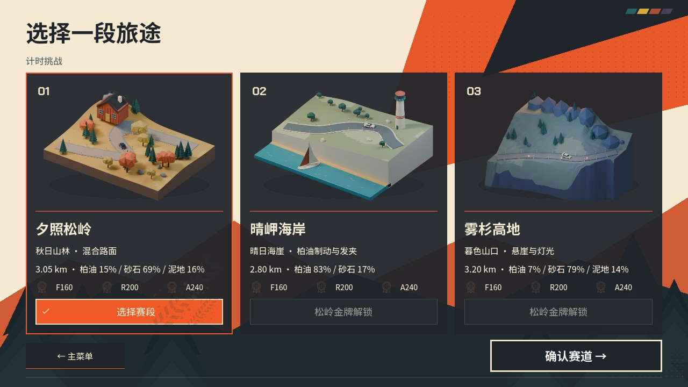
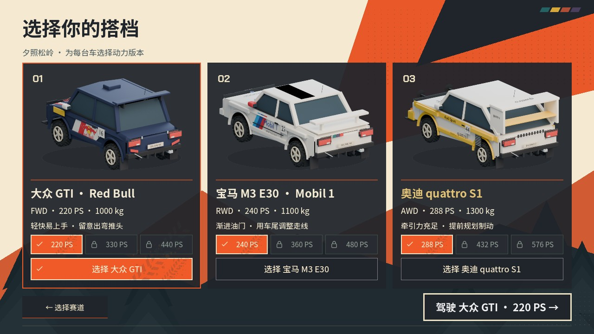
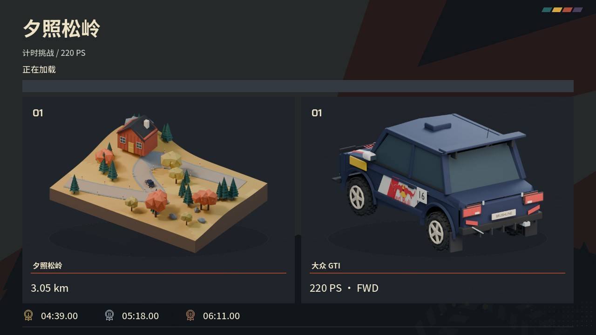

# Blender 透明菜单模型

后续车辆正面机位、拉花与加载缩放见 [车辆展示修整](../vehicle-polish/README.zh-CN.md)。以下截图记录初次接入。

2026-10-21：赛道选择、车辆选择和加载页改用 Blender 模型渲染，替换这三个页面的生成式插画和背景插画叠层。标题页及宣传 banner 保持原样。

## 素材与接入

- 三个赛道微缩模型：秋林木屋与砂石弯道、海崖灯塔与帆船、暮色山壁与临崖路。它们是主题示意，不是精确导航地图。
- 三辆车直接复用现有 Blender 赛车源模型，补齐轮胎、轮毂与展示车牌，以后侧三分之四视角呈现实际涂装。
- 六份独立可编辑源文件：`art_source/menu_models/*.blend`。车辆与道具的游戏源文件未修改。
- 六张 1024×768、straight RGBA PNG：`assets/ui/menu_models/*.png`。Cycles 40 samples、降噪，透明边缘有抗锯齿；Godot 开启 mipmap。
- `manifest.json` 记录源文件、渲染参数、透明比例和 SHA-256。透明像素比例为 55%～72%，并断言存在不透明主体和中间 alpha 边缘。
- UI 只裁掉透明留白，自适应缩放完整模型轮廓；不铺图片矩形底色。加载页复用所选赛道与车辆的两个模型。
- 移除旧选车页额外的实时小预览，避免重复模型与隐藏 SubViewport 开销。运行游戏不需要 Blender。

## 重新渲染

在仓库根目录执行：

```sh
/Applications/Blender.app/Contents/MacOS/Blender --background --python scripts/render_menu_models.py
```

默认读取已有 `.blend`，保留手工编辑。加 `-- --only=F160` 仅渲染一辆车；`-- --build` 只创建缺失源文件。`-- --rebuild` 会重新生成源模型，仅用于明确需要重新搭建场景时。`.gdignore` 阻止 Godot 直接导入制作源文件。

## 验证

- 原生 Godot Metal 窗口：1280×720、1920×1080、2560×1080 的三个页面均适配屏幕；检查透明叠加、完整轮廓、锁定与选中状态。
- `menu_polish_layout_test.gd`：126 项通过，包括实际 PNG 资源加载、控件边界与回放覆盖层检查。
- `menu_controller_test.gd`：35 项通过，模拟 GUI 手柄输入确认、返回与焦点；不替代实体手柄验收。
- `first_playable_flow_test.gd`：30 项通过，选择、动力档与场景加载流程正常。
- 合计 191 项、0 失败；Godot 导入与三份测试日志无 ERROR / SCRIPT ERROR。Python 脚本编译通过。
- 本轮只更新源项目，未重新生成发布 ZIP。旧版性能报告和旧界面截图保留为历史证据。




