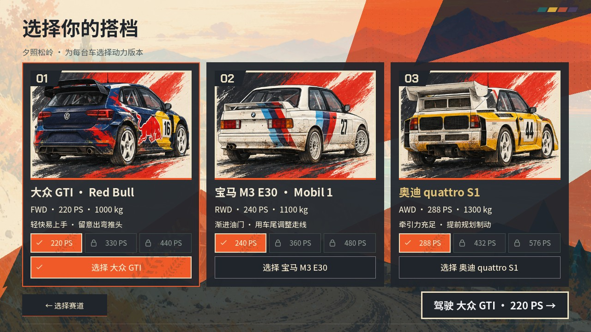
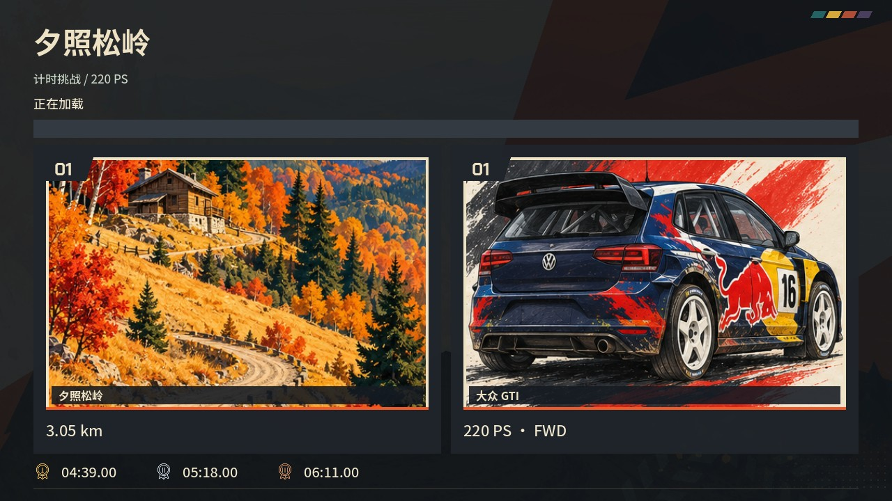
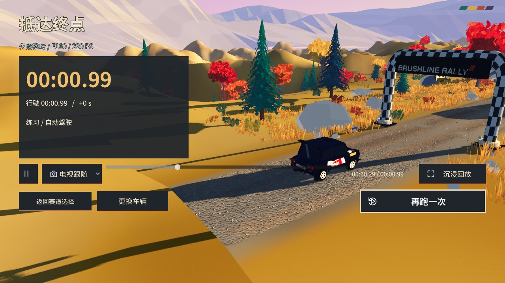

# 菜单与回放细节修正 · 2026-10-21

移除赛后回放的左深右浅全屏渐变，仅对标题文字加细描边以保证亮天空前的可读性。地图与车辆选择使用固定屏内布局，插画共享剩余高度，不再创建滚动容器；确认／返回与三车各自的动力档全部留在屏内。加载页仅保留地图和车辆两块插画，奖牌 SVG 使用金、银、铜对应色。暂停设置移除更换车辆与计时／练习入口。

实际 Godot Metal 窗口检查 1280×720、1920×1080、2560×1080 的插画和按钮边界，并以实际记录轨迹进入赛后回放。布局／回放测试 102 项、手柄 GUI 模拟输入 35 项、游戏流程 30 项、确认返回布局 30 项、车牌与奖牌 42 项，共 239 项通过。模拟输入不替代实体手柄验收。日志和原生截图随本目录保存。

本次仅交付源码与运行资源修正，不重建上一批验证 ZIP，旧 ZIP 仍对应其 SHA256 与原核心提交。

