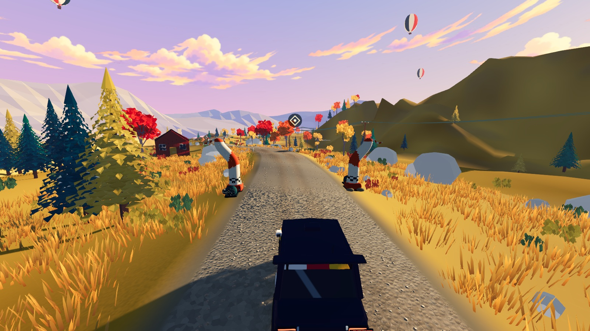
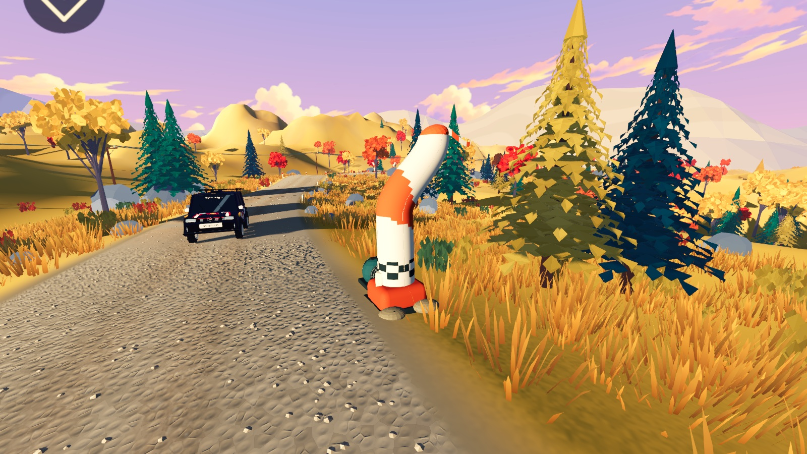
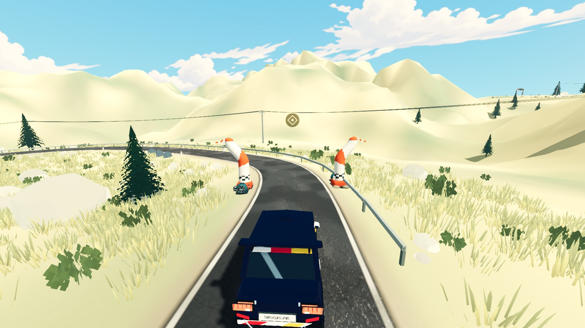
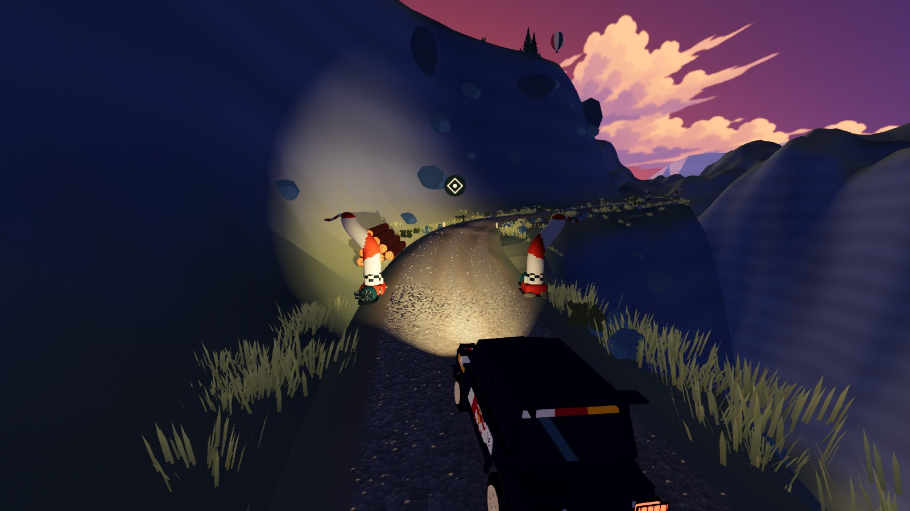

# 高压弯角气柱 · 方向 A

2026-10-21：已将三赛道的中间检查点替换为 Blender 制作的高压弯角气柱。起终点继续使用既有充气拱门。

## 实现

- 暖白膨胀柱身、朱橙斜色带、深墨色／暖白方格袖口；两侧弯头都朝道路外侧。约 3.47 米高，压重底座、扣带、沙袋、鼓风机格栅和波纹软管组成完整设备。
- 柱身轻微弹性摆动，末端布尾快速颤动；机器与底座固定。通过检查点时增加短促摆动，远处降低布尾细节。暂停冻结动画并暂停声音。
- 原创四秒风机循环使用环境音总线、距离衰减；全场最多复用两个空间声源，仅播放最近检查点的两台风机。
- 保留所有材质色块并合入一个 MultiMesh，不再由旧 shader 覆盖整个模型的配色。每组左右设备旋转朝向跟随路线，避免负缩放。
- 视觉设备没有新增碰撞。路线、检查点位置、车身擦边判定、漏点罚时、成绩和幽灵兼容键均未改变。

## 资产与维护

- 权威源：`art_source/screenprint/props/checkpoint.blend`；交付：`assets/screenprint/props/checkpoint.glb`。单台设备 9,188 三角面，包含 `BlowerAudio`、`StreamerRoot` 挂点。
- `scripts/build_pressure_checkpoint.py -- --replace-checkpoint` 在 Blender 内执行，仅重建此源模型；手工精修后不要再次覆盖源文件。
- 常规导出：Blender 后台运行 `scripts/export_screenprint.py -- --only=checkpoint`。
- 材质名 `Air*`、`Ribbon*` 分别烘焙为柱身／布尾动画标记，其余部分保持刚性。顶点颜色保留 Blender 材质颜色。
- `scripts/generate_checkpoint_audio.py` 保存风机声生成过程，无外部采样。音频峰值约 0.373，循环首尾相邻样本差约 0.00375，无削波。
- `concept-A/B/C.png` 为前一轮 imagegen 草图，完整提示词在 `concept-prompts.json`；仅 A 用于本次建模参考。下方图片均为实际 Godot 渲染，不是概念图。

## 验证

Godot 4.7.2 / Apple M5 / Metal Forward+，1600 × 900 原生窗口：检查松岭、海岸、高地的方向、色带、底座和夜间车灯响应。局部截图脚本为 `scripts/dev/pressure_checkpoint_capture.gd`，使用隔离档案和练习模式。

- 新测试：无头模式 42 项，原生模式 48 项，全部通过；覆盖两侧朝向、摆动包络净空、材质保留、固定部件、实例状态传输、风机播放、暂停、通过反馈与远处停声。
- 回归：车身检查点 7 项、赛段规则 20 项、品牌资产 40 项、套色资产 103 项、驾驶表现 23 项，全部通过。
- 日志与摘要见本目录 `checkpoint-*.log`、`validation.json`。导入及原生截图无脚本或 shader 错误。
- 本轮为局部视觉与功能验证，不代表完成全程帧率复测、Windows 实机或耳机／扬声器主观听音验收。未生成新发布包。

