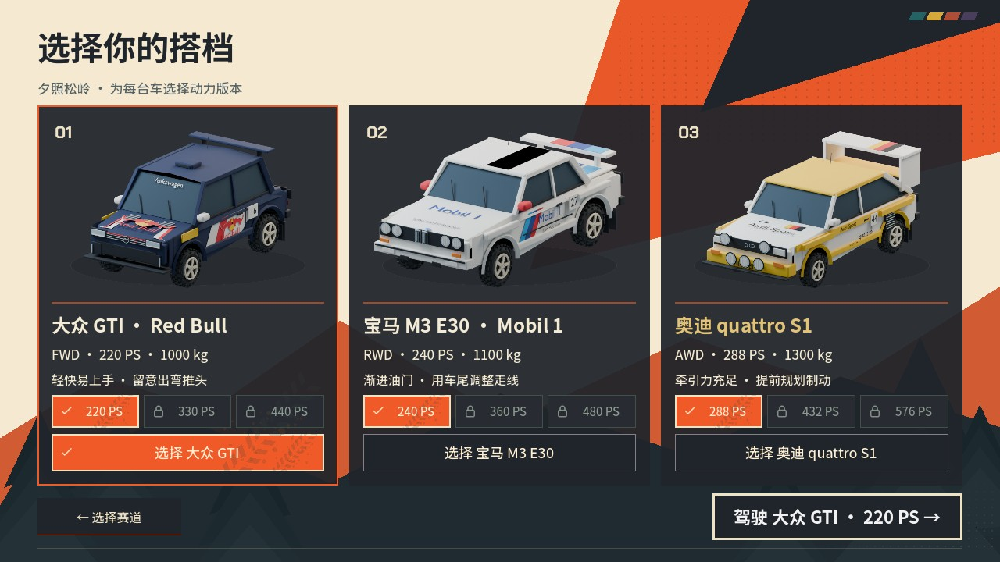
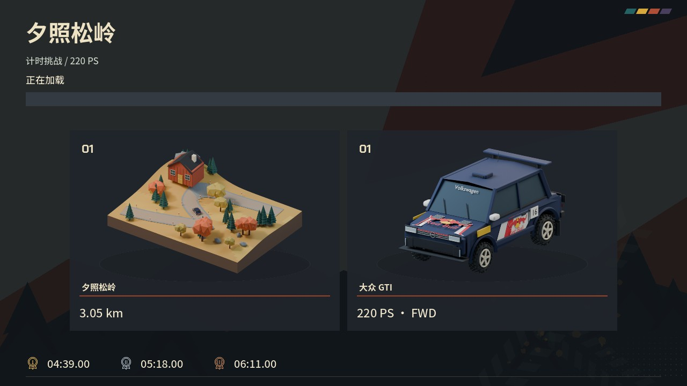
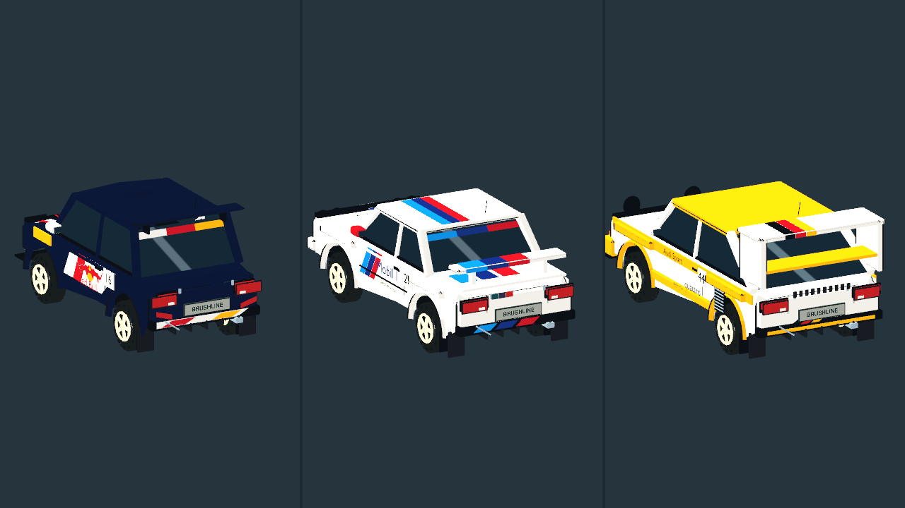

# 车辆拉花、正面展示与泥地低速诊断

2026-10-21。美术与 UI 已接入；车辆物理、路面参数、成绩版本和幽灵兼容键未修改。

## 本轮画面

- 车辆卡片与加载页改为前侧三分之四机位，继续使用透明 Blender 渲染。
- Audi S1 的车顶及两侧车顶边条为黄色；删除尾翼顶部及端板的 quattro 字样，替换为黑／红／黄条带。
- E30 尾翼增加浅蓝／深蓝／红三条色带，从翼面延伸到后缘，行李厢盖延续同色拉花。
- 三车新增不同配色的后窗上沿贴条、后保险杠拉花，保留车牌和灯具。游戏、回放与幽灵通过共享外观入口使用同一组 GLB。
- 加载双卡片左右各留 7% 内边距、上下各留 8%，减少模型和板块占屏；保留两个板块及奖牌颜色。

`refine_racing_livery.py` 在已有 `.blend` 上做局部修改；`export_screenprint.py` 重新导出三档 LOD。没有重建车体、修改碰撞或移动任何挂点。`render_menu_models.py` 的车辆机位同步更新，六个菜单源场景重新渲染。

## 验证

- 原生 Metal 窗口查看选车、加载与三车后侧实际游戏材质。1280×720、1920×1080、2560×1080 布局检查：126 项通过。
- 美术／机械兼容测试：103 项通过，三车三档 LOD 的所有功能挂点与上版逐项一致，机械资源哈希保持一致。
- 合计 229 项，0 失败。导入、截图与测试日志没有 ERROR / SCRIPT ERROR；Python 编译和 diff 检查通过。
- 泥地另完成 14 个受控实验，原始 10 Hz 数据与诊断脚本保留，详见下方报告。实验中的阻尼、滚阻及辅助开关仅改变该进程内的对象，未保存为游戏标定。
- 本轮未重新打包或发布 Release。

[泥地慢速诊断与下一轮建议](MUD_DIAGNOSIS.zh-CN.md)
