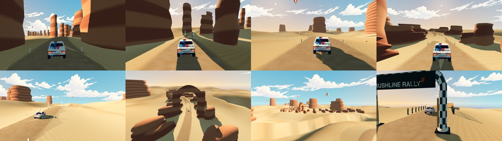
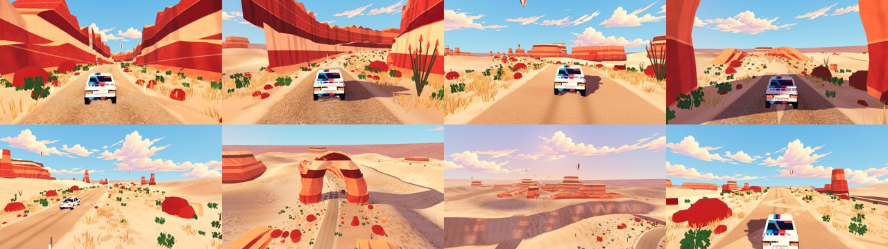
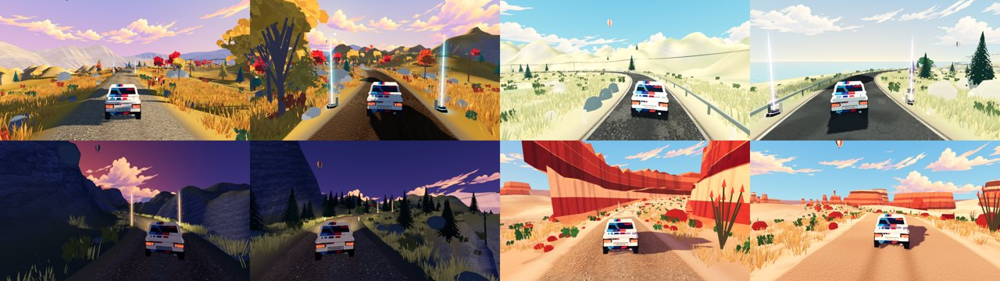
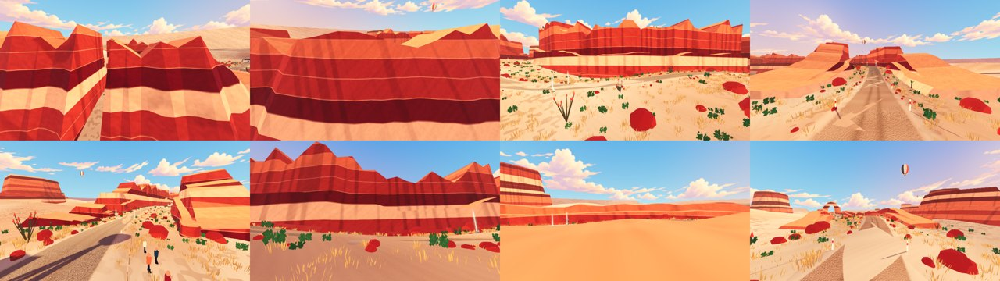
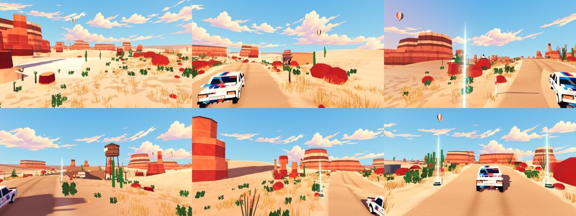

# 赤岩峡谷审美与可玩性验收标准

基准为前三条赛道（夕照松岭、晴岬海岸、雾杉高地）在相同机位下的实机截图。截图与指标由
`scripts/dev/stage_art_capture.gd`（8 个等距追尾机位与 6 个构图机位，1280×720，R200）和
`scripts/dev/art_metrics.py` 生成，同一组机位用于改造前后对照。

## A. 审美标准

| 编号 | 要求 | 判定方式 |
| --- | --- | --- |
| A1 主题光色 | 一个明确的时间与色彩主题，天空不是单一蓝色；太阳低角度产生可见长影 | 天空含暖色地平线；太阳仰角 ≤ 22° |
| A2 前景层次 | 每个追尾机位路肩 25 m 内有草丛、灌木或碎石，不出现大面积纯色平地 | 路面以下区域强边缘占比 `ground_detail` 平均值 ≥ 前三条最低值（0.152），单帧不低于 0.10 |
| A3 中景与远景 | 中景有岩壁或台地，远景有成层的地平线剪影；至少三层景深 | 人工检查全部追尾机位 |
| A4 峡谷可读 | 前 900 m 两侧有连续的岩壁走廊，不是孤立柱子；壁面有断层、台阶与崖顶 | 构图机位 `canyon-reveal`、`chase-0/1` |
| A5 地标 | 石拱横跨路线、比例宏大、轮廓风蚀不规则；终点台地可俯瞰 | `arch`、`mesa`、`finish` 机位 |
| A6 风格统一 | 岩石使用屏印分级明暗与平涂色带，阴影偏暖紫，不出现平滑塑料或写实 PBR 感 | 与车辆、老赛道道具同屏比较 |
| A7 生活痕迹 | 观众、医疗与工作人员、直升机、热气球、鸟群、动物与路边设施都存在且符合沙漠 | 场景节点检查；不出现驯鹿、熊等不合生境动物 |
| A8 色彩丰富度 | 画面不被单一沙黄色主导 | `hue_families` 平均值 ≥ 3.0，`colourfulness` 不低于前三条最低值（0.178） |
| A9 路面可读 | 行车线与周围沙丘有明显的明度或色相差，车辙与路肩可辨 | 追尾机位人工检查 |
| A10 实体封闭 | 岩壁、石柱、台地、巨石都是封闭实体，从任何机位都看不到空心内部或透过缝隙看到天空 | `redrock_art_test` 统计地面以上的开放边，必须为 0；外侧环视截图 |
| A11 中段节奏 | 900–2250 m 沙丘段每 200–300 m 出现一处可辨认的沙漠主题地标，并有区别于丝兰的高大植物 | 场景节点与位置检查；地标机位截图 |
| A12 菜单一致 | 赛道缩略图与车型图使用与其他赛道、车型相同的 Blender 透明渲染风格 | 赛道选择和车辆选择界面截图 |

## B. 可玩性标准

| 编号 | 要求 | 判定方式 |
| --- | --- | --- |
| B1 完赛 | 八车 × 三档全部完赛、零复位 | `first-playable-matrix --stage=redrock_canyon` |
| B2 节奏 | 中位完赛时间与平均速度落在前三条区间附近（203–242 s，46–49 km/h），沙地路段不应比砂石赛道显著更快 | 矩阵结果 |
| B3 通道 | 新增装饰的碰撞体不得进入行车通道；车道上方 1.7 m 内无障碍物 | `route_revision_test` 通道射线 |
| B4 视线 | 新岩壁不得遮挡弯心与下一路段的可读方向，路标在弯前保持可见 | 构图机位与追尾机位人工检查 |
| B5 性能 | 1080p 平均帧率与 P95 帧时间不劣于海岸基线 5% 以上 | `expansion_perf_probe.gd` |
| B6 回归 | 现有赤岩、沙地、车库与通用表现测试全部通过 | 受影响测试套件 |

## 改造前基线（2026-10-22）

| 赛道 | contrast | ground_detail | 最低单帧 | colourfulness | hue_families | sky_fraction |
| --- | --- | --- | --- | --- | --- | --- |
| 夕照松岭 | 0.235 | 0.378 | 0.285 | 0.300 | 3.1 | 0.17 |
| 晴岬海岸 | 0.215 | 0.270 | 0.203 | 0.178 | 3.9 | 0.25 |
| 雾杉高地 | 0.161 | 0.152 | 0.104 | 0.182 | 5.6 | 0.03 |
| 赤岩峡谷（改造前） | 0.204 | **0.099** | **0.051** | 0.242 | **2.8** | 0.20 |

改造前未达标项：A1、A2、A3、A4、A5、A6、A7、A8、A9；B2 偏快（53.2 km/h）。

## 改造后结果（2026-10-22）

| 指标 | 改造前 | 改造后 | 门槛 | 结论 |
| --- | --- | --- | --- | --- |
| ground_detail 平均 | 0.099 | 0.258 | ≥ 0.152 | 通过 |
| ground_detail 最低单帧 | 0.051 | 0.221 | ≥ 0.10 | 通过 |
| colourfulness | 0.242 | 0.414 | ≥ 0.178 | 通过 |
| hue_families | 2.8 | 3.5 | ≥ 3.0 | 通过 |
| contrast | 0.204 | 0.197 | 参考（老赛道 0.16–0.24） | 区间内 |

| 编号 | 结论 | 依据 |
| --- | --- | --- |
| A1 | 通过 | 太阳仰角 17°，沿第一段路侧向打光；杏色地平线、天青天顶、暖色云；岩壁投下长影 |
| A2 | 通过 | 路肩干草、丝兰、红果灌木、刺树与红色碎石（`redrock_art_test` 计数：丝兰／刺树 465，干草簇 29191） |
| A3 | 通过 | 近景路肩、中景峡谷壁／石柱、远景台地与两层环形台地剪影 |
| A4 | 通过 | 110–890 m 两侧连续台阶式岩壁，最高超过 20 m，弯内侧自动后退 |
| A5 | 通过 | 石拱跨度超过 40 m、拱顶高于 25 m，截面平滑风蚀；终点设台地观景台、遮阳帆与观众，终点崖面显示地层 |
| A6 | 通过 | 岩石改为与车辆相同的三级分色光照，色带平涂、暗部偏暖紫，去掉平滑漫反射 |
| A7 | 通过 | 五组观众、医疗与工作人员、矿区服务站、风车水塘、热气球、鸟群、直升机；动物限袋鼠与鸵鸟 |
| A8 | 通过 | 见上表 |
| A9 | 通过 | 行车线为更深的压实红土，带两道车辙与浅色路肩沙埂 |
| B1 | 通过 | 八车 × 三档 24/24 完赛、零复位 |
| B2 | 部分通过 | 中位 241.4 s、53.2 km/h，与改造前相同；本轮只改视觉不改路线和物理，比老赛道快约 4 km/h 的问题留待真人标定 |
| B3 | 通过 | 车道两侧 ±1.6 m、2.4 m 高射线零命中；`route_revision_test` 通道检查通过 |
| B4 | 通过 | 岩壁离路缘最近 5.5 m；弯内侧岩壁后退；追尾机位路标与下一段路线可见 |
| B5 | 通过 | 交替运行各 6 次，1080p P7：改造前中位 65.5 FPS / P95 21.8 ms，改造后 65.2 FPS / P95 20.3 ms |
| B6 | 通过 | 赤岩、路线、地形、表现、扩展基础、路肩、沙地样板、车库物理与漫画表现等套件零失败 |

性能数据受本机约 60 FPS 显示节奏影响，波动较大；只说明所测片段未见退化。真人试驾、实体手柄与审美的人工复核仍需用户确认。

## 第二轮复验（2026-10-22，玩家反馈后）

玩家试玩发现三个问题：山体是空心的、外表面有漏缝能看到天空；赛道选择缩略图与其他三张风格不一致；中段景物单调。另外新 P7 建模与实车不符。

- **A10 实体封闭：通过。** 原因是岩壁截面只有正面和背坡、两端敞口，台地与石柱没有底面，倾斜放置或沙丘起伏时露出内部。现在岩壁每段连续区间两端都加封口，背坡和坡脚下沉到地面以下，岩块加底面，远处台地按四角地形下沉。测试检查所有岩石网格地面以上的开放边，结果均为 0；从岩壁外侧、上方和断口共 8 个机位复查。

- **A11 中段节奏：通过。** 沙丘段新增盐碱滩（1180 m）、土坯贸易站与补给皮卡（1330 m）、游牧营地与骆驼（1560 m）、鬼镇水塔和木屋（1840 m）、平衡石（2050 m），以及成片的巨柱仙人掌、约书亚树、三股旋转尘卷风和每 95 m 一处的路线石堆。

- **A12 菜单一致：通过。** 赤岩缩略图改为与其他三条相同的 Blender 透明立体沙盘：成层台地崖壁、石拱跨路、风车水塔、矿井井架、遮阳棚、丝兰与刺树，沙盘上停着 P7。五台扩展车的车型图也改为同一渲染管线，取代原来带天空背景的 Godot 截图。
- 图像指标：ground_detail 0.259（最低单帧 0.223）、colourfulness 0.415、hue_families 3.5，仍高于老赛道门槛。
- B1：24/24 完赛、零复位，中位 241.4 s。B3：通道射线零命中。B5：与上一提交交替各 6 次，中位 119.8 对 120.0 FPS，P95 9.39 对 9.35 ms。

## 第三轮：赛道外抓地与刹停（2026-10-22）

玩家反馈：在赤岩偏出主路后刹不住，车一直往外飘。

**原因不是摩擦力，而是赛道外没有碰撞。** 路面网格的碰撞只覆盖道路中心两侧 22 m；在这之外，看得见的地形没有碰撞体（只有高地赛道给地形单独建了碰撞）。车开出 22 m 后就穿过地面掉下去，轮子离地，刹车自然无效，表现为一直往外飘。用 `scripts/dev/offroad_stage_audit.gd` 实测：以 90 km/h、偏离 20° 冲出路面并全力刹车，改造前松岭 22/24、赤岩 17/24 能停住，赤岩 7 次、松岭 2 次掉穿地面；海岸道路两侧较平，偶尔也会越过 22 m。高地的山崖一侧本就设计为可坠落，不在此列。

- **修复：** 松岭、海岸、赤岩三条赛道在 16–70 m 范围内，用与可见地形完全相同的三角形建碰撞（`RunoffTerrainCollision`），表面取各赛道的路肩材质；22 m 内仍由路面网格负责，二者重叠无缝隙。
- **软沙抓地：** 赤岩路外的松软沙地原摩擦系数 0.51，是全游戏最低（草地 0.75），刹车距离也最长。调到 0.66、侧向 0.76 后，60 km/h 全力刹停距离从 23.1 m 降到 19.1 m，接近压实沙地，同时仍比路面慢、有沙地的感觉。
- **结果：** 三条赛道 90 km/h 冲出路面全力刹车 24/24 都能停住，零掉穿；边刹边往回打方向盘，最大偏离 22–23 m。新增 `offroad_runoff_test`：在复位边界内的地形射线必须命中，每条赛道 90 km/h 冲出路面必须刹停。
