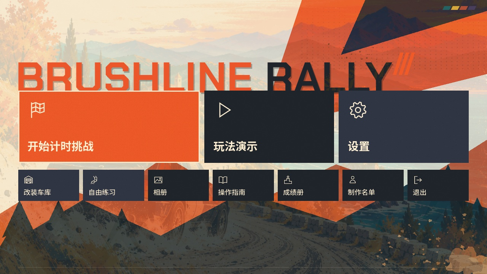
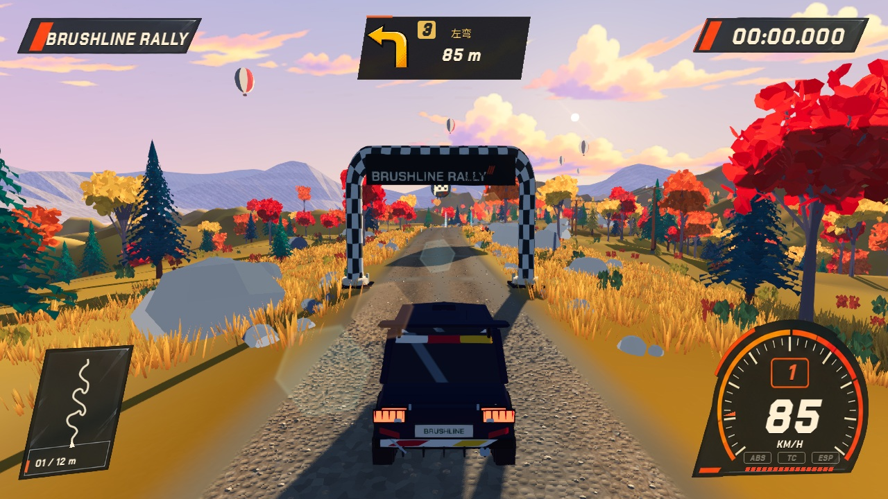

# 路书、标题界面与加载优化

2026-10-22；基线提交 `4b8473c`；Godot 4.7.2 / Metal Forward+ / Apple M5。

## 界面

- 路书箭头右上方增加数字角标，并为数字保留独立空间，不遮挡左右箭头尖端。
- 路书扩展为 **1–6 级，1 最急、6 最缓**。角标颜色依次为橙红、橙、琥珀、黄绿、薄荷绿、青蓝，数字始终保留。这是弯道等级，不是建议变速箱挡位。箭头轮廓仍表达测得的弯曲角度，等级按弯道半径确定。
- 以 20 米水平朝向窗口平滑曲率，在连续同向弯 ±96 米内取最小半径，遇反向弯或持续直线停止。1–6 级半径范围分别为 <25、25–40、40–65、65–100、100–160、≥160 米；生成的数字代码由 HUD 与语音共用。分档是本项目约定，并非道路通行速度建议；保留原提示位置、危险提示窗口和旧代码兼容。
- 继续使用原 Kokoro 中文音色（女 zf_001、男 zm_010），新增左右各六级、男女共 **24 条**离线语音，游戏运行时无需模型或联网。生成入口 `scripts/generate_pacenotes.py --grades`；[音频格式/时长/峰值记录](voice-validation.json)，[女声左三](../../../assets/audio/voice/female/LEFT_3.wav)、[男声右一](../../../assets/audio/voice/male/RIGHT_1.wav)。
- “进入自由改装车库”改为“改装车库”，移入第二排第一格，新增卷帘门车库图标。
- 标题页十个按钮的图标全部改为 CanvasItem 直接绘制的矢量几何。旧 SVG 曾被导入为小纹理再放大；新的图标直接按窗口实际分辨率栅格化，不依赖小尺寸贴图。
- 标题底部遮挡从约 24 个逻辑像素减少到 5 个。右下角新增固定随机种子的泥泞飞溅，处于背景层，不遮挡按钮、不捕获输入。



[标题界面 1080p](home-1080.jpg)




其余等级：[二级](left_2.jpg)、[四级](right_4.jpg)、[五级](right_5.jpg)、[六级](left_6.jpg)。

## 加载与渲染改动

1. 静态地形高度与渲染网格按赛道内容指纹缓存。指纹包含采样路线和所有存储的赛道属性；定义改变会失效。最多保存两个地形条目，顶点/法线数据的估算预算为 96 MiB，不是进程总内存上限。
2. 复用各生态的静态植被网格，保留最近一条赛道的植被布置计划。仅缓存资源、变换、颜色、布置记录和随机数状态，不缓存 Node、车辆、计时器或玩家状态。每次进入仍建立独立场景节点与地形材质。
3. 地形按 48 × 48 网格单元拆成可独立视锥裁剪的块，保持原来的全部三角形和法线；碰撞与地形高度采样保持原结果。
4. 草地渲染批次从沿路 160 米缩小为 40 米，保留所有植被实例与原有可视距离；仙人掌与约书亚树按 120 米空间格分批，避免跨越整段沙漠的大包围盒。
5. 最近道路查询只在确定最近段后创建结果字典，减少生成阶段的临时分配。

缓存用内存换取重复加载速度；地形预算不含驱动副本，最近植被计划与各生态基础网格也会占用额外内存。退出进程后缓存释放，没有写入玩家档案或磁盘缓存。

## 本机前后对照

同一探针、相同车辆 R200、相同赛道 600 米处起步、相同 1080p 离屏渲染目标；固定 60 Hz 模拟，预热 120 帧后采样 300 帧。每个版本每张图连续进入两次；性能采样期间没有并行运行测试或其他 Godot 渲染探针。加载计时包含场景生成与现有过渡，不含程序启动和首次导入资源。

### 松岭

- 首次场景加载：**8.87 → 8.37 秒**，约减少 5%。
- 同进程再次进入：**8.72 → 5.45 秒**，约减少 37%。
- 两轮平均帧率：**57.6 → 58.7 FPS**。
- 平均渲染图元：约 **250.7 万 → 225.3 万**，减少约 10%；绘制调用略有增加。
- P99 帧时间：约 **24.5 → 22.4 ms**。

### 赤岩峡谷

- 首次场景加载：**6.16 → 5.78 秒**，约减少 6%。
- 同进程再次进入：**5.99 → 4.34 秒**，约减少 28%。
- 两轮平均帧率：**56.4 → 59.9 FPS**。
- 平均渲染图元：约 **100.3 万 → 84.9 万**，减少约 15%；绘制调用略有增加。
- P99 帧时间：约 **27.4 → 21.9 ms**。

帧率收益较小，本次更明显的收益是重复进入与渲染图元减少。以上为两轮短片段的本机观测，受 60 Hz 探针设置与系统调度影响，不代表全赛道、所有车辆或其他机器的稳定增幅。海岸与高地做了功能/地形回归，没有单独采集性能增幅。

原始数据：[performance.json](performance.json)，[松岭优化前](perf-before-sunset.log)、[松岭优化后](perf-after-sunset.log)、[赤岩优化前](perf-before-redrock.log)、[赤岩优化后](perf-after-redrock.log)。对照版本与优化版本的路线进度相同。

## 验证

**14 组测试，601 项检查，0 失败**；最终日志无 Godot 脚本或资源错误。

- [菜单与角标](menu_pacenote_polish.log)：90 项；六级曲率边界、旧代码兼容、四赛道显示/语音代码一致，720p、1080p、超宽布局，第二排顺序，全部矢量图标，实际 Viewport 输入路径打开车库。
- [地形缓存](terrain_cache.log)：11 项；定义/路线变化失效，全部三角形保留，材质独立，布置与随机序列一致，缓存容量与淘汰。
- [HUD](hud.log)：34 项；角标不遮挡箭头，原仪表/输入提示回归。
- [漫画表现](comic_presentation.log)：36 项；原六种箭头轮廓与其他表现回归。
- [地形细节](terrain_detail.log)：64 项；四赛道地形、路肩、植被接地与碰撞射线。
- [菜单手柄导航](menu_controller.log)：35 项；焦点、确认、返回、设置导航。
- [赤岩美术结构](redrock_art.log)：50 项；景物保留，沙漠植物批次包围盒小于 140 米。
- [Demo](showcase.log)：95 项；原 75 秒演示回归。
- [越界路肩](offroad_runoff.log)：15 项；四赛道支撑与碰撞回归。
- [赛道流程](stage_play.log)：16 项；复位、暂停、重跑与成绩流程。

- [语音与驾驶体验](experience_update.log)：70 项；含新增 24 条男女声资源的真实加载路径与时长检查。
- [赛道会话](stage_session.log)：20 项；播报消费、复位与检查点流程。
- [赛道几何](stage_geometry.log)：16 项；路线、检查点支撑与确定性。
- [路线修订回归](route_revision.log)：49 项；四赛道路形、危险提示、景观碰撞。

截图使用独立 `--test-defaults` 档案，路书截图注入显示模型，以便稳定检查六种角标；不是实际行驶速度证明。手柄检查为模拟输入，未进行实体手柄验收。

## 复现入口

```sh
godot --path . --fixed-fps 60 --disable-vsync --max-fps 0 --script res://scripts/dev/loading_render_probe.gd -- --test-defaults --probe-stage=sunset_ridge
godot --path . --max-fps 60 --script res://scripts/dev/menu_pacenote_capture.gd -- --test-defaults
```

性能探针也可用绝对脚本路径在基线 `4b8473c` 的独立 checkout 上运行，保证前后使用同一采样逻辑。
