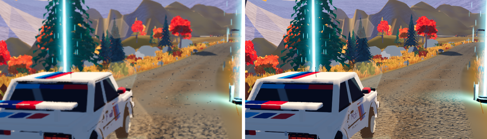
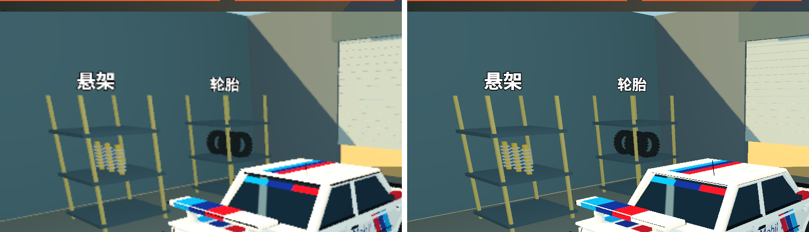

# 3D 画面按窗口真实像素渲染

日期：2026-10-22。

菜单使用 1280×720 逻辑画布（`canvas_items` 拉伸），文字与矢量按真实像素绘制，本来就清晰；正式驾驶与赛后回放直接渲染到窗口，也是真实分辨率。问题只出在两个离屏 3D 画布：玩法演示与车库视图按逻辑尺寸分配像素，在 2 倍缩放（Retina）窗口里只渲染了四分之一的像素再放大。

| 画面 | 改前（2560×1440 窗口） | 改后 |
| --- | --- | --- |
| 玩法演示 | 1280×720 | 2560×1440 |
| 车库 3D 视图 | 810×409 | 1620×818 |
| 直升机航拍照片 | 960×540 | 1920×1080 |
| 菜单、正式驾驶、回放 | 2560×1440 | 不变 |

- `RallyNativeResolution` 用窗口最终变换计算「逻辑尺寸 × 缩放倍数」，演示与车库在控件尺寸或窗口尺寸变化时重算。
- 演示画布抗锯齿与正式驾驶一致（FXAA、无 MSAA）；车库保留 2× MSAA。车库点选货架时，鼠标逻辑坐标换算到像素坐标。
- 驾驶舱仪表屏、终点横幅、翻页布料等固定尺寸贴图在屏幕上本就很小，未改。

左为改前、右为改后，同一帧 2 倍放大裁切：

## 性能

完整 75 秒演示，2560×1440 窗口，关闭垂直同步、不限帧，新旧版本交替各 3 次（Apple M4 Pro）：

| 版本 | 渲染尺寸 | 平均帧率中位数 | P95 帧时间 | P99 帧时间 |
| --- | --- | --- | --- | --- |
| 改前 | 1280×720 | 134.5 FPS | 18.11 ms | 24.41 ms |
| 改后 | 2560×1440 | 106.0 FPS | 18.80 ms | 24.82 ms |

像素量变为 4 倍，平均帧率下降约 21%，但仍在 100 FPS 以上；P95/P99 帧时间几乎不变，说明卡顿峰值来自镜头切换与场景加载，而不是分辨率。数据见 [showcase-performance.json](showcase-performance.json)，复现脚本为 `scripts/dev/showcase_perf_probe.gd` 与 `scripts/dev/native_resolution_probe.gd`。
