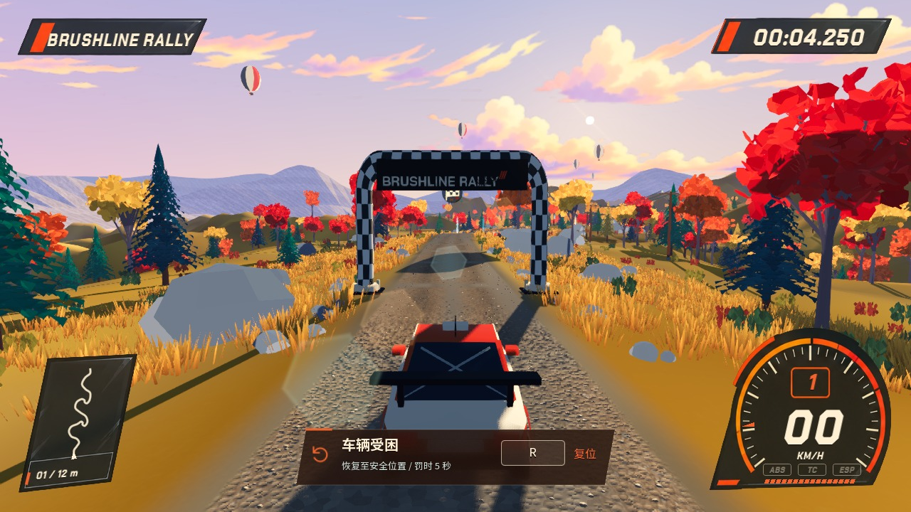
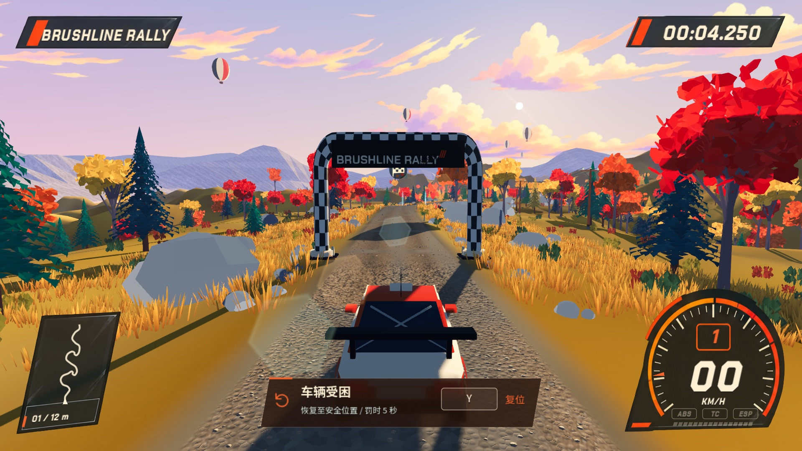
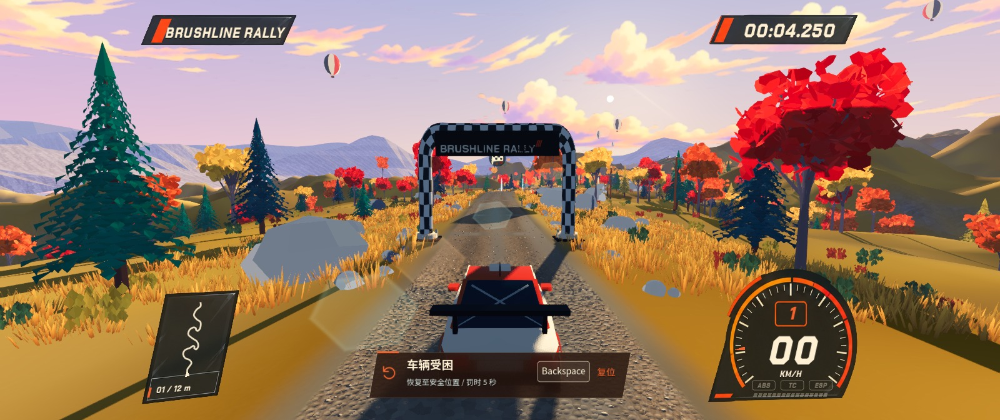
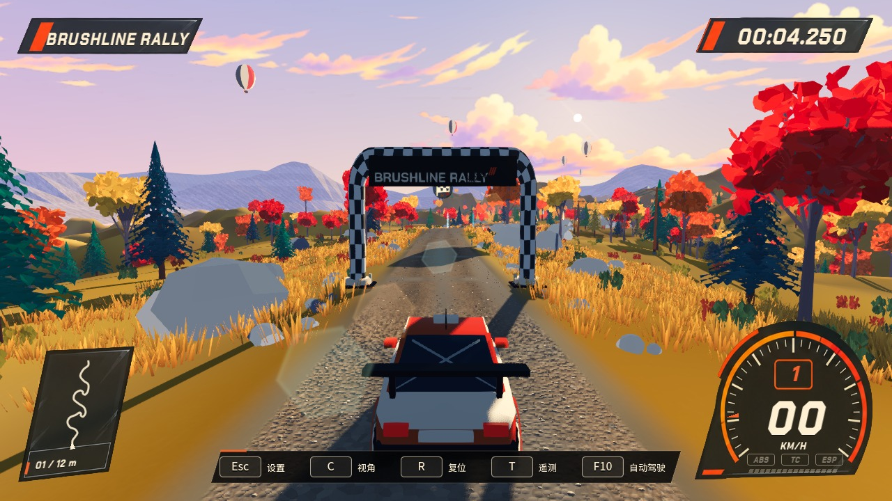

# 受困检测与驾驶按键提示

2026-10-22；Godot 4.7.2 / Jolt；基于 `86436d6`。

## 行为

- 驾驶员持续给油超过 45%，挂有前进或倒挡，未踩住制动、未拉手刹；约 4 秒仍在半径 1.5 米内、速度低于 3 m/s，则提示“车辆受困”。使用车身水平位移判断，覆盖撞住岩壁后的原地抖动和轮胎空转，不依赖轮速或赛道进度。
- 提示触发后松开油门仍可阅读；驶出上述范围、复位、重跑、完赛或切换自动驾驶时清除。暂停期间不累计检测时间、不显示卡片。
- 保留原有翻覆和静止逆向提示。起点之前的待发车状态也可检测；倒计时不检测。不自动替玩家复位，不修改车辆物理或原有罚时规则。
- 复位卡片使用矢量回转箭头、暖白文字、橙色强调、半透明斜边面板与描边按键。正式计时中说明罚时 5 秒，练习和起点之前不显示罚时。
- 底部常用按键栏停稳时显示、行驶后淡出。复位、视角、暂停、遥测、自动驾驶、完赛重跑与倒车指引读取当前绑定；手柄显示既有 Y / X / Start / Back / LT / RT 映射。减少动态效果设置令复位卡片立即显示。

## 验证

六组测试，共 **229 项检查，0 失败**；最终日志未出现 Godot 错误：

- [recovery_advice.log](recovery_advice.log)：38 项；30 / 60 / 120 Hz 的检测时序，静止、双踏板、手刹、空挡、短暂停滞、原地抖动、松油阅读、驶离、缓慢前进、翻覆恢复、关闭检测以及旧接口兼容。
- [hud.log](hud.log)：33 项；默认/重绑/手柄文案、淡入淡出、减少动态效果、HUD 几何与多比例边界。
- [input.log](input.log)：14 项；通过 Viewport 输入路径检查重绑复位和手柄 Y，旧 R 绑定失效。手柄为事件模拟，未进行实体手柄验收。
- [stage_play.log](stage_play.log)：16 项；起点前受困提示接入、重绑传递、复位清理、重复按键防重复罚时、暂停与完赛流程。
- [drive_modes.log](drive_modes.log)：33 项；倒车辅助与驾驶模式回归。
- [showcase.log](showcase.log)：95 项；75 秒 Demo 分镜与回放回归。

原生 Metal 渲染截图使用独立 `--test-defaults` 会话；固定车身并注入驾驶输入，经过实际检测器生成受困状态。截图用于 UI 验证，不作为自然驾驶撞击或陷沙实测证据。未穷举四张地图所有障碍物组合。帧率分档测试针对检测逻辑时间步，未重新采集整场景帧时间。

## 实机布局预览

### 键盘 / 1280 × 720



### 手柄 / 1920 × 1080



### 重绑长键名 / 超宽布局

截图工具将内容视口设置为 1600 × 672，直接检查完整超宽布局；游戏的默认 16:9 留边配置保持原样。



### 停车按键栏 / 1280 × 720



## 复现

```sh
godot --headless --path . --fixed-fps 120 --script res://tests/recovery_advice_test.gd -- --test-defaults
godot --path . --max-fps 60 --script res://scripts/dev/recovery_hint_capture.gd -- --test-defaults
```

截图脚本直接启动测试赛道，不读取或写入玩家档案。资源与测试通过后，按项目约定提交、推送及快进同步常用工程目录。
