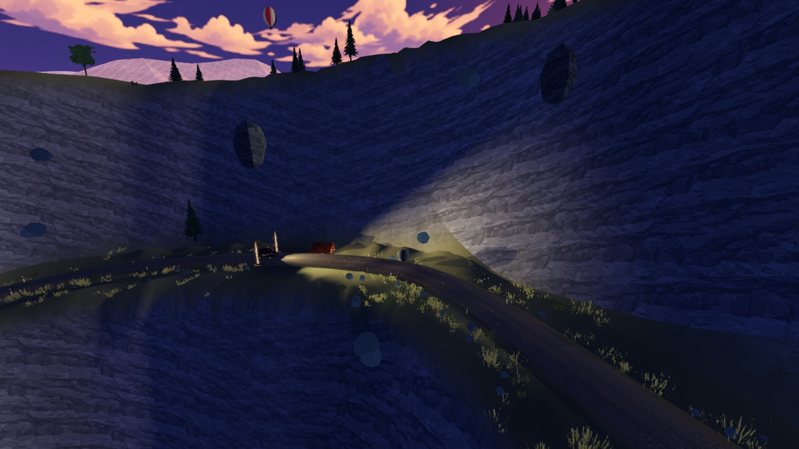
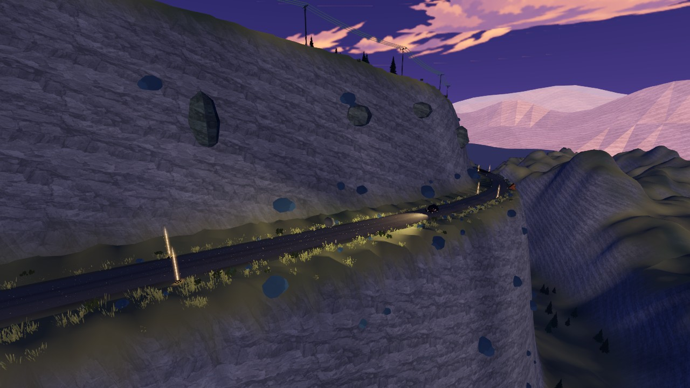

# 高地落石：固定横穿与持续下落

2026-10-22，基线 a193d86，Godot 4.7.2。

原来的落点会随车辆位置拉到车尾；后半段横移在 4.2 秒被截停，随后等待计时消失。现在每块石头固定在赛道某一横断面，从对应山侧的坡面滚落、横穿道路、越过下坡路肩继续下坠。横移持续加速，没有停车端点；旋转轴沿道路方向。路肩与独立路面之间使用连续高度过渡。

车辆接近只触发事件，不改变已启动轨迹。五处事件使用固定随机种子，复位后可重现。接近时提前约 5.5 秒加距离余量触发；车辆重置到落石点附近时，等其离开 20 米范围才触发。落石仍为无碰撞的景观演出，不增加撞击伤害。

越过近处崖面后继续按重力轨迹下坠到远景地形后方，避免把远处其他盘山路的高度当作支撑而抬回山上。仅在最后 1.5 秒、已经远离道路时淡出回收，全程继续移动。

## 验证

- highland_rockfall：91 项通过，覆盖五处横向轨迹的连续性、清理前落至谷地、30/60/120 FPS 一致性、车辆移动不牵引落点、复位及既有地形/路书检查。
- brushline_cliff：37 项通过，覆盖道路支撑、真实车辆坠崖复位，以及八车三个动力档不影响落石轨迹。
- 实机固定观景机位覆盖五处落石，各取第 1、3、4、6、10 秒。影片是第一处的 30 FPS 连续实机画面，冻结车辆、直接推进事件时间；无音频，不作为真人驾驶避障或物理碰撞验证。

[连续演示](crossing.mp4)

复现：`godot --path . --max-fps 60 --script res://scripts/dev/rockfall_crossing_capture.gd -- --test-defaults`。逐帧 PNG 写入已忽略的 logs/rockfall-crossing。
